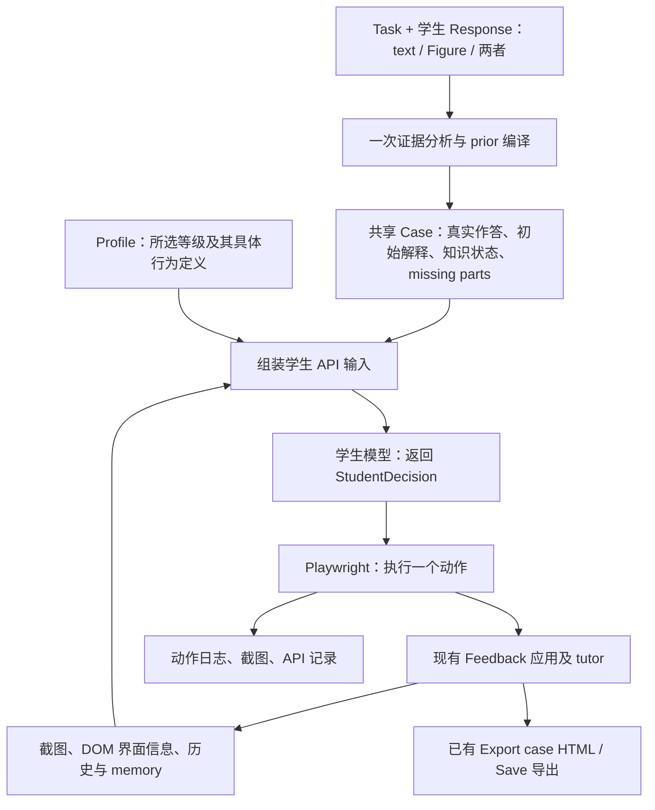

# Simulated learners：实现说明、实验依据与进度

最后核对日期：2026-10-29。本文记录当前项目的实现及已完成实验，供研究讨论、复现和后续开发接续使用。

**Current initial-state cache — 2026-10-29:** Section 63 implements the user-requested common K0 cache for new browser batches. One original-Response initialization is reused across profiles and runs with matching input/prompt/model settings; each learner copies it into separate state before independent Teacher/uptake updates. This source revision has offline validation only and does not change V3 history.

**Latest completed browser run and sharing edition — V3, 2026-10-28:** Section 60 records the new simplified-KM P1–P7 run and verified GitHub publication. All seven submitted their revisions and selected stop (106 actions); 276 actual calls and 9,624 mechanical integrity checks are archived locally. [V3.zip](https://github.com/Jiecao007/Multi-representation-feedback/blob/main/V3.zip) contains only the English prompt page, index and seven unchanged native interaction HTML files. Earlier “offline only” statements describe their historical source revision dates.

**Deliverable language — user requirement, 2026-10-28:** All newly authored reports, exported navigation, research notes, documentation, and supporting materials must be in English. Preserve dialogue quotations, actual prompts, and raw experiment evidence verbatim. Existing historical records remain unchanged; provide an English review edition rather than rewriting an experiment's recorded source or prompt version.

**Latest actual run — 2026-10-28:** Section 54 records the completed current P1–P7 trial, `simulated_students_current_20261028T202031Z_p1_p7`, after explicit user payload/destination/fee consent. All seven selected stop, with 112 executed actions, 14 native exports and no unsubmitted drafts. This run includes the role-split response-inferred simulator, strict Guidance gate and bounded local revision review described below. Prompt version `pv1-85bc18122fb74578`; actual per-call prompts and raw evidence are archived. Earlier “not yet live-tested” statements describe their historical revision dates.

**Current revision review — 2026-10-28:** Section 52 separates bounded local `revision_outcome` from broader `addressed_issue_status`. Evaluation receives exact delivered revision instructions and the actual delta as `revision_target`; a correct requested edit may be successful while the same larger issue remains unresolved. Praise and direct Supporting learning continue without premature closing. Source revision only: no new P1–P4 batch has been run.

**Current Guidance gate — user correction, 2026-10-28:** Section 51 supersedes earlier broader help-request eligibility and section 50's interpretation. Guidance is permitted only after three consecutive incorrect answers on the current issue, an accepted actual **I need a hint** button click, or clear current expressed frustration. Ordinary uncertainty, inability and chat requests for hints/examples/explanations receive higher-scaffold OTHER moves. Current implementation policy is `strict-guidance-v2`; no new learner batch has been run with it.

**Current learner architecture — user corrections, 2026-10-28:** Section 51 records the installed responsibility split: Knowledge Model Agent receives response-inferred prior knowledge and feedback uptake, updates/stores knowledge after each newly delivered Teacher message, then Learner Agent reads that state and receives only motivation and the three representation attributes. Shared definitions and variable-derived composite descriptions configure both Agents. Local-transfer limits remain unchanged. New prior preparation adds no imposed omission/inability or default-awareness condition. This source revision has offline validation only; the latest actual P1–P4 batch remains section 48's `simulated_students_two_agents_20261028_p1_p4_v1`, with its original prompts and prior. Historical observer/controller/gate sections 46–47 remain unchanged.

**Current fidelity implementation — 2026-10-28:** Section 58 records the completed scoped-interpretation revision and 32 fixed-context decisions (64 actual model calls). Positive scopes, evidence uncertainty and provisional beliefs are separate; the Knowledge Model Agent stores current-turn understanding before the Learner acts, and raw Teacher prose is excluded from the actor input. P7's two archived unsupported-answer cases improved. P4 showed the clearest expression difference; P2/P3 remain unvalidated, P5 was mixed and P6 weak. This is not a new full browser batch or human calibration.

**Current simplified architecture — 2026-10-28:** Section 59 supersedes section 58's scoped-turn interface. KM now owns only optional `known`, `unknown` and `possibly_known` lists, initializes from the original Response without profile/uptake or imposed prior hypotheses, and updates after each Teacher move using selected uptake. Learner uses saved knowledge plus its other profile attributes and visible dialogue. Current revision has offline validation only; section 58's actual fixed-context calls tested its historical prompts.

当前实现目录为 [browser_agent/](browser_agent/)。同级旧版 `run.py` 和早期 profile 文件属于先前原型，不能与当前浏览器 agent 的接口、配置或实验结果混用。

## 1. 当前目标与进度

目标是让 simulated learners 使用真实学生的初始作答，通过现有 Feedback 系统进行对话、查看视觉反馈、修改图示、提交和停止，并使用系统已有的 **Export case HTML** 导出交互记录。后续需要方便替换真实作答、misconception 和 learner profile。

| 工作                                          | 当前状态                               | 依据                                                                                                                                        |
| --------------------------------------------- | -------------------------------------- | ------------------------------------------------------------------------------------------------------------------------------------------- |
| 学生模型根据实际界面逐步决定动作              | 已实现                                 | [run.mjs](browser_agent/run.mjs)、[student_model.py](browser_agent/student_model.py)                                                        |
| 学生 shared prompt＋profile 取值＋额外说明 | 自动 prior 版本已与当前系统实跑 P1–P4；完整七类仍为旧系统批次 | [当前 P1–P4 报告](../../../outputs/simulated_students_current_20261028T035633Z_p1_p4/advisor_report.html)、第 43 节；旧七类见第 36 节 |
| 自动试跑导出关联 Prompt 版本 | 已实现内容版本、逐次实际 prompt、原生交互与追加历史 | [运行版本历史](../../../outputs/simulated_learner_run_history.html)、[prompt_versions.mjs](browser_agent/prompt_versions.mjs)、第 43 节 |
| 浏览器实际执行对话、图示编辑和提交            | 已实现                                 | [browser_driver.mjs](browser_agent/browser_driver.mjs)                                                                                      |
| Case、profile、维度定义与通用执行器分离       | 已实现                                 | [case](browser_agent/cases/math_2_numberline.json)、[profiles](browser_agent/profiles/)、[catalogue](browser_agent/profile_dimensions.json) |
| Task＋学生文字／Figure 自动生成共同 prior | 已实现；文字、纯图示、图文组合均可准备；实际数轴／电路检查 | [prepare_case.py](browser_agent/prepare_case.py)、[请求模板](browser_agent/case_requests/response_request.template.json)、第 38 节 |
| 将真实作答的已有内容和 missing parts 注入学生 | 已实现；新入口自动生成，旧人工 case 保留 | `response_grounding` → `initial_response_context`、`response_conditioning` → `profile.prior_knowledge` |
| 10/25 历史编号：P1 baseline、P2 motivation、P3 feedback uptake、P4 diagrammatic expression | 10/25 已完成新交互及导出 | [最新实验入口](../../../outputs/simulated_students_number_line_20261025_p1_p4/index.html)、第 22 节 |
| 10/26 历史编号：P5 textual expression、P6 coordination、P7 combined support needs | 10/26 已试跑并导出；P5/P6 自主结束，P7 上限截断 | [七类总览](../../../outputs/simulated_students_number_line_20261026_p5_p7/all_profiles.html)、第 23 节 |
| “I need a hint” 按钮                          | 10/25 已恢复；再次请求前须先完成两轮对话 | [界面](../app/index.html)、[请求门槛](../app/feedback.py)、第 18 节                                                                      |
| Tutor 的 prior knowledge / reflection 入口 | 10/27 定点更新；保留原流程和默认 reasoning，仅离线验证 | 第 24 节；当前代码不再等于 10/25–10/26 实验快照 |
| Tutor 的定义、开场问题与 prompt 文案 | 10/27 明确 strength 确认问题；五份 prompt 直接表述系统要求 | 第 25 节；规则、schema 和两类 support 入口保持第 24 节实现 |
| 减少过早提示和完整解法泄露                    | 已加入 prompt 与策略约束；效果仍需评估 | [tutor prompt](../prompts/feedback_tutor.md)、[feedback.py](../app/feedback.py)                                                             |
| 导出后发现的收尾对话循环                      | 10/25 新试跑中正常收尾；延伸边界待确认 | P1/P3 成功 review 后直接 invite dialogue；P2 的 all established 后结果追问见第 22 节 |
| P2 的低动机是否在行为中充分体现               | 尚未充分验证                           | 10/25 少做额外注记与探索，但 tutor 轨迹不同，单次比较不能归因于动机 |
| 扩展 profile、维度文献与行为保真度验证       | 七类均已配置和试跑；行为差异尚未充分验证 | 七类定义见第 21 节，P1–P4 见第 22 节，P5–P7 见第 23 节；P7 未自主完成，不能称为经验校准 |

本文最初只整理说明与进度；其后精简学生输入和 prompt，见第 17 节。10/25 恢复 hint 按钮并增加重复请求限制，见第 18 节；更新 talk move 路由，见第 19 节；按新三方面 representation 设定完成 P1–P4 试跑，见第 22 节；10/26 补充 P5–P7，见第 23 节。10/27 调整 Tutor 两类 support move 的资格，见第 24 节；随后明确开场优点确认问题，并将五份 prompt 整理为直接系统要求，见第 25 节，均尚未重新试跑。两批原生 HTML 与汇报资料均已归档，P7 达到外部上限时仍在讨论。历史输出保持不变。

## 2. 整体实现：学生模型、执行器、Feedback 系统

当前是自定义的 **模型决策 → Playwright 执行 → 再观察** 循环。



- **Student model**：依据初始知识、profile、当前反馈和实际操作结果，决定下一步做什么。
- **Browser driver**：提供通用操作能力，执行模型选择的动作；不会替学生规划完整解法。
- **Feedback/tutor 系统**：仍是现有应用。学生通过聊天、Show、修改和提交与它交互，应用会触发自己的 tutor API 调用。
- **Controller**：管理独立浏览器会话、每轮 API 调用、history/memory、步骤上限、日志和导出。

学生 API 与 tutor API 是两条不同的调用链。当前学生实现使用 Responses API 的结构化输出，返回动作 JSON，再由本地程序分发执行；当前代码没有使用内置 `computer_call` 动作协议，也没有注册正式的 function-calling tools。

一个模型动作可以对应多个底层 UI 操作。例如 `add_connection` 会被执行器展开为：点击 Connect、选择起点和终点、选择样式和方向、填写标签、确认。模型每轮选择一个高级动作；截图和 observation 按这些动作的前后保存，不保证记录每一个底层点击的中间画面。

## 3. 文件位置与职责

以下路径均以 `browser_agent/` 为当前实现入口。

| 文件                                                                    | 职责                                                                            |
| ----------------------------------------------------------------------- | ------------------------------------------------------------------------------- |
| [run.mjs](browser_agent/run.mjs)                                        | 读取配置，开启独立会话，调用学生 helper，执行动作，保存记录，点击现有导出按钮   |
| [student_model.py](browser_agent/student_model.py)                      | 定义 schema，展开 profile，校验和过滤输入，调用 API，解析输出，审计 memory 引用 |
| [student_prompt.md](browser_agent/student_prompt.md)                    | 全局学生角色、知识边界、简短交流、profile 应用方式、missing-part 规则和动作说明 |
| [profile_dimensions.json](browser_agent/profile_dimensions.json)        | Misconception 类别、motivation/feedback uptake 和一个含三个方面的 representation 总构念；当前版本 `2026-10-27-response-bound-prior`；所选等级含额外说明，共同 case 另组装 response-bound prior |
| [p1_average.json](browser_agent/profiles/p1_average.json)               | P1：五个操作键均为 average |
| [p2_low_motivation.json](browser_agent/profiles/p2_low_motivation.json) | P2：仅 task motivation 为 low                                                   |
| [p3_low_feedback_uptake.json](browser_agent/profiles/p3_low_feedback_uptake.json) | P3：仅 feedback uptake 为 low |
| [p4_low_textual_expression.json](browser_agent/profiles/p4_low_textual_expression.json) | P4：仅 textual expression 为 low |
| [p5_low_diagrammatic_expression.json](browser_agent/profiles/p5_low_diagrammatic_expression.json) | P5：仅 diagrammatic expression 为 low |
| [p6_low_coordination_translation.json](browser_agent/profiles/p6_low_coordination_translation.json) | P6：仅 coordination and translation 为 low |
| [p7_combined_support_needs.json](browser_agent/profiles/p7_combined_support_needs.json) | P7：五个操作键均为 low，初始知识仍共享 |
| [math_2_numberline.json](browser_agent/cases/math_2_numberline.json)    | 共享真实作答来源、任务、构造初始解释、misconception、知识组件与 missing parts   |
| [browser_driver.mjs](browser_agent/browser_driver.mjs)                  | Playwright 浏览器启动、界面读取、点击/输入/拖动、下载与执行结果                 |
| [test_contracts.py](browser_agent/test_contracts.py)                    | 输入边界、配置、输出和实验一致性等离线检查                                      |
| [test_response_grounding.py](browser_agent/test_response_grounding.py)  | Missing-part 标注与学生输入投影的离线检查                                       |
| [README.md](browser_agent/README.md)                                    | 运行命令、配置约定及解释边界                                                    |

精确复现历史实验时，应查看该实验目录的 `code_snapshot/` 和 `tutor_code_snapshot/`，而不是假设当前源文件仍等于当时执行的版本。

## 4. Learner dimensions 与 profile 选择

Misconception 是共享 case 中的**类别型初始概念状态**。当前其余三个总构念是 motivation、feedback uptake 和 representation ability；representation 内仅包含 textual expression、diagrammatic expression、coordination and translation 三个方面。为保持旧接口兼容，配置采用五个 flat 操作键，各提供 `average` 和 `low`。Average 表示可做合理的局部尝试，并不表示专家、高能力或保证成功。

以下是当前 catalogue 的中文归纳；实际发给模型的完整英文定义以 [profile_dimensions.json](browser_agent/profile_dimensions.json) 为准。

| Characteristic                      | Definition                                         | Average level / 类别                                                        | Low level                                                                    | 主要影响的行为                                                 |
| ----------------------------------- | -------------------------------------------------- | --------------------------------------------------------------------------- | ---------------------------------------------------------------------------- | -------------------------------------------------------------- |
| Misconception type                  | 对当前任务的具体信念或理解缺口                     | 当前为 M1：认为画出带标签的数轴已足够表示题目要求的运算；另支持 `uncertain` | 不使用高低等级                                                               | 如何解释已有图示、理解反馈、识别和修订缺口                     |
| Task motivation                     | 愿意在当前任务中投入多少额外努力、检查、求助和坚持 | 愿意回应并尝试可理解的小改进，但不会自动穷尽检查或追求完美                  | 倾向最小可接受完成，较少自发检查、展开、尝试替代方案或追问；仍可能学习并完成 | 是否主动检查、补充解释、继续尝试或停止                         |
| Feedback processing ability         | 理解反馈、联系当前想法并用于局部尝试的能力         | 通常能理解明确的局部问题或提示；联系多个步骤时仍可能需要澄清                | 可能只注意表面或部分内容、复述但尚不会应用；清楚支持仍可帮助其学习           | 求澄清、提出局部想法、尝试修改、反馈理解是否到位               |
| Textual representation ability      | 将自己已理解的数学或科学想法及关系用文字表达的能力 | 能表达一个熟悉想法或简单关系，理由或联系可能隐含                            | 即使有相关理解和投入，文字仍可能含糊、片段化或缺少关键联系                   | 解释和论证的清楚程度；不是单纯控制字数，也不是阅读能力         |
| Diagrammatic representation ability | 将已理解的想法映射到图元、方向、位置和关系的能力   | 通常能表达一个清楚的局部关系，对复杂或尚未理解的关系仍可能不确定            | 即使能口头解释，也可能难以选择合适标记、端点、方向或排列方式                 | 选什么图元、连接哪里、是否漏掉关系；不是鼠标精度或浏览器熟练度 |
| Coordination and translation | 解释两种表征的共同含义、保持一致并将一方修改转化为另一方的对应变化 | 能在已有或经支架提供的局部表征上解释对应并同步简单变化，可能需要局部提问 | 能指出基本对应，但解释共同含义、处理不一致或推导对应修订仍需明确支持 | 不把未学概念、忘记检查或单次弱解释直接算作协调困难 |

当前七个已配置 profile（10/27 将 P4/P5 调换；历史实验仍使用原编号）：

**当前 P4 = Textual expression Low，P5 = Diagrammatic expression Low。历史 P4 = 当前 P5，历史 P5 = 当前 P4。** 10/25、10/26 结果分别见第 22、23 节；原生导出和快照不重新编号。

| Profile | Misconception / case | Motivation | Feedback uptake | Textual expression | Diagrammatic expression | Coordination and translation |
| --- | --- | --- | --- | --- | --- | --- |
| P1. Moderate baseline learner | 共享 math-2 / M1 | Average | Average | Average | Average | Average |
| P2. Learner with low task motivation | 与 P1 相同 | Low | Average | Average | Average | Average |
| P3. Learner with feedback uptake difficulties | 与 P1 相同 | Average | Low | Average | Average | Average |
| P4. Learner with textual expression difficulties | 与 P1 相同 | Average | Average | Low | Average | Average |
| P5. Learner with diagrammatic expression difficulties | 与 P1 相同 | Average | Average | Average | Low | Average |
| P6. Learner with coordination and translation difficulties | 与 P1 相同 | Average | Average | Average | Average | Low |
| P7. Learner with combined support needs | 与 P1 相同 | Low | Low | Low | Low | Low |

P2–P6 分别相对 P1 只改变一个操作等级和 profile ID，不同时降低其他能力；P7 同时降低五个操作等级，用于综合支持需求情境，不能隔离某一特征的作用。初始图、初始解释、知识状态、模型、推理设置和步骤上限保持一致。旧四键配置由兼容逻辑明确补入 coordination Average，并在展开输入记录兼容信息；历史输出仍以当时快照为准。

10/21 曾讨论五类方案；10/25 最初会议分析的四类别、六类方案见第 20 节，之后用户进一步确定三个组成方面并要求两张新表，见第 21 节。最新七类已按本节所示配置，实际运行状态分别见第 22、23 节。这些是有目的构造的比较，不代表能力在真实人群中统计独立。

## 5. 当前真实数轴作答、知识状态与 missing parts

### 5.1 哪些是真实的，哪些是构造的

共享来源为 `source_id: math-2`，界面名称为 **Math · Number-line setup**。题目要求计算 −6、12、−4 的和，并用数轴表示。

- **真实材料**：原始学生数轴图及其整理后的可交互场景。最近实验保存的图在 [original_student_response.png](../../../outputs/simulated_students_number_line_20261021_no_hint_verified/original_student_response.png)。
- **构造设定**：初始解释、M1 类别、知识组件状态、对遗漏的意识和信念。它们不是对原图作者的已验证诊断。
- 共同初始解释为：`I drew a number line with the numbers on it.`

初始知识组件如下：

| ID  | Knowledge component              | 初始状态    |
| --- | -------------------------------- | ----------- |
| K1  | 识别数轴上的零和已有数字标签     | `known`     |
| K2  | 认识正负标签及其在本任务中的含义 | `tentative` |
| K3  | 组合这些带符号卡片数值的方法     | `unlearned` |
| K4  | 说明图示如何表示题目要求的运算   | `unlearned` |
| K5  | 得出并使用图示支持一个结果       | `unlearned` |

`known`、`tentative`、`unlearned` 可以随交互变化，不要求学生永远保持错误，也不允许看到一次局部提示就自动补齐完整专家解法。

### 5.2 Missing-part 注入

Case 的 `response_grounding` 区分：

| 类型    | 当前数轴案例内容                                        |
| ------- | ------------------------------------------------------- |
| 已有 F1 | 横向数轴及两端箭头                                      |
| 已有 F2 | 刻度及大约 −10 到 10 的数字标签                         |
| 缺失 G1 | 没有用跳跃、移动或其他运算标记表示加法过程；关联 K3、K4 |
| 缺失 G2 | 没有单独标识并联系运算的最终结果或位置；关联 K5         |

每个缺失另外配置 `initial_awareness` 与 `learner_belief`：

- `unaware`：尚未意识到遗漏是问题。
- `notices_incompleteness`：感觉不完整，但还不能定位缺少什么。
- `identifies_missing_part`：能够说出缺什么，但不自动获得修正方法。

当前七组共用同一 case，对两个缺失均从 `unaware` 开始。这是构造条件；“图上没画”本身不能证明学生不会、理解错误或不知道有遗漏。

`resolve_response_grounding()` 校验来源和知识组件后，将内容投影为实际学生输入中的：

```text
case_config.initial_response_context
├── source_id
├── already_present
├── response_omissions
├── learner_starting_position
└── inference_limits
```

这个上下文描述**最初作答**。后续通过实际画面和 memory 跟踪修订，不把已解决的缺失永久强加给学生。配置不向学生提供正确数值结果或完整的三步跳跃修订路线。

## 6. 学生 prompt 的实际控制方式

完整规则见 [student_prompt.md](browser_agent/student_prompt.md)。当前采用共享规则＋profile 取值＋response-conditioned prior knowledge，简短交流要求见第 31 节，当前 P4/P5 编号见第 30 节。自动 prior 生成见第 38 节；最近已执行版本为 [10/28 当前系统 P1–P4 学生 prompt 快照](../../../outputs/simulated_students_current_20261028T035633Z_p1_p4/code_snapshot/student_prompt.md)，结果及对应系统版本见第 43 节。完整七类最近仍为第 36 节的旧 copy 批次；10/25–10/26 及更早实验应查各自旧快照。

当前关键规则包括：

1. 从学生当前知识出发，不扮演已知道完整解法的助教；不虚构已接受的教学或已执行动作。
2. 每轮应用当前所选等级的完整定义。`resolve_profile()` 展开所选 level 的 `when_demanded`、`typical_response`、`support_and_change` 和 `application_notes`；未选中的等级不会一并发给模型。额外说明按等级统一派生，不按 profile ID 加入不同脚本。
3. 所有 profile 默认用短语或一个短句，简短回答当前被问到的部分。问为什么／如何时给简短相关理由，必要时再加一个短句；只提必要的澄清、求助或当前编辑问题，不主动展开其它问题、完整解法、后续计划或任务总结。文字表达控制清楚程度，不用长短替代能力差异；见第 31 节。
4. 一个局部线索只支持局部推断或尝试，不自动表示掌握全部相关知识、正确结果及完整图示。
5. Low motivation 影响自愿投入；不强制错误、拒绝、提前停止、固定轮数或固定消息长度。
6. 文字表达、图示表达、协调转换、反馈理解和低动机分别处理；不以技术失败伪造低能力。基本对应属于协调与转换，不另列第四个 representation 方面。
7. 每轮只选择一个动作，等待真实执行结果；计划或提出动作不能当作已经执行成功。
8. 不自动补做失败动作，不把强制步骤上限当作学生完成任务。

## 7. 每次学生 API 调用的输入与输出

### 7.1 输入

调用实现位于 [student_model.py](browser_agent/student_model.py)。当前最近实验使用 `gpt-6-sol`、reasoning effort `low`、最大输出 4000 tokens、图片 detail `high`、`store=False`，SDK 自动重试为 0。它们是本实现/实验设置，不是后续必须沿用的模型建议。

实际调用由以下几部分组成：

| API 部分       | 内容                                      |
| -------------- | ----------------------------------------- |
| `instructions` | `student_prompt.md` 的完整文本            |
| `input_text`   | `model_visible_input` 序列化后的 JSON     |
| `input_image`  | 当前界面截图的 base64 data URL            |
| `text_format`  | `StudentDecision` 定义的结构化输出 schema |

`model_visible_input` 包含：

```text
profile        所选维度及展开后的具体定义
case_config    允许的任务、初始解释、知识状态及 initial_response_context
observation    当前界面文字、控件、图元、弹窗等结构化信息
history        全部先前动作和执行结果，附无损 memory_delta，去掉重复发言
memory         上一轮保存的学生状态；第一轮为 null
```

Controller 每轮显式传回 history 与 memory；当前没有依赖 `previous_response_id` 维持跨轮上下文。

原始 controller 请求和本地日志仍保存完整 memory 快照。当前学生 API 使用 `deduplicated-v1` 投影，将这些历史快照无损改写成变化记录，同时完整保留最新 memory；实际序列化顺序为 profile、case_config、history、memory、observation。详见第 17 节。历史实验中的 response 文件仍是优化前实际输入。

Case/profile/observation 在发送前经过字段筛选和校验。研究用 seed payload、私有教师评估、rubric、未展示视觉指令等不进入这份学生输入。原图已画内容与构造状态必须分开记录。

调用简化示意如下；变量准备、校验和记录逻辑见源文件：

```python
response = client.responses.parse(
    model=model,
    instructions=prompt,
    reasoning={"effort": effort},
    max_output_tokens=4000,
    store=False,
    text_format=StudentDecision,
    input=[{"role": "user", "content": [
        {"type": "input_text", "text": input_text},
        {"type": "input_image", "image_url": image_url, "detail": "high"},
    ]}],
)
```

### 7.2 `StudentDecision` 是什么

它是项目用 Pydantic 定义的 Python 数据结构，规定模型一次决策应返回哪些字段。GPT 负责选择动作；这个类负责描述输出结构。

```python
class StudentDecision(StrictModel):
    action: Action
    utterance: Optional[str]
    memory: LearnerMemory
```

- `action`：下一步动作和参数。
- `utterance`：真正发送给 tutor 的发言。`send_message` 时必须与 `action.text` 一致；其他动作应为 `null`。
- `memory`：当前理解、未解决的问题、下一步意图及各知识组件状态；是状态摘要，不是对真实学生学习的外部测量。

`memory.component_states` 使用 `initial:K1`、`message:INDEX`、`action:STEP` 等引用。`memory_audit` 检查引用存在性和部分状态一致性；它不会证明反馈造成理解，也不会替学生修改状态、重新调用模型或修正答案。

### 7.3 `action` 参数从哪里来

参数来自项目的 `Action` 类，与现有界面功能及执行器对应。当前采用统一 schema，所以每次返回全部字段，用不到的字段为 `null`。`null` 按具体动作表示不适用、未指定或保留界面默认值。

| 参数           | 含义                                                                          |
| -------------- | ----------------------------------------------------------------------------- |
| `type`         | 动作类型，见下一节的 19 个 action                                             |
| `id`           | 当前界面中目标对象、连接或特定弹窗的 ID                                       |
| `text`         | 聊天文字、添加/修改的文字；`stop` 时也可说明停止原因                          |
| `messageIndex` | 要查看 Show 的消息编号；`null` 可选最后一个可用 Show                          |
| `topic`        | 对象库分类                                                                    |
| `label`        | 连接线含义文字，或对象库中的项目名称                                          |
| `from`         | 连接起点对象 ID；Python 内部名为 `from_id`，JSON 使用别名 `from`              |
| `to`           | 连接终点对象 ID，或移动/拖动的目标坐标 `{x, y}`                               |
| `shape`        | `straight`、`curved`、`bent`                                                  |
| `direction`    | 连接为 `forward`、`backward`、`both`、`none`；resize 时为 `larger`、`smaller` |
| `endpoint`     | 拖动连接的 `source` 或 `target` 端点                                          |
| `control`      | 当前观察到的中间控制点编号                                                    |
| `space`        | `canvas`：sceneRoot SVG 坐标；`screen`：浏览器屏幕坐标                        |
| `dx`、`dy`     | 在所选坐标系中水平、垂直移动的相对距离                                        |
| `glyphTexts`   | 个别文字片段的 `{glyph_index, text}` 列表；helper 会转换成执行器需要的格式    |
| `steps`        | Resize 点击次数，当前允许 1–20，默认 1                                        |
| `reason`       | 提交修改时可附带的真实修改解释；也可作为停止原因的记录后备值                  |

对象 ID、选项名称、坐标与控制点编号来自当前 observation，不能凭空假设。Canvas 坐标不等于屏幕像素，也不能假定是统一的 0–1000 标度。`forward` 指从 `from` 指向 `to`，不等于“向右”。

## 8. `observation` 包含什么

由 [browser_driver.mjs 的 observe()](browser_agent/browser_driver.mjs) 从渲染页面、HTML 控件和 SVG 几何信息中整理。

| 字段           | 具体内容                                                                                    |
| -------------- | ------------------------------------------------------------------------------------------- |
| `visible_text` | Observer 读取 `document.body.innerText`；当前 API 投影只保留未被其他结构化字段重复表达的页面文字 |
| `task`、`goal` | 页面任务和目标文字                                                                          |
| `messages`     | 消息编号、角色、文字、错误标记、是否有 Show                                                 |
| `controls`     | 按钮 ID、名称、disabled 和 pressed 状态                                                     |
| `elements`     | 对象/连接 ID、类型、标签、文字、选中和高亮状态、屏幕及 SVG 边界；连接还含 points 和箭头标记 |
| `handles`      | 端点或中间控制点、编号及屏幕/画布中心                                                       |
| `dialogs`      | 已打开弹窗的标题、文字、字段值、下拉选项、对象库项目                                        |
| `canvas`       | ViewBox、屏幕边界、是否可编辑、sceneRoot 到屏幕的坐标变换                                   |
| `status`       | Chat、draft、change hint、mode badge 和选中对象名称等状态文字                               |
| `stopped`      | 执行器是否已记录学生选择停止                                                                |

Controller 的原始 observation 另带截图路径；helper 将路径从文字 observation 中去掉，图片作为独立 `input_image` 发送。Response 日志单独保留图片路径、字节数和 SHA-256，避免重复写入大段 base64。

**观察范围的边界：** 当前截图使用 `fullPage: true`。DOM 可见性检查不等同于当前 viewport 的逐像素可见性：不检查遮挡，也不严格限制滚动范围；消息和 canvas 下部分元素的采集没有逐项进行这种可见性过滤。因此应描述为“截图＋DOM 辅助的 browser student agent”，不能称为仅凭当前屏幕像素操作的学生。

精确 ID、SVG 坐标及高级动作会降低定位和机械操作难度。图示意图、关系表达和修改策略仍可研究，但当前运行不能测量真实学生的鼠标精度、独立界面定位或 GUI 熟练度。

## 9. 当前 student moves 与可执行 actions

以下是当前完整的 20 个 action；10/25 新增 `request_hint`，其余可用性仍取决于当前页面、弹窗和修改权限。

| Action               | Student move / 界面行为                |
| -------------------- | -------------------------------------- |
| `send_message`       | 发出回答、问题、解释、反思或简单回应   |
| `show_feedback`      | 查看某条反馈对应的视觉图示             |
| `request_hint` | 点击真实 hint 按钮；按可见 DOM 记录实际回复或两轮 cooldown 拦截，不伪造发言 |
| `begin_revision`     | 通过现有 UI 开始修改                   |
| `exit_revision`      | 退出修改模式                           |
| `return_to_draft`    | 从较早反馈图返回当前草稿               |
| `add_text`           | 添加文字                               |
| `edit_text`          | 修改已有文字或其片段                   |
| `add_object`         | 打开/查看对象库，或选择一个项目添加    |
| `select`             | 选择图中对象或连接                     |
| `move`               | 拖动对象或连接                         |
| `add_connection`     | 添加连接并设置起终点、标签、形状和方向 |
| `edit_connection`    | 编辑已有连接参数                       |
| `reshape_connection` | 拖动端点或控制点，调整线形             |
| `resize`             | 放大或缩小所选图元                     |
| `delete`             | 删除所选图元                           |
| `undo`               | 撤销上一步修改                         |
| `submit_revisions`   | 提交草稿，可以附修改解释               |
| `cancel_dialog`      | 关闭当前支持的弹窗                     |
| `stop`               | 选择结束本次交互                       |

需要区分两层：

- **操作记录**：例如添加连接、发送消息，已由 action 明确记录。
- **研究编码**：Question/help-seeking、simple claim、explanation/justification、reflection、acknowledgement、dialogue navigation 等语言或认知意义。

目前这些语言类别共用 `send_message`，没有自动细分编码。图示修改也可进一步区分 conceptual revision、表面修改、部分修订、错误修订等，但需要依据前后图示和对话另行分析，不能单凭动作名称判断正确性。当前没有单独的 `modify_table` 动作；后续真正需要编辑数据表时，应按实际表格 UI 扩展执行器与 schema。

### 9.1 已发生的界面操作示例

以下是 [P1 第 4 步真实输出](../../../outputs/simulated_students_number_line_20261021_no_hint_verified/P1/step_04_response.json) 的 `action` 节选，省略无关 `null` 字段及 memory：

```json
{
  "action": {
    "type": "add_connection",
    "label": "−6 card: six spaces left",
    "from": "label_zero",
    "to": "label_minus6",
    "shape": "curved",
    "direction": "forward"
  }
}
```

起终点 ID 在该步输入的 `observation.elements` 中都存在。这一步的真实 `execution.ok` 为 `true`，并记录新连接 ID。

执行器通过实际控件完成操作，简化逻辑如下：

```javascript
await page.locator("#connect").click();
await page.locator("#connectionFrom").selectOption(action.from);
await page.locator("#connectionTo").selectOption(action.to);
await page.locator("#connectionShape").selectOption(action.shape);
await page.locator("#connectionDirection").selectOption(action.direction);
await page.locator("#connectionLabel").fill(action.label);
await page.locator("#connectionForm button[type=submit]").click();
```

真实代码还有参数、可用性、弹窗、修改权限和错误处理。移动/重塑使用鼠标事件；文字使用输入控件；页面 `evaluate()` 用于读取和坐标转换，不直接改写应用 scene。

## 10. 如何看实际输入、输出和执行结果

以下保留 10/21 历史实验的详细输入输出示例；最新 10/25 四 profile 的结果、prompt 与调用索引见第 22 节。历史实验目录为：

```text
outputs/simulated_students_number_line_20261021_no_hint_verified/
```

| 文件                                                                                                                                                                                                                                               | 查看什么                                                            |
| -------------------------------------------------------------------------------------------------------------------------------------------------------------------------------------------------------------------------------------------------- | ------------------------------------------------------------------- |
| [index.html](../../../outputs/simulated_students_number_line_20261021_no_hint_verified/index.html)                                                                                                                                                 | 两位学生导出和实验说明入口                                          |
| [experiment_manifest.json](../../../outputs/simulated_students_number_line_20261021_no_hint_verified/experiment_manifest.json)                                                                                                                     | Case/profile、共同起点哈希、模型、上限、并行设置、源文件哈希        |
| [P1/step_01_request.json](../../../outputs/simulated_students_number_line_20261021_no_hint_verified/P1/step_01_request.json)                                                                                                                       | Controller 的预处理前请求；不是完整 API wire body                   |
| [P1/step_01_response.json](../../../outputs/simulated_students_number_line_20261021_no_hint_verified/P1/step_01_response.json)                                                                                                                     | 实际文字输入、图片来源、原始模型输出、执行用 decision 和 API 元数据 |
| [P2/step_01_response.json](../../../outputs/simulated_students_number_line_20261021_no_hint_verified/P2/step_01_response.json)                                                                                                                     | 对比 P2 实际展开的 low motivation 定义与输出                        |
| [P1/action_trace.jsonl](../../../outputs/simulated_students_number_line_20261021_no_hint_verified/P1/action_trace.jsonl)、[P2/action_trace.jsonl](../../../outputs/simulated_students_number_line_20261021_no_hint_verified/P2/action_trace.jsonl) | 每步模型决定、实际执行、前后 observation/截图与 memory 审计         |
| [P1/run_summary.json](../../../outputs/simulated_students_number_line_20261021_no_hint_verified/P1/run_summary.json)、[P2/run_summary.json](../../../outputs/simulated_students_number_line_20261021_no_hint_verified/P2/run_summary.json)         | 运行状态、步骤、错误、导出一致性与停止原因                          |
| [code_snapshot/](../../../outputs/simulated_students_number_line_20261021_no_hint_verified/code_snapshot/)、[tutor_code_snapshot/](../../../outputs/simulated_students_number_line_20261021_no_hint_verified/tutor_code_snapshot/)                 | 当时执行的学生和 tutor 代码/prompt                                  |
| [audit_summary.json](../../../outputs/simulated_students_number_line_20261021_no_hint_verified/audit_summary.json)                                                                                                                                 | 本轮行为计数和解释边界                                              |

`step_*_response.json` 中最值得看的字段：

- `model_visible_input`：实际发送给模型的文字输入；全局 prompt 通过独立 `instructions` 传入，不在这里面。
- `screenshot`：实际图片的路径、类型、大小和哈希。
- `raw_output_text`、`raw_decision`：模型输出文本及解析后的原始决策。
- `decision`：经过接口格式整理、供执行器使用的对象；不是成功执行证明。
- `api`：请求/响应 ID、模型、token 用量等调用元数据。
- `memory_audit`：状态证据引用检查，不是学生成绩或掌握度评分。

模型想做什么看 `raw_decision`；操作是否成功看 action trace 的 `execution`；成功执行是否构成合理概念修订，需要检查实际前后作品和对话。

### 10.1 使用已有系统导出

最终 HTML 分别为 [P1.case.html](../../../outputs/simulated_students_number_line_20261021_no_hint_verified/P1/P1.case.html) 和 [P2.case.html](../../../outputs/simulated_students_number_line_20261021_no_hint_verified/P2/P2.case.html)。

它们通过原有 **Export case HTML** 按钮下载。另通过 Save 保存 [P1.exploration.json](../../../outputs/simulated_students_number_line_20261021_no_hint_verified/P1/P1.exploration.json) 和 [P2.exploration.json](../../../outputs/simulated_students_number_line_20261021_no_hint_verified/P2/P2.exploration.json)。没有另造一份对话来替代系统导出。

HTML 用于阅读实际对话和已提交图稿；中间编辑和未提交草稿需结合 exploration JSON 与 action trace。执行器导出时不会为了“漂亮结果”替学生提交草稿。

## 11. Tutor 的相关调整与当前边界

依据 [feedback_tutor.md](../prompts/feedback_tutor.md)、[feedback_policy.py](../app/feedback_policy.py) 和 [feedback.py](../app/feedback.py)：

- 默认给学生思考空间，避免在问句前提、二选一选项、表扬、视觉标记或 UI 帮助中提前泄露答案或下一完整修订步骤。
- 用户表格中的 “Provide direct guidance” 对应当前代码 move `provide_hints_guidance`。聚焦于一个原则、部分步骤或下一处值得检查的元素/关系，不给出完整剩余解法。
- 当前自动升级帮助的条件（10/25 更新）：**同一问题上连续三次有证据支持的 unsuccessful student responses，或当前出现明确 frustration**；有推进的成功回应清零。10/21 历史实验版本采用累计计数，不能混用。不是数 tutor 问了几次，也不是简单等待三轮。
- 单独一句 “I don't know” 可构成未成功回应，但本身不等于情绪挫败。
- 学生明确在聊天中请求 hint/help，或请求具体修订支持时，代码也允许有边界的帮助；所以“三次”是自动触发条件，并不是所有帮助唯一入口。
- “I need a hint” 按钮在 10/21 实验时已删除；10/25 按用户新要求恢复，随后明确固定间隔为两轮。一次成功请求后再次点击只显示剩余轮数提醒，须先成功提交两条普通对话回复才可再次请求；主动文字求助仍可使用。见第 18 节。
- 修改授权、提供提示、提出修订计划是相关但不同的判断，不能把查看反馈等同于授权修改。
- 10/25 新增按证据选 Support thinking move、修改 review 后直接进入支持阶段的路由，见第 19 节；10/27 保留这条主流程，仅更新 prior knowledge / reflection 的资格，见第 24 节。10/21 历史 HTML 不体现 10/25 规则，10/25–10/26 HTML 也不体现 10/27 的最新资格。

最近导出后修复了已完成 review 后又被迫进入新一轮思考问题的收尾路由。该修复已有离线回归记录，但**最近两份 HTML 不是修复后的重新试跑结果**。

## 12. 最近一次实验实际结果

来源：[audit_summary.json](../../../outputs/simulated_students_number_line_20261021_no_hint_verified/audit_summary.json) 与 [experiment_manifest.json](../../../outputs/simulated_students_number_line_20261021_no_hint_verified/experiment_manifest.json)。

运行时间记录为 2026-10-21 04:38–04:43 UTC，使用两个独立 Chrome 会话，并行数 2；学生模型 `gpt-6-sol`、effort `low`、每人最多 24 次学生决策。

| 指标                   | P1                        | P2                |
| ---------------------- | ------------------------- | ----------------- |
| 学生决策数             | 15                        | 16                |
| 直接聊天消息数         | 9                         | 9                 |
| 每条直接聊天平均词数   | 13.44                     | 13.44             |
| 每条直接聊天词数中位数 | 13                        | 13                |
| 修订提交次数           | 2                         | 3                 |
| 系统/投递失败          | 1，第 12 步；保留实际重试 | 0                 |
| 已提交连接数           | 3                         | 3                 |
| 结束状态               | `student_stopped`         | `student_stopped` |
| 未提交草稿             | 无                        | 无                |
| 导出与共同初始图一致性 | 通过                      | 通过              |

系统 HTML/manifest 的 learner-message 总数为 P1 11、P2 12，包含修订提交等 user 事件，不等于上表的直接聊天数 9。

这两次结果只能作为构造 profile 的自主交互示例。它们**没有证明 P2 的坚持或自愿努力更低**，也没有证明 profile 已校准、等同真人，或系统提升了真人学习。

P1 的投递失败和实际重试属于系统事件，不能编码为低知识、低动机或学习失败。较短回复本身也不能证明真实性。

### 12.1 技术重试与导出后的修复

- 前一次技术尝试保留在 [simulated_students_number_line_20261021_no_hint/](../../../outputs/simulated_students_number_line_20261021_no_hint/)。
- [retry_context.json](../../../outputs/simulated_students_number_line_20261021_no_hint_verified/retry_context.json) 说明重跑原因：命令识别器漏掉带 emoji/标点修饰的 Add/Draw 指令。修复发生在 tutor 策略，学生 prompt、profile、case 和运行设置未因此更换。记录有 203 项系统回归通过。重跑不是按学生结果挑选轨迹。
- [post_run_fix.json](../../../outputs/simulated_students_number_line_20261021_no_hint_verified/post_run_fix.json) 记录导出之后的收尾修复及 209 项离线系统测试通过，同时明确 `live_trial_after_this_fix: false`。
- 这些数字来自已保存记录；本文编写时未重新执行测试或再次 live trial。

## 13. 复用与运行方法

所有命令在项目根目录执行。环境需 Python 依赖、Node.js、Chrome 与 Playwright。当前 Playwright 默认路径与本机 Codex runtime 有关，换机器时通过 `PLAYWRIGHT_MODULE` 指定模块路径；Python 可用 `--python` 或 `SIMULATED_STUDENT_PYTHON` 指定。API 密钥复用现有环境加载，不能写进文档、命令示例或日志。

### 13.1 离线检查和准备

离线契约检查，不调用模型：

```bash
python3 -B experiments/open_ended_sketch/simulated_students/browser_agent/test_contracts.py
```

启动本地 Feedback 服务：

```bash
python3 -B experiments/open_ended_sketch/app/server.py --port 8765
```

准备检查读取 localhost 中的 example，保存配置/图示/快照，不提交作答或调用学生/tutor 模型：

```bash
node experiments/open_ended_sketch/simulated_students/browser_agent/run.mjs \
  --dry-run \
  --out outputs/simulated_students_prepare_next
```

输出目录必须是全新目录，重复使用示例目录前应换一个名称。Runner 当前只连接 localhost。

### 13.2 Live trial 命令示例

下列命令会实际调用学生 API，并通过现有应用触发 tutor API。它是后续执行参考，不代表本文编写时已运行：

```bash
node experiments/open_ended_sketch/simulated_students/browser_agent/run.mjs \
  --case experiments/open_ended_sketch/simulated_students/browser_agent/cases/math_2_numberline.json \
  --profile experiments/open_ended_sketch/simulated_students/browser_agent/profiles/p1_average.json \
  --profile experiments/open_ended_sketch/simulated_students/browser_agent/profiles/p2_low_motivation.json \
  --model gpt-6-sol --effort low --max-steps 24 --concurrency 2 \
  --out outputs/simulated_students_live_next
```

可用 `--concurrency 1` 依次运行，或用 `--headless` 隐藏浏览器。当前每个 profile 会开启独立 browser/context，避免两位学生共享会话。

实验结束后的共同起点/导出检查：

```bash
SIMULATED_STUDENT_AUDIT_DIR=outputs/simulated_students_live_next \
  python3 -B experiments/open_ended_sketch/simulated_students/browser_agent/test_contracts.py
```

`student_stopped` 是模型选择停止；`step_budget_reached` 是外部决策上限，不表示学生完成。API/执行失败需要单独查看，不能自动解释为某个 trait。

### 13.3 替换真实作答或 profile

更换真实 response：

1. 让新 `source_id` 对应现有应用的一个 example。当前 runner 从应用读取原图与 scene；仅填写一个新图片路径不足以注册新案例。
2. 创建新的 case JSON，写入任务、明确标为构造的初始解释、misconception 与知识组件。
3. 按新作答重新标注已有内容和 missing parts，并独立设置 awareness/belief；不能照搬数轴案例的缺口。
4. 如需新 misconception 类别，先在 catalogue 的 `misconception_type.values` 中定义 `label`、`initial_belief`、`scope`。没有足够依据时可用 `uncertain`。
5. 使用 `--case` 选择新文件；先做离线检查和 dry run，再安排实际实验。

更换 profile：

1. 复制一个 profile，修改 `id` 和所需维度的 `level`。
2. 每个维度只使用 `{"level":"average"}` 或 `{"level":"low"}`；操作定义从 catalogue 展开。
3. 不向 profile 添加临时 `behavioral_tendency` 等覆盖文字；当前校验会拒绝这些字段。
4. 对照比较尽量一次只改变一个维度，其余共同起点和模型设置一致；通过重复 `--profile` 增加学生。
5. 改变完整操作定义时，需要改 catalogue 并保留版本，不能只改名称而假设模型已收到新含义。

若更换题目领域但保留已有编辑能力，通常可复用 controller、student model 和 driver。若新增数据表编辑等新 UI 功能，则需要同步增加 schema、prompt、观察信息和执行器映射。

## 14. 技术依据、文献状态与后续评估

### 14.1 已核对的 OpenAI 官方技术依据

以下页面于本次相关实现讨论中通过 OpenAI Docs 搜索并读取，支持技术机制，不作为 learner profiles 有效性的证据：

- [Structured model outputs](https://developers.openai.com/api/docs/guides/structured-outputs)：使用自定义 JSON Schema/Pydantic 类约束返回结构；对应 `StudentDecision`。
- [Computer use integration recipes](https://developers.openai.com/api/docs/guides/tools-computer-use-integration)：包含 Playwright 本地浏览器环境、自定义 UI 工具及动作/截图循环的实现说明。
- [Function calling — The tool calling flow](https://developers.openai.com/api/docs/guides/function-calling#the-tool-calling-flow)：说明模型提出工具操作、应用执行并返回结果的标准流程。它是可参考的另一种封装，不能把当前结构化输出实现误记为已接入正式 function calls。

当前 observation 字段、action 名称、profile 和 browser driver 都由本项目定义；OpenAI 文档不会自动提供适用于这个 Feedback 系统的完整学生模型。

### 14.2 维度参考文献尚待最终确认

此前讨论过 Generative Students、TeachTune、student feedback literacy，以及文字/图示表达相关论文作为候选方向。当前 catalogue 和 profile 文件没有最终核验的论文引用或 APA 书目，所以本文不把候选题名、作者年份或此前截图中的标注当作已确认参考文献。

下一步需要对每个维度分别保存：准确 APA 信息、论文原文链接、支持的具体构念/学生差异、与本任务的适配，以及哪些定义属于本研究改编。

尤其是 textual 和 diagrammatic representation，用户已明确要求找出支持“这种能力重要且学生之间存在差异”的论文；仅证明绘图/写作能改善学习的干预论文不足以独立支持当前个体差异定义。现有 average/low 划分和五种 profile 方案仍是研究设计，不是文献直接验证的分类。

两份真实参考交互 `Math-Number-line-setup-2026-10-12.html` 和 `PH-007-Parallel-circuit-design-2026-10-12.html` 曾被用于讨论短回复和局部困难。它们不能单独校准等级，也不能据此给真实学生贴低动机等标签。最终分析前需要定位原始文件并制定统一编码。

### 14.3 后续评估建议；尚未完成的工作

| 要验证什么                | 可以采用的证据/方法                                                                          | 解释边界                                                       |
| ------------------------- | -------------------------------------------------------------------------------------------- | -------------------------------------------------------------- |
| 实验是否按设定实施        | 共享图/解释哈希、实际 API 输入、代码快照、独立会话、执行日志与原有导出核对                   | 属于实施正确性，不等于学生真实                                 |
| Profile 是否体现在行为中  | 对可比较反馈机会编码：自愿检查、追问、额外解释、重试、接受部分完成、停止；对同一设置重复运行 | 不以字数或总轮数单独代表 motivation；分离 tutor 差异和系统错误 |
| 是否像真实学生            | 用同任务真人记录作参照，独立编码对话 moves、修订质量和知识缺口持续/变化；报告编码一致性      | 需要真人数据与评审，不能由模型自评替代                         |
| Text/diagram 能力是否区分 | 对相同理解内容，分别评估文字关系表达与图示表达的一致性、完整性和可读性                       | 分开测量不等于统计独立；避免把知识缺口归因于表达能力           |
| Feedback 是否给出过多信息 | 编码 tutor 每轮披露的概念步骤、是否含答案前提、是否越过帮助门槛及视觉泄露                    | 合法 move 名称不保证 content 合适                              |
| 是否发生学习              | 独立的概念/迁移问题或专家评分，结合前后作品与解释                                            | memory 的 `known`、UI 成功或复制提示均不是充分证据             |

推荐的下一步顺序：先复核学生/tutor prompt 与当前行为证据，确认维度参考文献及行为编码，再决定是否调整低动机操作定义或新增 profile；随后用独立重复试跑检查差异。每次保留全部技术失败与选择重跑的理由，避免按学习结果筛选轨迹。

## 15. 给后续协作的接续摘要

- 当前已交付的是 P1/P2 浏览器 agent 和真实系统导出；不是仅对话的模拟，也不是预写的整段操作轨迹。
- 最近可读结果以 `simulated_students_number_line_20261021_no_hint_verified` 为主，原始技术尝试另外保留。
- Case、profile、完整维度定义、missing-part 标注与执行器已解耦，后续尽量通过配置复用。
- 当前首要未解决问题是行为保真度，尤其 P2 低动机尚未明显体现，以及维度的最终文献依据。
- 收尾修复在导出之后完成，没有修复后的新 live trial；继续时不要把当前代码和历史结果视为同一版本。
- 修改前先检查本文件、源配置及最近实验快照；发生新改动或运行后更新本文件的日期、结果入口、证据和待办。
- 本文件是项目中的持久交接记录；后续会话可据此恢复上下文，不依赖聊天记忆自动保留全部细节。

## 16. Token 与费用审计（2026-10-21）

这是对上述已完成实验的离线统计，没有新增 API 调用。逐条来源、按模型合计及价格假设保存在 [token_cost_20261021.json](analysis/token_cost_20261021.json)。

### 16.1 实际 token 用量

学生端逐条统计 `step_*_response.json → api.usage`。Tutor 端通过 session ID 匹配 `app/runs/feedback_turn_*/` 下的原始响应，并按 response ID 去重；额外纳入 P1 第 12 步失败投递的两次已消耗响应，以及后来的实际重试。只加成功 HTML 导出中的 API 记录会漏算这两次失败调用。

| 部分 | P1 | P2 |
| --- | ---: | ---: |
| 学生 API 次数 | 15 | 16 |
| 学生 input tokens | 325,434 | 352,136 |
| 学生 output tokens | 8,478 | 8,709 |
| **学生端总 tokens** | **333,912** | **360,845** |
| Tutor API 次数，含评估/回复/重写 | 18 | 18 |
| Tutor input tokens | 468,701 | 488,092 |
| Tutor output tokens | 17,392 | 18,198 |
| **Tutor 端总 tokens** | **486,093** | **506,290** |
| **完整一位学生交互总 tokens** | **820,005** | **867,135** |

图片输入已经计入 API 的 input usage；reasoning tokens 已包含在 output 中。Cache read/write 都是 input 的细分类别，不额外叠加到总 token 数。这些合计不含较早诊断实验、其他案例、未保存 usage 的传输尝试或本次 Codex 协作的用量。

### 16.2 参考费用；不是已核对账单

已从 [OpenAI 官方 Pricing](https://developers.openai.com/api/docs/pricing) 和 [Prompt caching](https://developers.openai.com/api/docs/guides/prompt-caching) 核对当前 Standard 短上下文价格。实际最大单次输入 42,710 tokens，没有进入 272k 长上下文区间。

| 模型，美元/百万 tokens | Ordinary input | Cached read | 30m cache write | 12h cache write | Output |
| --- | ---: | ---: | ---: | ---: | ---: |
| `gpt-6-sol`，学生 | 2.00 | 0.20 | 2.50 | 5.00 | 10.00 |
| `gpt-6-luna`，快速对话等 | 0.10 | 0.01 | 0.125 | 0.25 | 0.50 |
| `gpt-6-astra`，完整 review 等 | 10.00 | 1.00 | 12.50 | 25.00 | 50.00 |

计算公式为：`(ordinary × ordinary_rate + cached × read_rate + write × write_rate + output × output_rate) / 1,000,000`，其中 `ordinary = input − cached − write`。不重复收取普通输入与 cache write。

| 部分 | P1，按 30m 写入费率参考 | P2，按 30m 写入费率参考 |
| --- | ---: | ---: |
| 学生端 | $0.80 | $0.86 |
| Tutor 端 | $2.64 | $3.13 |
| **完整交互** | **$3.44** | **$3.99** |

**计费不确定性必须保留：** 代码未显式指定新的 cache TTL。新文档写明默认 30m；但保存的 tutor 响应仍携带旧式 `prompt_cache_retention: "24h"`，且没有分开记录 30m/12h 写入量。学生记录也未保存这项新时长细分。因此上表是按 30m 费率的参考估算，不是从本地文件确认的实付金额。若将全部 writes 按文档中的 12h 费率作为另一种假设，完整费用分别为 $6.50 和 $7.53；这同样不是对实际使用该时长的断言。最终需结合平台 Usage/Costs 账单确认，不把 token 数直接等同于固定美元数。

在 30m 参考场景下，Astra 完整评估/回复占每位学生总费用约 76%–78%。学生回复短并不代表完整系统便宜。按最近两位学生平均数做 100 次同等规模交互，参考量级约 371 美元；不同轨迹、帮助轮数、技术重试、价格和缓存情况都会改变实际成本。

### 16.3 当时识别的冗余与优化方向；实施更新见第 17 节

以下是优化前的已保存运行统计，不描述新投影的大小。

- 学生端约 97.5% tokens 是输入。P1 从每次 14,510 input tokens 增至最后 28,780；P2 从 14,561 增至 29,452。
- 每轮 history 带着每个旧步骤的完整 `memory_update`，同时又发送当前 memory。最后一步 P1 history 共 34,787 字符，其中旧 memory 快照 27,750；P2 为 35,895 和 28,548 字符。这里是 JSON 字符统计，不是 token 数或图片占比。
- `visible_text` 与结构化 messages、task、controls 有重复；elements 反复带完整对象和长小数坐标。最后一步的 elements 约 22,000 字符。
- 学生端 cached reads 仅占输入约 13%；不断变化的内容需要再次处理/写入。静态前缀和历史排序值得优化，但不能预先保证缓存命中率。
- Tutor 的 Astra 完整 review 成本高于学生端。P1 有 7 次 Astra 调用，P2 有 8 次；便宜的 Luna 调用则分别为 11 次、10 次。

低风险优先项：只向模型发送最新完整 memory 和必要的历史变化/证据索引；去掉历史中的无关 null、重复发言字段和重复页面文字；在不破坏定位的前提下精简坐标。完整原始日志仍保存在本地。之后再评估 cache 输入布局、是否存在不必要的完整 review，以及较便宜模型对反馈与学生保真度的影响。

本次 token 审计本身没有修改程序；随后按用户要求完成的输入和 prompt 精简记录于第 17 节。后续不应以强迫学生少回应、提前停止或删除 misconception/missing parts 等关键研究条件作为省费办法；降本效果及行为影响需要修改后的实测。

## 17. 输入去重与 prompt 精简（2026-10-21）

用户已要求实施去重和缩短 prompt。当前已修改 [student_model.py](browser_agent/student_model.py)、[student_prompt.md](browser_agent/student_prompt.md)，并增加 [test_input_compaction.py](browser_agent/test_input_compaction.py)。只做了离线验证，没有 live trial；第 12、16 节的历史交互结果和费用不因这些源文件变更而更新。

### 17.1 已实施的变化

- 历史 `memory_update` 改用 JSON Patch 的 `memory_delta` 表达相邻 memory 的 add/remove/replace 变化，以 `{}` 为起点。若逐字段补丁比一次整份状态替换更长，就选择后者，避免补丁格式反而增加输入。两者都保留独有的历史理解、问题、意图、组件表述和证据，不仅保留 known/tentative/unlearned 的变化。最新 `memory` 仍完整发送。
- 保留全部历史步骤、动作、实际结果及失败消息，消息编号和证据引用不重排、不截断。历史 action 中不适用的 null 和与 `action.text` 重复的 `utterance` 不再重发。
- 页面 `visible_text` 只去掉已由 case/task/goal/messages/controls/elements/dialogs/status 表达的整行；独有的页面通知保留。仅在页面 task 与 case 任务文字相同时去掉重复 task。
- 仅布局数字取两位小数，坐标变换矩阵保留六位；数学表单值和实际动作坐标不取整。省略 observation 中的空可选字段，保留 false、0 和空字符串。
- 输入采用紧凑 JSON；将稳定 profile/case 和可追加 history 放在不断变化的 memory、observation 前，便于缓存复用。未设置新缓存时长或承诺命中率。
- 缩短全局 prompt，保留所有维度的独立应用、普通学生简短交流、原始作答/missing parts 意识、局部学习和证据、全部 19 个动作及参数规则。
- 校验在去重之前和之后都执行，不能通过将私有字段藏进随后会去除的旧快照来绕过输入边界。`input_projection.version` 记录 `deduplicated-v1`。

未改变 profile、case、完整所选维度定义、misconception、missing-part 标注、模型/effort、截图及 image detail、StudentDecision schema、浏览器动作或 tutor 实现。全量本地请求/执行日志仍保存，以便审计。

### 17.2 离线对比与验证

结果见 [input_compaction_20261021.json](analysis/input_compaction_20261021.json)。使用最近 P1/P2 共 31 份已保存请求，经当前 `prepare_input()` 重新投影，没有执行旧动作或请求模型：

| 指标 | 优化前 | 优化后 | 减少 |
| --- | ---: | ---: | ---: |
| 全局 prompt 词数，按空白切分 | 1,491 | 820 | 45.0% |
| 全局 prompt 字符数 | 10,143 | 6,145 | 39.4% |
| P1 累计 prompt＋JSON 字符数 | 970,655 | 706,802 | 27.2% |
| P2 累计 prompt＋JSON 字符数 | 1,058,873 | 768,131 | 27.5% |

这些是文本字符/词数，不是 API 实测 tokens，也不包含截图或输出 schema 的用量，不能声称完整实验费用同比下降。Tutor 端成本未优化，下一次实际运行需重新记录 token、缓存、行为和费用。

离线验证包括 46 项测试全部通过，以及 31 份历史输入的真实投影检查：profile、case、最新 memory 和完整消息保持一致；截图哈希与 schema 不变；memory provenance 审计结果与旧记录一致；history 可稳定追加。独立检查还逐步重建了这 31 份输入中的 225 份原始历史 memory，不遗漏状态未变时的新表述或证据，并确认每份 delta 不比一次整份替换更长。整体文本减少来自 prompt、序列化、文字去重和坐标精简等共同作用，不应全部归因于 memory 差量。完整检查命令：

```bash
SIMULATED_STUDENT_AUDIT_DIR=outputs/simulated_students_number_line_20261021_no_hint_verified \
  python3 -B -m unittest discover \
  -s experiments/open_ended_sketch/simulated_students/browser_agent -p 'test_*.py'
```

待后续实际实验确认的仍是：新 prompt 下的学生行为是否真实、P2 motivation 是否体现、具体 token/缓存节省，以及系统原有收尾修复后的交互效果。未经新的试跑，不能把旧 HTML 称为当前精简版本的输出。

## 18. 恢复 hint 按钮与重复请求限制（2026-10-25）

用户在核对 10/23 导师会议后，先要求恢复按钮并拦截连续点击，随后明确将间隔固定为 **2 turns**。一次 turn 定义为成功提交一条普通 Dialogue 消息并获得反馈，不要求答对。

- [index.html](../app/index.html) 恢复 **I need a hint**；发送原有 `intent=hint`。
- 一次成功的按钮请求将后端 session 的 `hint_turns_remaining` 设为 2，`hint_request_pending` 保持兼容；两个字段随 public reply 返回，并保存在反馈轮次和 session 记录中，因此原有 Save/resume 流程也保留剩余轮数。旧版只有 pending=true 的存档按剩余两轮迁移。
- [app.js](../app/app.js) 在再次点击时显示 `Please answer the Dialogue question for 2 more turns, then try again.`；完成一轮后提示 `1 more turn`，并聚焦聊天框。不添加虚构对话、不清空草稿、不发送 API 请求。
- [feedback.py](../app/feedback.py) 在模型调用前拦截剩余轮数大于零的 `intent=hint`。每次成功的 `intent=dialogue` 消息扣一轮，两轮后解除限制；失败请求不提交状态。单纯开关 revision 或提交图稿不扣轮数。新 submission 重置。
- 本次限制按钮请求；原有聊天文字求助、自动 guidance 门槛和教学 prompt 未修改。

离线验证：`test_fast_dialogue.py` 32 项、`test_feedback.py` 95 项、`test_case_resume.py` 9 项全部通过；JS 语法检查通过。扩展现有 `test_submission_notice_browser.mjs`，在真实 headless Chrome 中验证首次 hint 后仍需两轮、第一轮后仍拦截、第二轮后可再次 hint，并核对拦截时无网络请求且保留输入、原有修改提交行为正常；全部 API 为本地 mock。没有新增 live learner/tutor 试跑，历史导出不变。

## 19. 按证据选择 talk move、缩短修改 review 循环（2026-10-25）

用户明确更新了教学逻辑；完整规则与流程图见 [FEEDBACK_LOGIC.md](../FEEDBACK_LOGIC.md)。本次改的是 tutor，不是 simulated learner 的 profile、case 或行为 prompt。

- 初次 Highlight 后，evaluator 根据任务的核心概念、前置关系及学生 Response 选择最重要的一个问题，记录 `issue_priority_reason`。错误先 `press_for_accuracy`，模糊含义先 `revoice_or_clarify`，之后进入 Support thinking。两个初始检查都记录 issue-scoped 标记，避免反复 clarify。
- Support thinking 不再由任意 `talk_move` 标签或重复问题时轮换决定。后端先检查有原话支持的 `cognitive_conflict`，选择 reflection；否则检查有原话支持的 `prior_knowledge_connection`，选择 prior knowledge；否则用 elaboration 推进 `reasoning_gap`。同时满足时先处理冲突，再联系已有知识。具体问题重要性和语义判断仍由 evaluator 依据题目与作答完成。
- 自动 guidance 从累计失败改为同一问题的连续未成功回应；grounded successful response 清零。三次后直接 guidance，明确求助/挫败的原有即时支持保留。失败投递、重写重试不重复计数。
- 新字段 `revision_outcome`/`revision_outcome_evidence` 评价之前处理的关键点，区别于“所有问题都已解决”的 `revision_resolved`。真实修改成功：先具体夸奖，再挑下一关键问题直接 support；修改失败：直接指出当前有证据的问题并 support；无法确定则诚实说明不确定。没有修改不能得到成功认证。
- review 的 Support thinking 状态随当前 issue 保存，在后续聊天中继续生效。明确有效的 review outcome 结束强制 revision-reason 等待，避免修改后重跑 WHY/check 循环。失败 review 可披露该问题的诊断，但不会因此自动获准给出全部修复步骤或答案位置。
- 两轮 hint 按钮间隔保留。新增字段同步进入完整 evaluator/tutor 与快速合并对话 prompt；无新字段的旧评估仍按旧记录解释。

离线验证：完整 Python 回归 220 项通过（含 11 项新路由测试）；模型调用全部使用本地 stub，本地 HTTP 边界检查仅用本机端口。额外验证了失败 review 不能跳到其它问题、未改变图稿不能借用旧 delta 获得成功认证。代码/schema 快照和核对记录见 [talk_move_logic_20261025/manifest.json](../../../outputs/talk_move_logic_20261025/manifest.json)。没有新 live learner/tutor trial，也不改写历史案例与导出。

## 20. 导师会议纪要与合并表征维度的设计建议（2026-10-25）

用户要求先整理 10/23 导师会议，并厘清文档中合并 textual / visual representation 的意见、取值范围与 profile 数量。详细纪要与建议已保存为 [20261023_导师会议纪要与模拟学生设定建议.docx](../../../outputs/meeting_minutes_20261023/20261023_导师会议纪要与模拟学生设定建议.docx)，共九页；前五页按议题整理会议与大致时间，后四页区分提出的操作方案与会议结论。依据为 [录音](../../../meeting_with_advisor/meet-ha-10-23.m4a)、[已保存自动转录](../../../meeting_with_advisor/meet-ha-10-23_transcript.txt)及用户提供的两张 10/21 批注截图。自动转录存在时间和术语不确定性，文档中已标明。

### 20.1 会议中可以确认的意见

- 约 36:11–37:52：合并 textual / visual 两个构念，定义强调连接不同表征；同时保留学生在一种形式中比另一种更熟练的可能。会议没有确定统一数值量表或高低总分。
- 约 38:45–39:49：讨论先从四类回到五类，因为文字较熟练与图示较熟练仍是两种不同情境；再建议增加 `low across the board`，并澄清为各维度都较低，暂时讨论为六类。导师最后说先加批注供思考，不能写成已最终批准六类。
- 其他相关意见包括：保持共同 prior knowledge；减少学生不必要的额外文字与过度解释；学习和修改不宜过快、过于顺利；教师案例应减少内部执行细节。Learning rate / slip 的讨论不等于要求随机插错或让学生永久失败。

### 20.2 建议方案，尚未实施

以下保留为最初会议分析时的建议；用户随后明确总构念包含三个方面，并要求生成新的两张表，更新见第 21 节。此处四类别、六类 profile 的方案不再作为最新文档方案。

建议构念名称为 **Representation coordination ability / 表征协调能力**，定义为用文字和图示表达当前已经理解的想法，并在两者之间建立有意义且一致的对应关系。采用四个**类别取值**：基本局部协调、文字较熟练、图示较熟练、两种表征均需更多支持。它们不是可相加或排序的四级数值量表；“较熟练”是相对差异，不把原先 Average 一侧升级为专家 High。各类别都需描述文字到图示及图示到文字的联系。

| 建议 profile | 任务投入 | 反馈处理 | 表征协调 |
| --- | --- | --- | --- |
| P1 基本参照 | 常规 | 能利用局部反馈 | 基本局部协调 |
| P2 较低任务投入 | 较低 | 同 P1 | 同 P1 |
| P3 反馈处理需支持 | 常规 | 需更明确支持 | 同 P1 |
| P4 文字较熟练 | 常规 | 同 P1 | 文字到图示映射需更多支持 |
| P5 图示较熟练 | 常规 | 同 P1 | 图示到文字阐释需更多支持 |
| P6 综合支持需求 | 较低 | 需更明确支持 | 两种表征及其协调均需更多支持 |

推荐先用这六类开展系统探索与教师案例评价。它们是有目的构造的情境，不是经验聚类。P6 同时改变多个条件，不能用它隔离“双表征困难”的独立作用；如果研究问题要求该对照，应另加任务投入、反馈处理均保持基线的纯双表征困难情境，形成七类。两种任务投入 × 两种反馈处理 × 四种表征类别的全部组合为 16 种，但不必穷举。

验证时需保持 case、初始作答、知识状态与 misconception 一致，区分知识不足、反馈理解、表征映射、任务投入及技术执行失败。先用固定局部表达任务检查类别可区分性，再做系统中的重复运行与不知标签的教师判断。短回复不能单独证明低动机，图上遗漏也不能单独证明表征能力不足。Ainsworth (2006) DeFT 可支持关注跨表征联系与转换，但不规定本项目四个取值或六类 profile。

本次只形成纪要与研究设计建议并更新 handoff；**未修改** `profile_dimensions.json`、P1/P2 配置、学生 prompt 或 API schema，未创建新 profile、请求模型或运行新实验。第 4 节所述当前实现及历史实验仍按其原版本解释。

## 21. 三方面 representation 总构念与两张新表（2026-10-25）

本节及第 22–23 节记录原日期的设定与试跑，保留旧编号：旧 P4 为图示表达 Low、旧 P5 为文字表达 Low。10/27 当前编号已调换，见第 30 节。

用户进一步指出：文字和图示各自的表达能力尚可时，仍可能存在跨表征 link 困难；并明确选择“能指出基本对应，但难以解释两者为什么一致，或修改一种表征后无法同步修改另一种”的情境。随后用户确定 **Representation ability 是一个总构念，只包含三个方面：Textual expression、Diagrammatic expression、Coordination and translation**，要求将 characteristic 表和 profile 表重写为可复制的 Word 表格。

交付文档为 [Simulated_Learner_Final_Tables.docx](../../../outputs/simulated_learner_final_tables_20261025/Simulated_Learner_Final_Tables.docx)。两张表均为原生可编辑表格；表 1 保留 characteristic / definition / values / behaviors 结构，并将 representation 合并为一个父项、三个组成方面。三个方面各采用 Average / Low 操作设定，不再用四个互斥类别替代整个构念，也不把 basic correspondence 单列为第四方面。Average 指基本局部表现；Low 指更多支持需求，均不是已验证量表分数。

本次文档采用七个有目的的情境：P1 全 Average 基线；P2 仅 motivation Low；P3 仅 feedback uptake Low；P4 仅 diagrammatic expression Low；P5 仅 textual expression Low；P6 仅 coordination and translation Low；P7 五项均 Low 的综合支持需求。P6 保留基本对应能力，且文字与图示表达均为 Average。七类编排用于保留此前单项困难、增加协调转换困难并保留综合情境，不代表导师在会上批准了最终七类，也不代表经验分类。

协调与转换应在已有或经支架提供的局部表征上判断，避免把表达困难本身算作协调困难；忘记检查、一次不清楚的口头解释也不能单独证明协调困难。各情境保持共同的 task、初始图示与解释、prior knowledge 和 misconception；综合支持需求不额外降低初始知识，也不能用于隔离任一特征的独立作用。文档中的操作等级允许学生在支持下进步，不强迫持续失败或固定错误。

本次只更新两张研究设定表与 handoff；没有修改已实施的 catalogue、P1/P2、学生 prompt、case、API schema 或历史输出，也没有模型调用或新试跑。第 4 节仍描述实际实现；九页会议纪要保持原样，其末尾设计建议需结合本节后续讨论阅读。

## 22. P1–P4 新交互实验的准备、执行与归档（2026-10-25）

用户要求按新设定让 P1–P4 与当前系统交互，继续使用原 math-2 数轴案例，并记录系统/学生 prompt、完整交互、问题与后续修改安排。准备资料保存在 [preparation 目录](../../../outputs/simulated_students_number_line_20261025_p1_p4_preparation/)，其中 `preflight/` 是明确的 dry-run 快照，**不是新交互结果**。

### 22.1 已完成的前置实施

- Catalogue 采用 `2026-10-25-three-component-representation`，在旧四个操作键之外增加 `coordination_translation`；`constructs.representation_ability.components` 明确恰好三个方面。`resolve_profile()` 保持旧配置兼容并记录默认值；P1–P4 均显式指定五个键。P3 只降低反馈 uptake，P4 只降低图示表达。
- 学生 prompt 同步应用三个方面及其边界，不提前授予未学知识；新增 `request_hint` schema 和真实按钮执行，尊重原生两轮间隔，不强迫使用。DOM cooldown 拦截记录为已点击但未投递 hint，避免误算成模型或执行失败。
- Runner 首页去除硬编码“两组”说明，并额外快照 `server.py` 与 `FEEDBACK_LOGIC.md`。准备以两个独立 headless Chrome 会话并行、同一 `gpt-6-sol` / low、24 次学生决策上限运行四个 profile；上限不代表学生完成。
- 本批独立服务使用相同 app/tutor 实现，端口 8766，API 记录单独保存在 preparation 的 `tutor_api_runs/` 并在结束后归档；试跑与保存全部完成后已关闭该临时服务，8765 原会话不受影响。`runtime_config.json` 只保存非秘密模型/版本/路径信息，不保存凭据。学生修改前文件另保存在 `learner_before/`。

### 22.2 运行前检查与授权经过

Python 离线测试运行 50 项，49 项通过、1 项完成实验审计按条件跳过；真实 Chrome 的 hint 检查全部使用本地 mock，验证冷却期间没有 API 请求或新增发言、保留草稿、两轮 Dialogue 后再次可请求。四 profile 的 runner `--dry-run` 成功，外部模型请求为零。实际展开的 profile 存为 `resolved_profiles.json`。

最初实际运行命令被自动审批拒绝，要求明确授权将本次案例、截图、prompts 和交互上下文发送到外部 API。核对目的地为 `https://api.openai.com` 后，用户明确回复 **“允许发送并运行 P1–P4”**，随后才启动本批模型请求。准备阶段的零请求 dry-run 与之后的实际运行分开记录，不能将 dry-run 或历史 P1/P2 当作本次结果。

运行前审计见 `pre_run_review/`：保留 10/21 已执行版本比较、后续收尾修复、输入精简、hint 门槛、talk move 路由、修改后 review 路径及新 representation 设定的差异。后续实际记录需分别标注观察到的问题和未实施的下一步修改，不为得到理想轨迹中途改 prompt 或重写原生 HTML。

### 22.3 实际运行结果与核对

最新目录：[simulated_students_number_line_20261025_p1_p4/](../../../outputs/simulated_students_number_line_20261025_p1_p4/)。[index.html](../../../outputs/simulated_students_number_line_20261025_p1_p4/index.html) 链接四份原系统 HTML；[advisor_report.html](../../../outputs/simulated_students_number_line_20261025_p1_p4/advisor_report.html) 汇总 prompt 全文、完整对话、路由依据、问题与后续安排；`advisor_brief_en.txt` 提供可复制的英文提纲。

| Profile | 学生决策 | 普通 Dialogue 回复 | 修订提交 | 原生对话事件（学生／Tutor） | 结束状态 |
| --- | ---: | ---: | ---: | ---: | --- |
| P1 | 11 | 3 | 1 | 4／5 | student_stopped |
| P2 | 10 | 5 | 1 | 6／7 | student_stopped |
| P3 | 11 | 5 | 1 | 6／7 | student_stopped |
| P4 | 16 | 9 | 3 | 12／13 | student_stopped |

四份最终图均有 `0→−6→6→2` 三段正确连接，学生最终结果为 2。全部 48 个学生动作成功，没有运行或投递错误，也没有未提交草稿。四个初始 scene、图像和解释一致；原图为同一 math-2。完成实际数据后的 50 项 Python 离线检查全部通过，48 次 memory audit 没有引用结构问题；这些检查不证明学生概念掌握或 profile 校准。

共保存 48 次学生模型响应和 44 次 Tutor 模型响应。Tutor 的 44 次包含 P2/P4 各一次内部策略校验重写，均在成功投递前完成，不是 HTTP 自动重试。实际 Tutor 使用 `gpt-6-astra` 与 `gpt-6-luna`；学生为 `gpt-6-sol` / low。保存的 usage 总计 input 1,890,968、output 79,832、cached input 569,254、cache write 1,321,438 tokens；cached/write 为输入细分，不重复加到 input，也不据此给出实付费用。

### 22.4 已观察到的行为与解释边界

- P1/P3 完整修订成功后直接邀请进一步对话，没有重复 accuracy/WHY 循环。P4 前两次 review 的私有 `revision_outcome=successful`、`revision_resolved=false`：先表扬新箭头，再直接 support 下一处缺口；第三次 `successful + true` 后正常收尾。本轮未出现 failed review。
- P3 五条普通回复均理解问题并推进，未明显表现低 feedback uptake。P4 每条箭头首次正确，三次提交与 Tutor 每次只要求一条箭头相伴，不能仅凭更多提交证明低图示表达。P2 少做额外注记与对象库探索，与较低可选投入相容，但单次轨迹和不同 tutor 问题不能验证动机的稳定作用。
- P4 两次下一段思路已有依据时仍被要求再描述一次，之后才回到 revision plan；它遵循现行强制 support 规则，可能存在效率优化空间，需要先确认教学规则。P2 全部 criterion 已 established，内部 focus 为 extension，却仍用 develop_reasoning 追问原题结果一次，必要解释与可选延伸的边界待统一。
- 所有最终整图视图都有新增标签较小、曲线／文字拥挤或重叠的问题；实际 app 截图也有同类可读性问题。数学端点正确与图示视觉沟通清楚是不同检查，不能把共同显示缺陷算作 P4 能力差异。
- 两次内部重写的原稿、要求与最终稿均保存。P4 被重写原稿提到的从 0 向左表示 −6 已由学生上一条提出；复述既有想法与新增修复指令的校验边界需要复核，不据此认定最终回复泄露答案。
- 四组均未请求 hint，也未触发连续三次未推进后的 guidance。Coordination 均为 Average，本批没有检验 Low coordination 情境。模型的 known/tentative 及一次正确图稿不等于独立学习测验，教师人工评审尚未进行。

### 22.5 后续安排及证据位置

`analysis/observations.json` 汇总 16 项 AI 辅助逐段复核与 7 项尚未实施的安排：先离线改善图示可读性，再设计固定局部诊断与 profile 检查；与导师确认已有充分推理时的 review 路径及 established/extension 边界；补测未覆盖分支；在版本冻结后做探索性重复和不知标签的教师评价；离线复核两次重写的判据。本轮之后**未按这些建议修改 Tutor 或学生 prompt**。

实际系统调用位于 `tutor_api_runs/`，`tutor_call_index.json` 按 profile/版本索引；`analysis/routing_trace.csv` 与 `.json` 保存 32 轮公开回复、evaluator 建议、最终 move、优先问题理由和 revision 状态。`code_snapshot/`、`tutor_code_snapshot/` 为执行版本；逐次学生 response 保存实际展开输入、截图哈希、schema、输出及 usage。`pre_run_record/` 保留实施前文件、差异与授权；`historical/20261021/` 保留明确标记的旧资料，不覆盖旧目录。

四份原生 HTML 共 60 个对话事件，逐项与 exploration 一致；只读浏览器检查均无页面错误或外部请求，前后文件哈希不变。`qa/` 保存截图与检查记录。汇报分析由 AI 辅助完成，观察、解释、拟议修改分列；后续教师评审与真实学生验证仍需开展。

## 23. P5–P7 补充试跑（10/25 准备，2026-10-26 执行）

用户在收到 P1–P4 实际交互后要求“剩下的 P5,6,7 也可以运行一下”。已新增 P5（仅 textual expression Low）、P6（仅 coordination and translation Low）、P7（五个操作等级均 Low）三个配置，并新增独立的 `test_extended_profiles.py`。其余元数据与 P1 一致，case 及初始知识不变；P6 仍保留基本对应能力，文字与图示表达为 Average。

本批沿用同一全局 prompt、catalogue、helper、driver、runner 和 tutor。与第一批 manifest 的 20 个核心文件哈希逐项一致，模型、effort、上限和并行设置也相同。包含第一批实际数据审计的 53 项 Python 离线检查全部通过。

准备目录为 [simulated_students_number_line_20261025_p5_p7_preparation/](../../../outputs/simulated_students_number_line_20261025_p5_p7_preparation/)。`source_comparison.json` 保存两批版本/设置核对；`resolved_profiles.json` 保存实际展开定义；`preflight/` 是明确的零 API 请求 dry-run，不能当作实际交互。之后执行的最终目录为 [simulated_students_number_line_20261026_p5_p7/](../../../outputs/simulated_students_number_line_20261026_p5_p7/)。第一批文件与历史结果保持原样。

最初实际运行命令被自动审批拒绝，因审批将先前 API 授权限定为 P1–P4。用户于 10/26 明确回复 **“允许本项目后续同类模拟试跑”**，授权本项目 simulated learner 试跑使用现有 API key，把案例、截图、系统/学生 prompts 与交互上下文发送至 `api.openai.com` 并产生调用费用，随后才执行本批模型请求。这个项目级同类试跑授权持续有效，不应仅因 profile 编号或批次改变而重复询问；目的地或数据范围发生实质变化时再核对适用范围。实际授权与先前零请求准备阶段分开保存于 `pre_run_record/preparation_record.json`。

### 23.1 实际结果与跨批次一致性

[all_profiles.html](../../../outputs/simulated_students_number_line_20261026_p5_p7/all_profiles.html) 为七类原生 HTML 总览；[advisor_report.html](../../../outputs/simulated_students_number_line_20261026_p5_p7/advisor_report.html) 保存本批完整 prompts、对话、问题与后续安排。`earlier_p1_p4/` 仅复制先前四类原生 HTML、summary 和 profile 供便捷查看，不是新运行，也不替代先前完整 API/动作归档。

| Profile | 学生决策 | 普通 send_message | hint 按钮 | 修订提交 | 原生事件（学生／成功 Tutor／错误） | 真实结束状态 |
| --- | ---: | ---: | ---: | ---: | ---: | --- |
| P5 | 11 | 3 | 1 | 1 | 5／6／0 | student_stopped |
| P6 | 11 | 5 | 0 | 1 | 6／7／0 | student_stopped |
| P7 | 24 | 16，含一次回复投递失败 | 1 | 2 | 19／19／1 | step_budget_reached |

P5/P6 各完成一版运算图并自主停止；P7 的三段连接和结果 2 正确，但最后 c2 仍为 developing、`revision_resolved=false`，Tutor 仍在提问。**P7 是外部上限截断，不是学生完成，也不是自主退出。** 三组均没有未提交草稿，所有原生 HTML 已通过原系统按钮导出。

实际输入逐次验证所选等级正确，20 个核心代码/prompt 文件及共同 scene/image/初始解释均与第一批一致。源版本相同不保证 evaluator 选择同一问题范围，也不能从行为差异反推 profile 因果作用。完成新数据后的 53 项 Python 离线检查全部通过，66 项源版本及实际学生 prompt 哈希核对无差异；46 次 memory 引用结构审计无问题，不代表独立概念测验。

### 23.2 主要新观察

- **P5 文字表达差异仍未明显体现。** 短回复可以理解。第 4 步真实点击 hint，获得“卡片值表示当前值变化”的原则及首段 `0→−6`，没有直接获得后续端点或结果；之后自行尝试三段连接、结果注记并一次提交。仅这段轨迹不足以确认 Low textual expression。
- **P6 低协调尚未充分检验。** 图文一次相符，没有要求在一方变化后同步修改另一方，也没有已理解内容上的语义冲突，不能仅凭初始化 Low 标签认定该困难已被模拟出来。
- **P7 的轨迹长度有明显混杂。** 同一初始手描数轴下，只有 P7 最初评估即保留 tick-label alignment uncertainty；其余六条初评主要记录缺少运算。P7 后续正确解释计数，但该几何不确定持续阻塞 c2。原 scene 明确保留手描几何，未推断标签与刻度的校准关系；草图近似、重建不确定与概念错误需要分开。
- **编辑元数据矛盾。** P7 的 `canvas.editable=true`，刻度 aria-label 却仍称 `View only`。学生反复报告没有刻度控制，Tutor 也采用了“刻度 view-only”的说法。源码中 21 个刻度是可移动叶对象，不是固定一组不可编辑图形；本次学生没有实际拖动刻度，因此不能把未找到控件等同于永久不可编辑。
- **有推进仍重复追问。** P7 第二次提交只增加步数注记，没有改变间距；review 对当前间距问题判 `revision_outcome=unsuccessful`，但肯定注记并直接继续 support。之后版本 16–19 的回答被评为 successful、未推进计数为 0，c2 却始终 developing，继续询问已解释或相近的 12/−4 步计数，直至 24 次上限。
- **一次真正的回复校验失败。** P7 第 20 步原稿和重写稿均违反 `Focus on at most four relevant parts`，服务器拒绝投递并保留原反馈；第 21 步同文重试后继续。它不是网络故障，也不是学生数学错误。全批共 6 次内部重写，5 次通过，1 次未通过。
- **真实 hint 状态部分覆盖。** P5 的作图及提交未扣掉两轮冷却；P7 成功 Dialogue 后剩余轮数 `2→1→0`。两者均无第二次按钮点击，不能声称自然轨迹验证了冷却拦截。P7 的 UI 求助和回复失败应与概念未推进分开记录。

### 23.3 归档、检查与后续安排

本批 46 次学生响应、46 次 Tutor 响应均保存，原生对话共 63 个事件。`tutor_api_runs/` 有 33 次处理尝试，其中一次因校验失败没有 session/public reply；按其唯一的学生消息及前文对应 P7，归属依据另存 `analysis/tutor_profile_overrides.json`，没有把未投递原稿补成学生可见对话。32 次成功系统回复的实际路由在 `analysis/routing_trace.csv`／`.json`。

保存 usage 合计 input 1,911,385、output 83,958、cached input 601,790、cache write 1,309,319 tokens；cached/write 为输入细分，不重复加总，也不当作已核实账单。两批原始输出与首次 API 授权前的准备资料不混为本批 usage。

`analysis/observations.json` 分列 14 项 AI 辅助逐段复核、36 条已核验原话和 7 项尚未实施的安排：先修编辑/可访问性状态一致性和图示可读性；确认几何评估范围及已充分回答后的推进/收尾判据；复现四焦点校验失败；用固定局部表达与单方修改协调任务做诊断、探索性重复和不知标签的教师评价；补齐 hint 覆盖。本轮没有据这些观察中途修改系统或 prompt，没有延长 P7 预算来制造理想结果。

三份原生 HTML 只读检查均无浏览器页面错误或外部请求，所有 63 个事件与 exploration 一致，文件前后哈希不变；七类总览中旧四份副本也与原文件哈希一致。`qa/` 保留截图，图中小字号和标签重叠问题保留原样。教师人工评审及真实学生验证仍未进行。

本批临时 8766 服务在记录归档后已关闭；原有 8765 服务未动。完整新增资料包为 [Number_Line_P5_P7_20261026.zip](../../../outputs/Number_Line_P5_P7_20261026.zip)，含 P5–P7 全部本批记录及先前四份原生 HTML 副本，原第一批全量 API/动作资料仍在其原目录与先前 ZIP。

## 24. 保留原流程，更新两类 support move 的定义与资格（2026-10-27）

用户明确保留原来系统主导的反馈逻辑，要求定点修改 Build on prior knowledge 与 Reflection 的定义、示例和进入条件。本次没有采用 10/26 广泛 V2 提案的 support_need 分类、普通回应/空 move、readiness 放宽、Support 内新澄清状态或其他流程重排。

实际变更为五份 Tutor prompts、`feedback_types.py` 和 `feedback_policy.py` 的 support 候选资格。优先结构仍为 **合格 reflection → 合格 prior knowledge → 默认 invite_elaboration_reasoning**，开场、首次 check、review 直接 Support、同问题三次失败/挫败帮助、hint 按钮两轮间隔、诊断/披露/编辑权限和既有 readiness 逻辑保持原样。

- **Reflection**：新增 `reflection_target`、`reflection_evidence`、`reflection_reference`、`reflection_reference_source`、`reflection_need`，要求具体已有解释、实际学生原话、可用比较依据及尚未完成的评价任务。认知冲突为可选证据，单独的 conflict 不再足以触发；无冲突但确需检查解释与当前图示对应时可以进入。缺少第一次理由仍用 reasoning，成功修改不额外强制反思。
- **Prior knowledge**：`prior_knowledge_mode` 默认 established，仍需有用 connection 和学生实际知识原话；显式 activate 模式则使用独立的 `prior_knowledge_activation_evidence`，锚定实际任务、题图缓存、用户配置目标、学生原话或提交图中的 verbatim label。这个锚点不证明掌握，也不能冒充学生知识证据；不因缺少 quote 就自动开启 recall。
- 新增七个字段均有默认值，旧存档可解析；旧 prior connection/quote 保持兼容。旧 conflict-only Assessment 可读取，但新选择不会用 legacy fallback 继续自动 reflection。历史已经记录的 move 不作追溯改写。
- Python 核验字段完整性、长度和原话来源；与当前问题的语义相关性、回忆是否有用、比较依据是否可用和评价是否尚未完成仍由 evaluator 明确判断。不能把 substring 命中当成概念有效性的证明。

修改前后快照、逐行差异、说明与范围核查保存在 [feedback_moves_update_20261027/](../../../outputs/feedback_moves_update_20261027/)。原流程 PNG、10/25–10/26 实验目录、学生 prompt、profile、case 和原生 HTML 均保持原样。

离线完整系统回归 **236 项通过**，其中新增 16 项覆盖无冲突 reflection、conflict-only 回退、缺失/伪造/过长证据、两种 prior 模式、旧 schema 默认、原流程权限保持和 full/fast/cache/rewrite 一致性。全部模型调用使用本地 typed stub；HTTP 边界测试只绑定 localhost，没有付费模型调用。本次没有新的 browser learner live trial 或导出，因此既有 P1–P7 轨迹不能被称为这些新资格下的结果。

## 25. 开场确认问题与直接要求式 Prompt（2026-10-27）

用户要求细化 Recognize strengths、Press for accuracy、Revoice、Ask for clarification 的定义和示例，并明确 Highlight 后必须有一个问题，让学生确认、指出或简短解释自己的优点，再进入下一 move。用户随后要求整个 prompt 直接写系统要求，去除历史系统/定义对比和重复的防御性提醒。

五份运行 prompt 按角色整理：Evaluator 自足评估证据与 move 资格；Tutor 集中写动作、回复、字段和视觉要求；Fast 负责缓存状态、私有评估和消息路由；Dialogue 只作普通消息/rewrite 适配；Examples 提供具体表达。空白分词总数为 12,722→4,601，约减少 64%；这是文本长度统计，不是实测 token 或费用结果。

- Recognize strengths 明确为“具体认可＋一个同优点确认/识别/简短解释问题”；开场注入的 `inquiry_target` 同步为这一目标。学生回应后继续下一教学问题，避免把 strengths 变成额外的长 WHY 证明。
- Press 定义涵盖准确性、依据与完整性；当前初次核查仍使用中性 observation 和一个开放 judgment question，保留原字段与披露要求。
- Revoice 转述学生实际表达并交还确认权；Clarification 直接问清含义不足的词语、指代或标记；两者仍共用同一 API ID。
- Prior/reflection 的七个字段、两种 prior 模式和合格 reflection→prior→默认 reasoning 顺序保持第 24 节实现。`feedback_policy.py`、`feedback_types.py` 与本轮前逐字一致；`feedback.py` 仅修改两处开场指令/提示字符串，AST 核对没有执行逻辑变化。

当前要求、修改前后完整 prompt、逐行记录和范围检查保存在 [feedback_move_definitions_update_20261027/](../../../outputs/feedback_move_definitions_update_20261027/)。本轮未新增测试；最终完整离线回归仍为 **236 项通过**，模型为本地 stub、HTTP 仅 localhost。没有新 live learner/tutor trial，学生配置、提示、案例、历史输出及流程 PNG 均保持原样。

## 26. 独立 Revoice / Clarification、组合与 Supporting learning（2026-10-27）

用户要求把 Revoice 与 Ask for clarification 分开，允许二者组合，并使它们也能用于 Feedback: Supporting learning；同时更新简洁 prompt、实际逻辑、PNG 与可编辑 PPT，再启动系统供本人测试。

- 独立运行 ID 为 `revoice`、`ask_for_clarification`。`talk_moves` 保存单项或有序组合 `[revoice, ask_for_clarification]`，`talk_move` 为第一项。Fast 的 `selected_talk_moves` 与实际选择一致；完整/快速路径、重写、缓存、会话、公开反馈和 HTML 导出均携带组合，导出显示两个 move 名称。
- Revoice 要有 `revoice_need`（当前共同理解需要，≤35 words）及 `revoice_evidence`（实际学生实质原话，≤25 words）；Clarification 要有 `clarification_need`（具体未明含义，≤35 words）。组合时先暂拟转述已表达部分，再用一个问题澄清未明部分。首次核查和 Supporting learning 均可使用。
- Supporting learning 内的含义核实保留 issue/check 标记、已有推理和 support 进度；review 仍直接返回 step 4。需要建立含义时先选合格 meaning move，然后为合格 reflection → prior knowledge → 默认 reasoning。开场优点确认问题、help/closure/revision 优先级、三次未推进帮助、hint 两轮间隔、披露和编辑权限继续适用。
- 输入兼容读取 `revoice_or_clarify` 为 clarification；没有追溯重写历史结果。新 prompt 使用独立 move 和组合要求，直接描述本系统行为。

归档为 [feedback_revoice_clarification_20261027/](../../../outputs/feedback_revoice_clarification_20261027/)，含修改前后快照、完整 prompt、差异与验证。`figure/output/Feedback_Process_Updated_20261027.png` 从最终 PPTX 重新导入后渲染，内容一致；PPTX 为原生文本、形状和连接器，可编辑。图保留九步和原色系，step 4 列出两个独立 move 并说明组合，step 2 包含优点确认问题；旧图保留原样。

离线完整系统回归 **251 项 Python 测试通过**，其中新增 15 项覆盖独立/组合、证据、单问题、Support 与 review 状态保持、优先级、完整/快速路径、重写、缓存和记录；另有 **14 项 HTML 导出检查通过**。没有付费模型调用，也没有新 simulated learner live trial 或新实验导出，既有 P1–P7 轨迹仍对应其各自执行快照。

已用当前代码启动 `http://127.0.0.1:8765` 并在 Chrome 打开全新的测试页，初始提交页面与案例列表正常显示，留给用户开始实际测试。服务为 fast profile：初评 `gpt-6-astra`，普通消息 fast 路径 `gpt-6-luna`（fallback `gpt-6-sol`）。此页面启动检查未点击 Start feedback，不能当作模型交互验证。

## 27. 求助识别与提示递进修复（2026-10-27）

用户在实际数轴测试中报告：hint 只说向左、不足以开始；说“still don't know”或“please directly tell me”后仍收到几乎相同的抽象追问。已只读核对同一会话的四个实际运行回合并另存证据，原输出保持原样。

实际原因包括：`hint_requested` 漏识别直接讲解请求；Fast 沿用了上一轮 `not_applicable` 和旧 `outcome_evidence`；后台把模型已有的具体第一步草稿强制重写成 reasoning/prior knowledge；显式 hint 原有零问题合同也限制了“具体线索＋小应用问题”。

- 明确帮助表达扩展到普通 help、direct tell、what to do、explain first step 及对应中文，排除引用、否定和单纯提及。当前同问题的“不知道／仍不会”由实际当前消息识别，直接允许 `provide_hints_guidance`；不需要等三次失败，也不把普通不会当成情绪挫败。关闭、明确编辑和 review 的其他路由继续适用。
- `thinking_policy` 提供 `assistance_reason`、`prior_guidance_count`、`guidance_level` 与 `guidance_question_mode`。首次 focused cue 提供具体原则／观察／部分步骤；首次不会时附一个更小的应用问题，普通 hint 可附零或一个。直接索要讲解则零问题，给当前局部步骤。已有同问题提示或明确直接请求进入 concrete step，提供一个更具体的局部示范。
- 一次局部操作的起点、方向、量和终点作为一个有界教学点；保留后续操作给学生。想象／解释式提示保持 view-only，实际编辑指令仍按其独立权限。五份运行 prompt 更新定义、帮助要求和示例，继续直接说明本系统要求。
- 每轮重新计算瞬时 response/evidence/frustration/stuck。后台清理不匹配的旧证据；当前同问题不会记录当前原话、unsuccessful 和 stuck，一轮只计一次；明确求助不当作失败推理。三次失败与 hint 按钮两轮间隔仍分别保留，输入普通求助可以获得支持。

归档为 [feedback_hint_recovery_20261027/](../../../outputs/feedback_hint_recovery_20261027/)，含前后源码、完整 prompt、差异、真实四回合证据及最终原始日志。**266/266 Python 离线检查通过**，新增 15 项提示恢复检查；四个实际保存 Assessment/input 通过当前 Python 路由离线重放均选 guidance，未生成新回复。该检查覆盖 full/fast stub、问题合同、局部教学点、旧证据清理、计数与冷却，不证明新模型生成质量。

额外三情境实际模型回放被自动审批拒绝，理由为当前真实案例数据外发至 OpenAI API 和费用需要明确授权；没有执行 API 请求，也没有采用绕行。`live_replay/preflight.json` 是零请求准备记录，`approval_status.json` 保存未执行状态，不能当成新实验。

用户当前案例已通过页面 Save 保存并以 `--resume-case` 恢复到本地 8765 服务：同一 session、drawing version 1、9 个成功 Tutor 回合，保留对话和图稿。原测试页可继续使用。没有新 simulated learner 运行；P1–P7 历史结果仍对应原执行快照。第 26 节 PNG/PPT 保留其日期内容，本次未重绘其三次失败一栏，当前早期不会即可帮助的条件以代码与 FEEDBACK_LOGIC.md 为准。

## 28. 从概念提示到图上建模与已授权 Tutor 回放（2026-10-27）

用户明确回复“可以执行”，接受第 27 节后的具体授权问题：把当前三个数轴情境的任务、图示结构、对话和 prompts 发至 `api.openai.com`，用现有 key 做最多六次付费模型调用；同时要求提示明确教学生如何在图上建模。授权原文及范围保存于 [feedback_modeling_guidance_20261027/authorization.json](../../../outputs/feedback_modeling_guidance_20261027/authorization.json)。本次使用完六次上限，不能把此项授权当作本次无限重试许可。

- 五份运行 prompt 明确图示构建困难下要给出图示形式、放置／连接和概念含义。Concrete step 使用当前可执行画图指令，例如从 0 到 −6 画一条左向箭头表示 −6 卡，设置 `guidance_requires_edit=true`、`next_step=revise` 和原文 `guidance_instruction`。这种帮助可打开编辑，但不把学生算作已经理解，也不由后台替学生添加箭头。Concept-only 描述／想象仍为 view-only。
- 新增 `editor_context` 到完整及 fast 输入，区分支持哪些工具与当前是否授权编辑。审查确认 math-2 的 0 和 −6 都是可选 Connect 端点：↗ Connect → From/To → Direction=From → To → Save connection；可选 Curved 并拖中间手柄。端点默认连对象中心，未推断与刻度的自动校准；没有自由画笔或 Arrow 图库素材。
- 实际画图指令与可用编辑权限双向校验。真实回放暴露命令识别器把 “Adding a negative number…” 说明句当成编辑指令，同时漏识别 “Use ↗ Connect: set From…”。修复区分基本祈使动词、Try drawing 和实际编辑工具命令；普通 Show／选中观察不授权编辑。

三个独立复制状态的 Tutor 情境（hint button、hint 后仍不会、明确直接讲解）已执行，persistent ledger 硬限制共六次 API 调用、并行最多二，原 session 与图稿不修改。模型为 `gpt-6-luna` / low。六次模型响应均完成，但三个初次投递流程都在上述校验器处失败；实际输入、原稿、重写稿、validation 与执行源文件保存在 `live_replay/`，执行快照哈希与当时 run_config 一致。

修复后使用真实三份 original draft 作本地 stub 重放：全部一次通过机械校验；后两条完整 Connect 指令开放编辑，committed 与 original 图稿逐字不变。首次 hint 真实输出仍只有方向／移动，明确记录为不合格的建模提示，未把机械通过当作教学质量通过。因此随后收紧首个 focused cue：图示构建困难下也必须出现图示形式，至少给一个具体放置／连接参数，再问剩余参数。该收紧版本没有再次调用模型，六次上限已用满。

最终 **279/279 Python 离线测试通过**，含 13 项建模／命令识别／工具上下文专项；日志在 `validation/python_tests.log`，真实原稿本地复检在 `validation/saved_original_draft_replay.json`。首次 275 项通过记录和真正失败的 API 运行均保留，不覆盖为成功结果。所有修改、完整 prompts、差异和证据位于 [feedback_modeling_guidance_20261027/](../../../outputs/feedback_modeling_guidance_20261027/)。没有新 simulated learner 运行，历史 P1–P7 输出及日期流程图保持原样。

当前用户案例仍以 `--resume-case` 在 8765 服务保留同一 session、9 个成功回合和 drawing version 1，原页面可继续发送消息。模型回放用独立副本，不把实验原稿插入用户对话。

## 29. 学生 Shared prompt、profile 取值与等级额外说明（2026-10-27）

用户认为 simulated learner prompt 不够好，提出所有学生共用 shared prompt，各 profile 从中取值并加入额外说明。原实现已有共享 prompt 和所选等级展开，本次保留这个接口，整理实际发送的设定，而不为七类分别编写不一致的学生脚本。

### 29.1 当前组合方式

1. **Shared prompt**：`student_prompt.md`，共同学生角色、观察边界、知识与意识更新、交流方式、动作和 memory 合同。
2. **Profile values**：七个 `profiles/*.json` 继续只选 `average` / `low`。P2–P6 相对 P1 仍各只改变一维；P7 五维均 Low，初始 case 与知识共享。
3. **Selected-level instructions**：`profile_dimensions.json` 版本为 `2026-10-27-shared-prompt-selected-levels`。十个等级均采用 `when_demanded`（触发情境）、`typical_response`（典型倾向）、`support_and_change`（支持与变化）、`application_notes`（两条额外应用说明）的统一结构。

实际 API 的 `instructions` 仍是共享文本；`input_text.profile.dimensions.*.operational_behavior` 包含所选等级全部四项。原有 `resolve_profile()` 和输入投影已能完整携带这些字段，无需新的 prompt compiler 或自由文字覆盖。未选等级不发送；任意新增 profile 顶层描述仍不会自动进入模型输入。后续调整同一等级的定义和说明应在 catalogue 中统一完成。

### 29.2 实质文案修改

- 取消所有人默认“一个短分句或一句”的要求，改为按当前问题所需细节回应，识别可简短、解释可展开。文字清楚程度和自愿投入分别由所选等级控制。
- 明确 Low uptake 在反馈指向、含义或应用隐含时如何需要局部澄清；已澄清的理解继续保留。Low textual expression 聚焦“已理解关系但没有表述清楚”；Low diagrammatic expression 聚焦选择表达惯例，技术故障不代表能力。
- Low coordination 保留基本对应及两种表达的独立等级；在两种局部表征可用、内容已理解后，解释共同含义、处理不一致和推导同步修改才构成相关需求。若没有跨表征需求，不强行制造错配。
- 所选倾向依当前需求应用，不要求 Low 每轮出错，也不要求 P7 每轮叠加全部困难。支持产生的局部进步累积；内部 memory 保持清楚，文字表达困难作用于学生可见表达。

本轮只修改学生共享 prompt、catalogue 和说明文档。七个 profile 原文件、case、`student_model.py`、`browser_driver.mjs`、`run.mjs` 与 Tutor 源码未因本轮修改。此前已完成的 API/HTML 输出保持原样。

### 29.3 核验与交付

现有学生离线检查运行 53 项，其中 52 通过、1 项因未指定 live audit 目录而跳过。将 10/25–10/26 已保存的 94 份 request 经当前 `prepare_input()` 离线重组，所选等级和额外说明全部保留；除 profile 外的模型文字输入及截图与原记录一致。七类展开核对及独立复核确认 P2–P6 仍各只改变指定维度，P7 改变五维。

可读交付为 [review.html](../../../outputs/simulated_learner_prompt_update_20261027/review.html)，包含共享完整英文 prompt、七类矩阵、每类实际展开说明。每类目录另有 `selected_profile.json`、静态合并 `review_prompt.txt` 和基于历史第 1 步 observation 的 `offline_sample_input.json`。后者仅为离线重组示例，不是新模型回复。修改前后快照、差异、哈希与 94 份输入核验均在同目录。

HTML 独立只读检查确认 35 个本地链接及片段有效、50 项文本/设定一致性核验通过；桌面及手机均无整页横向溢出、页面错误或外部请求。`qa/` 保存检查记录与六张截图。

**本轮零 API 调用、没有新学生决策或新系统交互。** 这些检查验证组合与传入内容，不验证行为区分度；旧 P1–P7 轨迹不能作为新版有效性的证据。后续需在当前 Tutor 版本下重新试跑，并在真实的解释、图示表达和跨表征变化需求出现时评价差异；P6 过去未遇到同步修改任务，仅改 prompt 不足以证明该困难已被检验。

## 30. P4 / P5 编号调换（2026-10-27）

用户要求按维度列顺序排列，将 P4 改为 Textual expression Low，P5 改为 Diagrammatic expression Low。当前配置文件改为 `profiles/p4_low_textual_expression.json` 和 `profiles/p5_low_diagrammatic_expression.json`，各自 ID 与等级一致；其余四个等级均 Average。P1–P3、P6、P7 及共享 prompt、catalogue、case 和运行逻辑保持原样。

当前 README、配置检查和第 3–4 节同步更新。第 29 节记录共享 prompt 调整；另一个第 28 节仍为建模提示回放，已消除重复章节编号。新的设定页面为 [review.html](../../../outputs/simulated_learner_profiles_reordered_20261027/review.html)，P4/P5 的展开 JSON、复制用 TXT、表格和说明均按新编号生成。

**历史编号映射：10/25 的 P4（图示 Low）对应当前 P5；10/26 的 P5（文字 Low）对应当前 P4。** 原始请求、响应、原生 HTML、快照、旧 Word 表格及原 prompt review 保留原样。新版离线样本仅以该映射给历史输入重编号，并记录 `source_profile_id` 与当前 `profile`，不改写历史记录或制造新交互。重新进行同类试跑时使用当前配置；复现历史批次使用其存档配置。

本次未调用 API、未生成新学生决策。现有 53 项学生离线检查中 52 通过、1 项因未指定历史 live audit 目录跳过；新旧配置比较确认仅编号互换，P2–P6 仍各只改变一维。新版页面及所选等级均已核验。


## 29. 三 Agent 与稀疏 Learner model 重构（2026-10-27）

用户确认并要求实际重构：Transformation 只处理新上传图；Evaluation 做初评，之后只有提交的图实际改变才再评估；普通对话完全由快 Tutor 处理。普通文字解释、求助、困难或未改图提交都不触发 Evaluation。有实质更新才写 Learner model，近期对话单独保留。

当前主应用为 `feedback.py` 调度、`evaluation_agent.py`、`transformation_agent.py`、`tutor_agent.py` 三个 LLM 角色，配 `agent_api.py`、`agent_types.py`、`learner_model.py`、`tutor_context.py` 和 `interaction_contract.py`。普通调用只返回轻量 TutorTurn，无完整 Assessment、无 Evaluation fallback，也无自动第二次模型重写。Tutor 自己选 move；程序核对 IDs、路径、字数和编辑指令等数据合同。默认快 Tutor 用现有 fast model，初次及改图后的正式评估由配置 Evaluation model 负责。

- Learner model 分 task、representation、evaluation 和重要 observations。Evaluation 独占正式 level/status/missing parts；Tutor 只能提交有原话依据的 understanding/difficulty/subtask_completed 更新，空／重复／无来源补丁不改变 memory revision。短期输入仅最近六轮，当前消息完整；界面对话与导出历史不混入该记忆。
- 初评同时读取学生原图、任务题图和重建 scene；原生改图后当前提交 scene 为准，原图标为原始参考。题图任务事实进入 task_summary，供纯文本 Tutor 使用。图版本与评估版本绑定；没有改图不制造新评估结果。
- 当前 Tutor 输入显式带 evaluation_updated/diagram_changed，避免把已保存的 successful review 当成新提交成功；Evaluation 显式收到 addressed_issue，避免误评另一个问题。建模 help 可给可执行画图指令并开放编辑，学生实际构建，后台不代画。Visual 仍引用当前 IDs/既有连通路径，前端保留对应提交快照回放。
- 旧 policy、types、compact context、visual coordinator、writer normalizer 和五份旧 prompts 已隔离到 `tests/legacy_support/`，不被运行应用导入。当前运行只读 Evaluation/Tutor 两份反馈 prompts 和所选 reconstruction prompt。未来浏览器学生 runner 的源码快照清单已改为当前模块，新增核心文件不会遗漏；本轮没有修改学生 shared prompt、profile 值或 case。

验证归档 [three_agent_refactor_20261027/](../../../outputs/three_agent_refactor_20261027/) 含63份实施前文件、前后差异、当前源码、两个完整运行 prompts、真实前后端 stub QA、运行配置与复核记录。新增架构23项、memory11项、context5项均通过；完整 Python suite **318/318通过**（包含历史兼容与既有结构检查，不能把全部都称为新架构测试）。前后端实测调用顺序为 E,T,T,T,E,T，实际用 Connect 加箭头、改图提交、Save JSON 和离线HTML导出均通过；使用独立本地端口与typed stubs，零外部模型调用，原用户tab和案例不被用作测试副本。

对原数轴会话8份保存输入做离线投影，prompt＋精简JSON输入＋Pydantic合同的字符总量中位数减少约56.2%。这是字符规模比较，不是实测API token、账单或延迟结果；本轮没有真实LLM性能基准，也没有新的模拟学生运行。现有P1–P7结果仍对应各自执行快照。

用户最后保存的数轴案例（9个成功回合、drawing version 1）以及仍打开页面的旧案例（2个回合）均已保存，使用可重复的 `--resume-case` 同时恢复两个会话；新测试页打开9回合案例。旧会话在首次使用新runtime时只迁移已有证据并保留legacy_assessment来源，不调用Evaluation，也不补造历史缺失的能力level。学生继续消息即可使用快Tutor；新提交走完整三Agent流程。历史API/HTML/图表/实验目录保持原样。

## 31. 所有学生的简短、聚焦对话要求（2026-10-27）

用户明确要求所有 simulated learners 的对话比较简短，只回答 Feedback system 询问的部分，并只提必要的问题。已把共同要求写入实际运行的 `student_prompt.md`，同时同步 catalogue、README 与当前设定页面；本节更新同日 prompt 整理时较宽泛的多句交流表述。

- 通常用短语或一个短句回答当前询问的部分；问为什么／如何时只给简短相关理由，必要时再补一个短句。没有固定的逐字截断或按 profile 强制长度。
- 只在当前问题或修改需要澄清、帮助或必要编辑信息时简短提问；不每次回复都附加问题。
- 不主动提出其它问题、预答后续内容、提供完整解法、后续修订计划或任务总结。系统明确要求计划时，仅简短回答所要求的部分。不确定时简短指出具体哪里不会。
- 简短风格适用于全部 profile。Textual expression 仍控制是否说清楚，Average 不因此写长篇，Low 不只是少说几个字；motivation 保留对自愿投入的作用，memory 仍清楚记录状态与证据。

Catalogue 版本为 `2026-10-27-shared-prompt-brief-dialogue`。同步收紧 Average textual expression 和 Low motivation 中两条可能弱化简短要求的 application notes；所有 profile 所选等级及当前 P4 文字 Low／P5 图示 Low 编号保持不变。case、运行器、执行器、模型调用、Tutor 和历史交互均未因本次修改。

当前可读页面为 [review.html](../../../outputs/simulated_learner_brief_dialogue_20261027/review.html)，包含更新的完整 shared prompt、七类展开 JSON 与复制用 TXT。目录保存修改前后快照及差异。94 份已保存输入按原有编号映射离线重组，所选说明完整保留，非 profile 内容与原输入一致；历史数据保持原样。

现有学生离线检查 53 项中 52 通过、1 项因未指定 live audit 目录跳过。没有新增模型请求、学生决策或实际交互；简短程度和 profile 差异仍须通过之后的实际试跑观察。


## 32. 真实初始反馈的高亮 ID 修复与零请求恢复（2026-10-27）

用户在新三Agent系统实际初次提交 math-2 后报告错误。原始记录为 `app/runs/feedback_turn_acc60da10fb9411c899f7a7f871ffa20`：Evaluation 和 Tutor 均已成功生成；Tutor 的四个 focus_ids 是合法图中对象，但 acknowledgment_ids 错填 criterion ID `c1`，机械校验因此拒绝投递。两字段当时没有 schema description，prompt 也未解释 acknowledgment_ids 的命名空间。实际原调用 Evaluation 10.591s、Tutor 2.524s；总13.124s，不能把此前仅stub验证当成真实输出覆盖。

本次在 Tutor schema/prompt 明确 diagram IDs 与 criterion/issue IDs。初始 recognize_strengths 回合若 focus 全合法且属于一个已正式评估的strength，允许把空ack或仅误用已知criterion别名的ack机械对齐为该组已支持的图ID，记录canonicalization；不改正文、move或评估，不新增LLM重写。未知目标、不支持的strength及普通对话不会借此映射。

新增16项真实输出及边界回归通过，完整Python suite **334/334通过**，模型全为本地stub。真实原稿原样重放后只修正辅助高亮字段即可通过投递；原始失败目录及其before快照保持不变。归档为 [three_agent_visual_grounding_fix_20261027/](../../../outputs/three_agent_visual_grounding_fix_20261027/)，含失败副本、前后源码、完整日志、canonicalization和recovery receipts。

用户失败页面通过Save保留后，复用该次已生成的真实Evaluation/Tutor结果本地恢复为新会话，模型调用数为0。恢复artifact显式标记recorded_response_replay/recovered_from，不能当新增付费实验计数。原文与正式评估均未改动；之前技术错误留在失败快照，当前页面可看到恢复回复并继续对话，Show高亮正确的轴、−10、0、10。该恢复会话与之前2回合/9回合案例同时由server --resume-case保留。没有新学生模型运行或新的外部API请求。


## 33. 简短、积极的 Highlight 与流程上下文修正（2026-10-27）

用户用 PH_007 实际对话指出开场离开核心缺口、回复冗长，以及连续不知道后报错；随后确认修正，并要求 Highlight 明确表扬、积极热情。本次保持三个 Agent 及模型配置，更新实际 Evaluation/Tutor prompts 和 TutorTurn 字段说明：每个 strength 聚焦一个特征，优先连接最高优先级 missing part；Highlight 明确、具体地表扬，再问一个短确认／识别／简要解释问题。普通回复通常15–30英文词、合计至多45词；后续只在有新证据时表扬，教师解释不算学生已经理解。

Tutor 输入现显式携带 expected_stage/allowed_moves：初次 Highlight、普通确认后 inquiry、实际改图评估后直接 Supporting learning；求助可直接 guidance。Press 先问当前图示含义或是否满足要求，再支持修复。程序对明确的阶段元数据进行对齐，但不改写教学原文，不能仅凭此声称所有模型问题在语义上都已符合流程。连续不知道时，prompt 要求给一个具体局部建模动作，说明图元、位置／连接和含义。

PH_007 三次实际失败的共同问题是可见正文已有编辑指令而 edit_instruction 缺失或不逐字匹配。现在对 guidance／plan 中已有的独立祈使句，可机械复制原句补齐编辑字段，设置 next_step=revise 并记录 canonicalization，不另调模型、不改正文、不代学生画图。原63词失败稿仍不满足45词上限，不能把局部字段修正称为该长稿完整通过。

新增11项流程与编辑恢复回归通过；完整 Python suite **345/345通过**（本机临时端口测试需允许绑定，全部模型为本地stub），零新外部API调用、零新模拟学生运行。归档 [feedback_process_focus_20261027/](../../../outputs/feedback_process_focus_20261027/) 含修改前后prompt/源码、四轮原始PH_007副本、差异、验证与恢复记录。真实模型的简短程度、热情表达和流程语义尚待用户接下来的实际测试。

本机8765服务已重启；当前PH_007三回合会话和打开的math-2两回合会话先通过Save保存，并与原9回合数轴及此前恢复的1回合案例一并载入。旧对话和原始失败记录保持原样。测试新Highlight需新建提交；已有会话的下一轮读取新prompt。


## 34. 完整 move 定义、示例与入口校验迁入三 Agent（2026-10-27）

用户要求补齐此前重构时遗漏的 move 示例和进入条件。当前11个 move 的定义、边界与简短示例已纳入实际 Tutor 输入：`feedback_tutor.md` 为共同要求，新增 `feedback_move_examples.md` 按阶段选择相关段落，由 `TutorAgent` 在同一次调用中读取。内容含 Prior 的 established／activate、无冲突也可进入的 Reflection、首个解释缺失用 Reasoning、独立及组合的 Revoice／Clarification、图上提示递进、修改计划 invite／provide、实际 review 和收尾。Highlight 保持具体、热情的表扬加一个短问题；普通回复仍以15–30英文词为目标、合计最多45词。

新增 `TutorTurn.move_evidence` 和 `move_selection.py`：Revoice 需当前解释核实需要及学生原话；Clarification 需具体意义缺口；Reflection 需已表达目标、原话、可用reference及source、未完成判断；Prior established 需实际学生证据，activate 用独立上下文anchor且不能冒充掌握证据。引文最多25词、needs／connections最多35词，引用只在实际传入该Tutor请求的学生对话、解释和有来源的重要observation中核对；教师／Evaluation描述不算学生知识。Supporting learning 检查顺序为 meaning → 合格Reflection → 合格Prior → 默认Reasoning，不自动改选或改写原文；相关性、reference可用性和判断是否仍有教学价值仍由Tutor判断。

修改计划可邀请学生拟计划（无当前编辑指令、保持view-only），或提供一个实际可执行的局部改图步骤；要求已有理解依据或当前主动修改请求。Hint intent 强制guidance；两个先前困难加当前difficulty在本轮即要求guidance，成功回应可清零，UI请求不新增失败；结束和主动修改保留对应路径。普通对话仍只有一次快Tutor调用；Evaluation仍只在初次提交／实际改图提交触发。move_evidence仅保存于该轮模型记录，不自动进入稀疏Learner model。

新增26项入口／来源／顺序／示例加载／帮助计数回归通过；完整Python suite **371/371通过**，runner JavaScript语法检查通过。所有新检查都使用本地typed stub，零外部API调用、零新模拟学生运行。未来runner的source snapshot清单已加入新的校验模块和示例文件；历史输出保持原样。归档 [feedback_move_migration_complete_20261027/](../../../outputs/feedback_move_migration_complete_20261027/) 保存修改前后版本、精确差异、测试记录、实际发给stub的分阶段prompt规模和四个恢复会话的凭据。

本机8765服务已重启并恢复当前PH_007三回合、math-2两回合，以及此前9回合／1回合数轴案例。已在界面确认当前电路会话完整恢复；下一次回复读取补齐后的规则。尚未用新版本进行真实模型或模拟学生教学效果试跑，离线合同通过不代表真实语义效果已验证。


## 35. Python 执行完整 Feedback process，保持三 Agent 架构（2026-10-27）

用户确认按九步图实现完整流程，继续采用三个Agent、shared Learner model及Python代码。新增 `feedback_process.py` 作为会话流程控制器：`workflow` 保留active_issue、初次check标记、待澄清review、收尾邀请及finish状态。Python确定当前允许的move／stage／issue ID；`TutorAgent`在同一次快模型调用中使用受这些值限制的动态TutorTurn schema。模型提供语义判断和简短教学表达，不能直接改变阶段或切题。普通对话不新增Evaluation或第二次重写调用。

- 初次Highlight之后的普通回应必须进入当前图示核查；Press／meaning检查需一个问题，不能以Reasoning跳过。目标澄清和支持协商可保留checkpoint，求助、三次困难及主动修改保留图中的支线。Supporting中的Revoice／Clarification不重开初次check。
- 当前问题锁定到实际改图review。成功结果需撤销已解决的addressed gap，并直接支持下一priority issue；失败／不确定即使返回列表重排或省略原ID，也在workflow保留原评估anchor，正式Learner-model评价结果不被Python改写。不确定review先在Supporting中澄清；成功review需简短ack。空missingparts但仍有未完成criterion不能直接结题。
- 全部解决后先邀请进一步提问，收到无进一步问题才结束；明确主动退出可随时结束。否定／引用结束请求不构成退出。明确请求修改可恢复已结束的会话。Begin revision在界面可随时使用；开始后取消而未交互不会消费初次核查，编辑过程中仍能普通推理／概念帮助，不必每句话都是修改计划。
- Evaluation只在初次或实际图改变提交触发，并需给与实际修改一致的outcome和evidence；unchanged／explanation-only仍仅Tutor。Hint两轮间隔、成功reset、当前第三次difficulty指导、既有move证据门槛、建模edit权限及视觉ID／路径检查保留。输出合同错误记录validation且不提交状态、不暗中重试。

新增34项完整流程与反例回归通过；完整Python suite **405/405通过**，runner JavaScript语法通过。原先能被接受的跳过check、普通dialogue切issue、未请求提前complete反例均被拒绝；测试同时验证review重排／省略原gap、uncertain澄清、成功nextissue、initial全部正确、退出、修改计划、hint、保存恢复与旧workflow迁移。全部使用本地typed stub，零外部API调用、零新模拟学生运行；这是流程合同验证，真实教学表达质量尚未新试跑。

归档 [feedback_full_process_20261027/](../../../outputs/feedback_full_process_20261027/) 保存before／after、精确差异、流程实现说明、完整测试与恢复凭据。未来runner源码快照清单加入 `feedback_process.py`，历史实验和原始记录不变。本机8765服务已重启并保留PH_007三回合、math-2两回合及此前9回合／1回合数轴案例，当前电路页面已确认恢复。旧会话在下一次请求时迁移流程元数据，不补做Evaluation。

## 36. 最新学生在旧 open_ended_sketch copy 上的七类试跑（2026-10-27）

用户要求使用 `experiments/open_ended_sketch copy` 测试最新 simulated learners，因新系统仍在修改。已完整冻结旧 copy 的后端、前端与 prompts，排除 `.env`、旧 runs、缓存和旧学生目录；加入当前学生 helper、driver、shared prompt、catalogue、case 与七个 profile。当前编号 P4 为 Textual expression Low，P5 为 Diagrammatic expression Low。运行器仅调整审计快照清单和展示文案，学生决策与操作逻辑不改；旧 copy 原文件和正在修改的新系统未因试跑而修改。

旧服务单独位于 8766，原新系统 8765 未动；所有七类记录和 API 数据保存后，已核对进程并关闭该临时服务。准备目录为 [simulated_students_old_copy_20261027_preparation/](../../../outputs/simulated_students_old_copy_20261027_preparation/)，实际输出为 [simulated_students_old_copy_20261027_p1_p7/](../../../outputs/simulated_students_old_copy_20261027_p1_p7/)，不是 dry-run 或历史记录改名。

延续用户 10/26 的项目级“允许本项目后续同类模拟试跑”授权，使用现有 key，将同类案例、截图、prompts 和上下文发至 `https://api.openai.com`；没有重复索取同范围授权。凭据仅在环境中加载，未复制 `.env` 或记录 key。学生模型为 gpt-6-sol / low，最多 4000 output tokens，每类最多 24 次决策、并行 2 个独立 headless browser。旧 Tutor 初评/改图评估为 gpt-6-astra，普通 fast dialogue 为 gpt-6-luna；保留原 gpt-6-sol dialogue fallback 设置。旧 UI 没有 hint 按钮或两轮冷却，但支持文字求助；本批不验证 hint 冷却。

### 36.1 真实结果

| Profile（当前编号） | 决策 | 普通 send_message 尝试 | 修订提交 | 原生事件（学生／成功 Tutor／错误） | 结束状态 |
| --- | ---: | ---: | ---: | --- | --- |
| P1 baseline | 15 | 8 | 3 | 11／12／0 | student_stopped |
| P2 motivation Low | 24 | 12 | 3 | 15／15／1 | step_budget_reached |
| P3 feedback uptake Low | 9 | 3 | 1 | 4／5／0 | student_stopped |
| P4 textual expression Low | 15 | 8 | 3 | 11／12／0 | student_stopped |
| P5 diagrammatic expression Low | 15 | 7 | 3 | 10／11／0 | student_stopped |
| P6 coordination/translation Low | 11 | 4 | 1 | 5／6／0 | student_stopped |
| P7 combined Low | 24 | 17 | 3 | 20／21／0 | step_budget_reached |

共 113 次学生决策、159 个原生事件、17 次修订提交，七份 HTML 均通过原系统按钮导出，没有未提交草稿。P2/P7 是外部上限截断，不是学生完成或主动退出。P7 最后仍无运算箭头，刚进入第一张卡的局部理解；P2 已表达正确组合并标出结果，但刻度问题仍在讨论。P2 使用从首个加数 −6 开始的两条箭头，不能机械认定缺少 0→−6 就是数学错误；采用的起点惯例及 Tutor 认可需结合原话判断。

### 36.2 学生表现与系统条件分别记录

- 59 次普通发言尝试的空白分词中位数 15、范围 8–30，整体简短；这只是描述统计。P1/P4 在收尾邀请后各主动再报一次结果，虽短但未严格限定到被问内容，可作为共同 prompt 的具体后续修订点。
- P3 的 Low uptake、P4 的 Low textual expression 本次未明显区分。P5 有一次 12-step arrow 的局部不确定，支持后首次作图均正确，尚不足验证独立图示表达困难。其补画 0→−6 也可能是完善自己先前的 start-at-zero 计划，不能算数学错误或证明 Tutor 错误收尾。
- P6 图文局部相符，但没有解释跨表征一致性或单方修改后同步另一方的充分需求；协调困难尚未测到，不是已经验证失败。P2 有明知其余间距未修、只移动一处就提交的表现，与 Low effort 相容但受到额外任务、Tutor 路径和上限混杂。
- P2/P3 很快提出完整运算路径，需校准初始 unlearned 与后续推断的边界；两者当时多保留 tentative，不能说它们直接宣称掌握。Memory 引用存在或状态改变不等于外部知识测验。
- 七份首轮 Evaluator 的实际 JSON、prompt、题图字节、原图和 committed scene 输入逐字一致，模型/effort/temperature 设置相同且无学生先前对话或 profile 元数据；P2/P7 却先被评出刻度/标签关系问题，其余五类主要缺少运算。该差异先于学生决策，不能由 learner profile 表现解释。核验见 `analysis/initial_assessment_comparison.json`。
- P7 前 20 次决策主要处理几何间距，后期才进入加法；第 23 步具体求助，第 24 步只推断零起点，属于适当的局部知识边界。旧策略对 P7 有 9 次成功的内部重写，把多份计划/提示原稿改回继续思考；不能把这些未投递原稿当作学生实际获得了帮助，也不能将长轨迹归因于 combined Low。
- P2 最后一轮原稿因四焦点上限、重写稿因缺少 acknowledgment_ids 未通过。它是系统回复校验失败，不是网络故障或学生错误。失败目录没有 session/public reply；`analysis/tutor_profile_overrides.json` 依据唯一学生消息及前一 Tutor 原话归属 P2，没有补造公开回复。全批另有 P2 一次成功重写，故内部重写共 11 次，其中 10 次通过、1 次投递失败。

### 36.3 材料、检查与后续

[advisor_report.html](../../../outputs/simulated_students_old_copy_20261027_p1_p7/advisor_report.html) 包含完整 shared/selected profiles、实际 Tutor prompts、原生对话及动作、截图、17 项 AI 辅助观察和 11 项尚未实施的安排；[index.html](../../../outputs/simulated_students_old_copy_20261027_p1_p7/index.html) 为七份原生 HTML 入口。66 条引用原话及证据路径逐项核验。下一步先控制共同初评与首问，再分别诊断简短表达、图示惯例、图文同步和自愿投入；不通过强制错误或强制退出制造 profile 差异。另列收尾范围、知识推断校准及共同呈现问题。

冻结学生现有 53 项离线检查中 52 通过、1 项因未指定历史 audit 目录跳过。所有 113 次真实学生输入可经同一 helper 重建，profile、prompt/catalogue 哈希、截图、非 profile 内容均一致，memory 引用结构无问题。49 个旧系统源码文件及实际学生源码冻结核对通过；报告 168 项源版本/实际 prompt 核对无差异。以上不证明行为保真或真人学习。

七份原生 HTML 的 159 个事件与 exploration 一致，页面错误/外部请求为 0，前后哈希不变。P1–P6 共有小字号和标签重叠问题，功能通过不表示图示清晰，不能归为某个 Low profile。QA 记录与截图保存在 `qa/`。初始 scene/图片与此前相同，但旧 Tutor 仅 3/15 个此前核心文件哈希相同，本次不能称为 prompt 改动效果的受控前后比较。

保存的模型响应为 113 次学生、118 次 Tutor（含内部重写），83 次 Tutor 处理尝试产生 82 次成功公开回复。usage 合计 input 4,850,155、output 196,454、cached input 1,410,476、cache write 3,438,986 tokens；缓存项属于输入细分，不重复加总，不当作已核实账单。本轮结束后没有据观察修改学生或旧 Tutor；历史输出仍保持原样。

完整资料包为 [Number_Line_Old_System_P1_P7_20261027.zip](../../../outputs/Number_Line_Old_System_P1_P7_20261027.zip)，92,604,522 bytes、1,310 个文件，ZIP CRC 检查通过。最终汇报/索引的 1,134 个链接及 40 项内容检查通过，桌面和手机均无整页溢出、页面错误或外部请求；记录保存在 `qa/report_qa.json`。

## 37. 基于提交 Response 的 prior knowledge 与最简图示标注（2026-10-27）

用户指出本次 P1 在泛问“怎样表示第一张卡”后，未得到具体方法就给出完整起点/方向/量的画法，学生过于熟练；要求 prior knowledge 结合实际提交拼接，并使图上只保留“−6”等简短标识。

已新增 case.response_conditioning 的严格结构和 resolve_prior_knowledge()，将已校验 response_grounding 的 source、已有 F1/F2、缺口 G1/G2 与每项知识状态、陈述、当前限制和学习要求拼入实际 profile.prior_knowledge。所有七类共用这一内容知识，能力取值及 P4文字Low/P5图示Low编号不变。source、不存在/重复的组件或证据、遗漏的相关gap绑定、未明确配置的假设均拒绝；旧case没有该配置时不自动从遗漏推断不会。

本案例按用户要求明确设定：能读轴、零和数字标签，但尚不会独立完成/表示卡片运算或得到结果，提交不是“本来会做只是没有画”。这是一份显式研究者构造假设。Shared prompt 将知识边界作用于真正发言和画图，不仅看 memory 是否写 tentative；泛问不授予方法，具体原则、示范、支架比较或有依据的实际尝试才支持相应局部学习，同时保留合理学习与迁移，不强制某次犯错或永久不会。

数轴卡片连接要求 action.label 直接为卡片数值，不附加“six spaces left”等过程说明；没有请求时不额外 add_text 解释。submit_revisions.reason 默认 null，被明确要求时才给短语。driver 每次提交清空/填写 reason，防止复用上一版长说明；不静默删改显式说明或动作。两版 app 的“I have finished my changes. Please review my diagram.”是固定界面文字，本轮未改动任何app或旧copy，reason为空只去掉额外“My reason...”部分。

### 37.1 定点回放与验证边界

材料位于 [simulated_learner_response_prior_20261027/](../../../outputs/simulated_learner_response_prior_20261027/)，可读 [review.html](../../../outputs/simulated_learner_response_prior_20261027/review.html)。保存 before/after、差异、实际两版 prompt、七类展开值、3份模型输入/输出/usage和背景截图。

延续项目级同类模拟授权，在api.openai.com运行gpt-6-sol/low的3次学生调用、0次Tutor调用、0次浏览器动作：
- 原P1 step03泛问情境，新学生答“I think −6 means moving left, but where should that move start?”，没有给完整0→−6画法；保留局部猜测并具体求助。
- 原P1 step04含局部端点指令情境，新学生选择0→−6连接但label=null，没有长标签；该中间结果保留。
- 随后明确要求卡片值label，复检同一指令情境，选择相同连接且label=“−6”。

后两个保存情境包含历史学生此前正确计划及memory，因此仅验证已有指令下的局部动作/标签，不能证明新学生通过该次反馈学会，也不是受控的完整学习轨迹。泛问回放发生在最后标签措辞细化之前，知识边界未变。调用后catalogue仅更新version/interpretation元数据，当前实际展开profile与回放版本逐项一致。没有重跑完整P1或P1–P7闭环；旧批次HTML和API输出保持原样。

最终Python离线检查60项：59通过、1项因未设置历史live audit目录跳过；7项新增合同覆盖拼接、状态来源、source/feature/gap完整性、原始字段绕过、显式假设和旧case兼容。浏览器3个本地提交回归情境通过，外部请求/模型调用为0。检查不保证以后所有学生发言都符合语义边界，仍需新的完整交互验证。

## 38. Task＋学生 text／Figure 自动生成 prior（2026-10-27）

用户确认需要通用流程：Task＋学生 Response → 分析已有知识、缺口和不确定 → 生成该作答的 prior knowledge → 与 P1–P7 组合，并要求 Response 支持 text＋Figure。本节替代“新任务需要手写知识组件”的默认工作方式；第 37 节的人工数轴 case 和全部历史实验仍保留。

### 38.1 实现与接口

新增 `browser_agent/prepare_case.py`、`prior_analysis_types.py`、`prior_analysis_prompt.md` 和 `case_requests/response_request.template.json`。请求的 `task`、`student_response` 各有 `text` 与 `figure_paths`，各自可为纯文字、纯图示或两者；每部分至少一种输入。支持最多 8 张经 PIL 核验的非动画 PNG/JPEG/WEBP/GIF，单图最多 12MB、总计 40MB、单图最多 2000 万像素。路径相对于请求 JSON，也支持本地绝对路径。

分析采用一次多模态 Responses structured output，默认 `gpt-6-astra`／low；Task 和 Response 的文字、图片均分别标识。模型生成 evidence、observations、动态 knowledge components、cross_representation、overall_uncertainty。没有固定数轴步骤、K1–K5、题型分支或正确端点。文字引用须精确匹配原文；图引用须对应实际索引和有效区域；题图不能独自证明学生掌握。图文冲突／不确定须进入关联观察和非 demonstrated 知识组件，不能仅藏在私有 provenance。

编译时，demonstrated → known，partial／uncertain → tentative，contradicted → unlearned；not_demonstrated 在 `support_needed` 下设为 unlearned，在 `evidence_only` 下设为 tentative。默认 support_needed 对应用户要模拟“提交这样的作答说明相应技能尚需支持”的情境，但不是对原真实学生的确定诊断。缺口意识没有文字依据时，构造默认 unaware 并注明来源；不强行推断其 motivation、uptake 或表征能力。

每项 prior 保留状态、原始依据、当前限制和支持需求。对 unlearned 加共同的行为限制：不能调用模型自身知识补出完整正确方法或全指定的新步骤；泛问、表扬和“请修改”不提供方法，具体解释、局部示范、有意义支架或有依据尝试可支持局部学习。随后统一交给既有 `resolve_prior_knowledge()` 和 profile 展开。**同份作答的 P1–P7 共用完全相同的内容 prior**，五项能力值不变，P4 文字 Low／P5 图示 Low。Shared student prompt 继续要求简短、只答当前所问；标注例子改为通用的必要数值／符号／短名，未请求时不附加过程说明，reason 默认空。

运行入口：

```bash
python3 -B experiments/open_ended_sketch/simulated_students/browser_agent/prepare_case.py \
  --request response.json --out outputs/prepared_response_01

node experiments/open_ended_sketch/simulated_students/browser_agent/run.mjs \
  --case-response response.json --prepare-only --out outputs/preparation_only_01
```

新 `--case-response` 入口默认七类，分析在 profile 循环前只执行一次；`--profile` 可选子集。`--dry-run` 只检查输入，零 API、零应用／浏览器访问，不制造 generated_case。输出目录必须新建，不覆盖或自动重试。`--reuse-analysis PREPDIR` 仅允许原始文字和图片元数据／哈希完全相同的输入零请求重编译；源 prompt、schema、响应与原状态保留，旧 usage 不作为新调用累加。

自动准备不限于浏览器应用的图示数量；实际浏览器试跑仍要求 `source_id` 对应应用中同一张已注册学生图。Runner 对 `--case-response` 及两步生成后 `--case generated_case.json` 均校验 source、学生图和题图数量／哈希；当前每例必须恰有一张学生图。纯文字、多图或未注册作答可准备 prior，但不能接到默认数轴上冒充同一作答。

### 38.2 实际分析与学生定点检查

材料为 [simulated_learner_multimodal_prior_20261027/](../../../outputs/simulated_learner_multimodal_prior_20261027/)，入口 [review.html](../../../outputs/simulated_learner_multimodal_prior_20261027/review.html)。保存实际输入、原图副本、prompt/schema、API 响应／usage、生成 case、七类展开值、三个源码阶段和复核记录。

本轮延续用户项目级同类模拟授权，目标 `https://api.openai.com`；凭据只在进程环境加载，未复制 `.env`。共有 **4 次实际分析、3 次实际学生调用、0 次 Tutor 调用、0 次浏览器动作**，无自动模型重试。另有一次旧 client 的 dotenv 路径加载失败，未获响应 ID，单独保存为技术错误；修正环境后在新目录运行，未覆盖失败记录。

- 数轴 text＋Figure：真实 math-2 原图与题图，文字为此前构造的初始解释“I drew a number line with the numbers on it.”，不归于真实原图作者。首次分析成功但编译器过严，要求题图背景证据也在学生观察中；修正为学生依据必须被观察覆盖、附加任务背景允许后，零请求复用结果生成 case。题图单独证明掌握仍被拒绝，首次失败凭据保留。
- 电路纯 Figure：真实 PH_007 图示，学生文字保持空字符串。分析区分已表现的并联分支、总开关、A1 支路测量，与 A2 总电流／支路电流的理解问题；没有补造文字解释或具体正确接线方案。
- 构造的图文冲突：同一数轴图配上专为检查而构造的“已画完三次移动和结果”文字。冲突被写入实际知识限制，不只留在 cross_representation。该文字不归于真实学生。以上各 case 均已展开七类共同 prior。

针对“P1 太聪明”，采用原 P1 step03 的同一可见问题、截图与两次已执行动作；删除旧 memory／memory_update，避免不同知识 ID 的旧状态污染。可见历史仍保留，因此这些是保存情境的定点检查，不是从开头重新交互。

1. 首次自动 prior 后，P1 仍答“Maybe draw an arrow from 0 left to −6 for the first card.”，没有解决。
2. 编译器加入共同 unlearned 行为限制后，仍答“I could start at 0 and draw an arrow six spaces left to −6.”，没有解决。两次虽将相关项记为 tentative、引用检查无问题，仍违反实际发言边界；不能用 memory 合规替代语义判断。
3. 分析 prompt 再通用地细分成功第一步所需的初始条件、关系、表征惯例、转换等先决知识，不提供具体选择；数轴最后一次分析生成静态认识、加法、模型起始、连续运算四项。最后 P1 答“I know −6 is left of zero, but I’m not sure where to start a movement for the first card. Could you show me an example?”，没有给完整画法；KC2–KC4 保持 unlearned，引用检查问题为 0。

最后一次只能视为**一次定点改善**。分析组件与 prompt 同时变化，不能单独归因于某句措辞；未重复检验、未重跑 P1–P7 闭环、未证明跨任务稳定或 profile 行为保真。通用分析仍可能漏读图片、错误归纳或通过概念措辞间接启发学生，应核查原始证据。

### 38.3 验证、边界与接续

最终 Python suite 92 项：91 通过、1 项因未设置历史 live audit 目录跳过。新增编译器 14 项、preparer 18 项，检查原文／图引用、动态组件、两种遗漏策略、图文冲突、纯图示空文字、图片验证、API／schema 失败、输入严格匹配、七类共享 prior 和零请求复用。Node runner 合同检查通过，覆盖一次准备、七类／子集、dry-run 不访问应用、两入口图源绑定和错误拒绝。所有测试模型为本地 stub／dry-run，不能当作语义稳定性的实验证据。

实际保存的唯一响应 usage 合计 input 51,685、output 6,869、total 58,554 tokens；缓存属于输入细分，不重复累计，不作为核实账单。详见 `final_execution_summary.json`；测试 stub 和零请求重编译不计入实际调用。

本轮未修改两版 app／Tutor、新系统进程或旧输出；历史七类 HTML 仍对应第 36 节快照。下一步应先固定共同初评和首问，在不同作答上重复检查“泛问不授予完整方法”，再检查具体帮助后的局部进步及七类闭环；P2 投入、P3 uptake、P4 表达、P5 图示、P6 协调仍需在对应需求实际出现时验证。若需要任意新图直接进入编辑，再单独扩展应用导入接口。


## 39. Evaluation 选定 Highlight、视觉降级及真实错误恢复（2026-10-27）

用户在完整流程版PH_007再次遇到通用错误，并要求Evaluation在初评选定Highlight送入Learner model，Tutor直接读取表达。实际失败 `feedback_turn_d9aee9f386af4fc496743c1c54212e85` 已有32词有效回复、所有5个focus IDs都存在，但visual_action／delivery均为none。先检查最多4个ID、后丢弃无用视觉字段的顺序导致整条回复被拒绝。初评 `32a7b2…` 已把A₁正确接入L₁支路排在第一，Tutor仍选并联＋开关并展开解释，因此排序和软提示不足。

当前新增 `EvaluationResult.highlight_plan`（单一feature、evidence、focus_ids、related_issue_id、selection_reason、praise、question），由Evaluation选定与最高优先缺口相关的真实优点，正式Learner model保存并投影。`highlight_plan.py`核对该计划属于一个已有strength、图ID和priority issue，表扬＋确认问题最多35词。初次Tutor的同一次schema固定这两句，后台把视觉目标绑定到同一计划；不另选strength、不追加讲解。历史无计划评估保留原文兼容；无效显式计划回退首个已支持strength并记录来源。普通对话模型／调用次数保持原样，未切换模型。

视觉元数据现在先canonicalize：未启用视觉时清空无用IDs／paths；无效的可选overlay降级为纯文字，并记录字段变化，不再丢弃有效教学文字。目标不凭空补造，原回复不重写；阶段、move证据、编辑指令和文字长度等核心校验继续执行。新增11项真实失败与Highlight链路回归通过，完整Python suite **416/416通过**，runner语法检查通过。未来源码快照加入新helper，历史实验保持原样。

本次还用同一PH_007独立副本完成**2次实际模型调用（Evaluation＋Tutor）**，无自动重试：Evaluation选中“A₁与L₁串联、正确测支路电流”，计划关联 `a2_total_current`，Tutor输出与计划逐字一致，共18词："Great job connecting A₁ in series with L₁! Did you place it there to measure only L₁’s current?" 视觉目标为a1、wire_a1_l1、l1，实际总耗时12.993s。该验证没有改动生产会话，只验证一次初评，不能据此声称所有后续对话稳定。

当前失败页先Save归档，再把该轮已经生成的真实Tutor原稿放入一个由原5回合状态复制的恢复会话；本地回放只清理视觉字段，**0次额外API请求**，正式Evaluation及正文保持不变。恢复会话为6回合，原错误历史保留，原始失败/模型文件不覆盖；回放artifact显式标记recorded_response_replay、actual_model_api_calls=0，不能算新付费交互。服务重启后已在页面确认恢复回复可见，并保留6个旧/新会话。

材料为 [feedback_highlight_delivery_fix_20261027/](../../../outputs/feedback_highlight_delivery_fix_20261027/)，含before／after、原始两轮证据及哈希、完整测试、独立真实初评请求/响应/usage、恢复脚本和凭据。其它线程新增的学生prior、case准备和历史批次资料保持原样。


## 40. 不确定性先用高支架支持提问，保留第三次失败 Guidance（2026-10-27）

用户指出PH_007学生说“I don't know”后过早得到A₂应在common path的规则，希望继续用其它Supporting learning moves提出更高支架问题。经可选问题确认，用户选择“保留三次失败后自动 Guidance，仅取消不确定性的直接触发”；本次没有实施“仅按钮才能Guidance”。明确Hint／直接帮助请求与清楚挫败的既有路径保留。

`feedback_process.py`将普通不确定性与HELP分开，输出 `uncertainty_expressed`、`uncertainty_question_support` 和 `support_question_scaffold=high`。前两次实际same-issue无法推进时继续meaning／合格Reflection／合格Prior／默认Reasoning；schema不允许Guidance或修改plan来直接给答案，要求一个问题、无当前编辑指令。Highlight后的普通不确定性可进入Support，正式uncertain review仍保留meaning优先。第三次当前difficulty仍自动Guidance，真实成功advance可reset；带maybe的正确进展不自动当失败。主动修改仍按独立revision路径处理。

Tutor prompt加入“锚定一个可见对象／观察／学生已有想法，缩小比较或拆成较小步骤”的要求；前两次不确定不直接给新规则、位置或完整修改方案。新增scaffolding示例段，移动planning到单独段；根据当前allowed moves仅加载被允许的Guidance／planning示例，避免模型在一般Support中照抄直接示范。普通对话保持一次快Tutor，不触发Evaluation、不改共享模型正式level。

新增12项回归通过，完整Python suite **428/428通过**。针对用户PH_007已保存的“so i need to move A2”后状态，对同一句“i don't know”的独立副本做**1次实际Tutor调用**，0次Evaluation、0次生产会话操作：选中build_on_prior_knowledge，22词问句“You noticed A₂ measures only L₂’s branch current. Starting at the left junction, which route would include current from both bulb branches?”，没有开放编辑；正式评价及Learner model revision保持不变，耗时6.006s。该单次检查验证没有立即给Guidance，不证明学生实际学会或所有后续提问质量稳定。

流程图沿用九步参考版式，保留3 consecutive unsuccessful responses→Provide guidance及hint两轮／frustration支线，新增uncertainty before3→more focused support question，并说明smaller step／simple choice。新PNG和可编辑PPT在 [feedback_uncertainty_scaffolding_20261027/figure/output/](../../../outputs/feedback_uncertainty_scaffolding_20261027/figure/output/)；完整图／局部图已检查，PPT含100个原生形状、18条原生连接线、0张栅格图片。旧图保持原样。

归档 [feedback_uncertainty_scaffolding_20261027/](../../../outputs/feedback_uncertainty_scaffolding_20261027/) 保存before／after、差异、实际API记录、428项日志、图源和验证。8765服务已重启，当前5回合PH_007及此前6个会话均保留；当前页面已确认恢复，历史已发出的Guidance不重写。其它线程的prior生成、模拟学生配置及历史输出不受本次变更影响。


## 41. Hint 数轴移动误判为改图的修复与零请求恢复（2026-10-27）

用户点击I need a hint后再次遇到通用错误。实际失败为 `feedback_turn_ee6b9af03b044e5a808f4237551fa2ea`：模型已成功返回“For the −4 card, start at 6 and move four steps left. Which number do you reach?”，Guidance、edit_instruction空、next_step=explain均符合概念提示。后台检测器将and move误判为编辑，提取器又要求句首编辑命令而提取不到，最终拒绝整个提示；原模型调用4.206s。

本次只调整live `interaction_contract.py` 的识别／提取：二者共用 `_edit_sentences` 分类，数值移动／加法不自动等同画图；draw arrow、move A₂、move endpoint等仍为实际编辑，带“For the −4 card,”前缀的真实命令可复制完整原句。句子边界保留−2.5等小数，question-only／hypothetical／mental语句保持view-only。支持常见英文数量、分数、小数、科学计数的概念移动。流程、Guidance入口、readiness、active issue、Hint两轮间隔及其它严格校验保持原要求；未改模型或增加LLM重写。

新增 `test_hint_motion_delivery.py` 11项通过，完整Python suite **439/439通过**。测试嵌入这次原始17词Tutor JSON及精简实际上下文，验证单次Hint Tutor、0次Evaluation、文本原样投递、view-only、冷却2轮；同时验证带前缀／小数的真实画图指令能开放编辑，以及错误phase／issue／evidence／不可见edit仍拒绝并回滚。原始模型记录、before和证据哈希均保留。

失败数轴页面先Save归档，复制其7回合后端状态到新恢复会话，用已经生成的这条Hint本地重放，**零新增外部API调用**、正文及正式Evaluation不变。新会话8回合，Hint冷却为2、edit_enabled=false；恢复artifact显式标记recorded_response_replay、actual_model_api_calls=0，不计新付费交互。8765服务重启时保留9个会话，并在浏览器确认恢复Hint已显示、输入框可继续回答；原错误历史未删除。

材料为 [feedback_hint_motion_fix_20261027/](../../../outputs/feedback_hint_motion_fix_20261027/)，含精确差异、439项日志、原始失败副本、恢复脚本与凭据。没有新增模拟学生实验；其它线程的学生prior和历史输出保持原样。


## 42. 手动画布操作与聊天建议的边界（2026-10-27）

用户明确学生必须动手操作画布，不能通过文字改图。核对后端与前端确认已有此边界：普通message忽略传入的scene／edits，Tutor的edit_instruction只开放学生工具，不执行图形修改；实际canvas草稿需Review changes提交后才更新committed，并仅在图形实际变化时调用Evaluation。

本次在Tutor prompt、字段说明、editor_context及FEEDBACK_LOGIC中统一写明“手动操作建议”；学生表达修改意图或说“我改好了”不构成已提交改图证据。三处界面状态明确“on the canvas”。保留既有工具开放方式、三Agent架构和教学阶段规则，没有引入聊天改图功能。

扩展已有两项运行边界测试，覆盖Move／Draw／I moved等文字不改变图形、drawing_version或正式Evaluation；Guidance只开工具，聊天夹带草稿仍不提交，同一几何改动通过workspace-complete提交才E＋Tutor并更新版本。相关Python检查39项全部通过（runtime23、context5、Hint11），Node反馈工作流与app.js语法检查通过；均为本地检查，零外部API调用。8765服务重启并保留9个已保存会话，浏览器确认数轴8回合进度仍在。材料为 [feedback_manual_canvas_boundary_20261027/](../../../outputs/feedback_manual_canvas_boundary_20261027/)。未新增模拟学生实验，历史记录保持原样。


## 43. 当前系统 P1–P4 实跑与逐次 Prompt 版本化导出（2026-10-28）

用户要求立即运行 P1–P4，导出可检查的交互，并使后续每次导出都能看到对应 prompts／版本，便于导师核对修改轨迹。本次使用当前 `experiments/open_ended_sketch`（包含第 39–42 节修改），不是旧 copy；先冻结当前系统和学生实现，在独立 8767 端口运行，原 8765 服务和用户会话未动。临时服务已在导出后关闭，shutdown_record.json 保留凭据。

实际材料为 [simulated_students_current_20261028T035633Z_p1_p4/](../../../outputs/simulated_students_current_20261028T035633Z_p1_p4/)，[advisor_report.html](../../../outputs/simulated_students_current_20261028T035633Z_p1_p4/advisor_report.html) 为汇总，[index.html](../../../outputs/simulated_students_current_20261028T035633Z_p1_p4/index.html) 为四类版本化入口。准备与完整冻结运行副本在相邻 `_preparation/` 目录。所有旧实验保持原样。

### 43.1 本次实际配置

- 同一 math-2 原始图、题图及构造初始文字。复用第 38 节最后的 `math_text_figure_refined` 分析，动态组件为 KC1–KC4，零新增 prior 分析调用；Runner 再核对 source_id、学生图和题图 SHA。`prior_preparation_reference/reuse_receipt.json` 明确旧分析不是本批新调用。
- P1 Average baseline；P2 仅 Motivation Low；P3 仅 Feedback uptake Low；P4 仅 Textual expression Low。四类实际第一轮内容 prior 完全相同。
- 学生 gpt-6-sol／low；Tutor gpt-6-luna／low；Evaluation gpt-6-astra。使用现成可交互 scene，未调用 Transformation。最多 24 次学生决策，并发 2 个独立浏览器，SDK 自动重试 0。
- 前一轮讨论的独立知识控制层和新的习得率机制**尚未实施**。本次是自动 prior＋现有 prompt／memory 的实际表现，不能标为已经加入 learning-rate controller。
- 延续用户项目级同类模拟授权及本次明确运行请求，使用现有 key 至 https://api.openai.com；凭据仅在环境加载，未复制 .env。

### 43.2 真实交互结果

| Profile | 学生决策 | 修订提交尝试／成功 review | 学生事件／成功 Tutor／投递错误 | 结束原因 |
| --- | ---: | ---: | --- | --- |
| P1 | 16 | 2／1 | 9／7／3 | 成功 review 后邀请进一步讨论，学生选择 stop |
| P2 | 17 | 2／1 | 12／9／4 | 陈述 sum=2 后成功进入进一步帮助邀请，学生拒绝并 stop |
| P3 | 15 | 1／1 | 10／6／5 | 因系统反馈反复失败 stop；不能记为正常完成 |
| P4 | 14 | 1／1 | 9／6／4 | 因系统反馈反复失败 stop；不能记为正常完成 |

共 62 次学生决策、84 个原生交互事件、6 次提交尝试和 4 次成功修订 review。四类均通过原应用按钮导出 HTML／exploration JSON，没有未提交图稿；均绘制三条数值标签连接，未额外添加解释文本，revision reason 为 null。P1 曾打开 object library 后取消，该探索如实计为动作。`student_stopped` 只表示模型选择停止，不表示解决所有问题；没有外部上限截断。

P1 在泛问后先请求例子，随后 Tutor 给出局部示范；P2/P3/P4 后续也获得起点、方向或分步提示，不能称完整画法完全无帮助产生，更不能仅凭正确图示认定独立学习。P2 动机差异尚未充分验证；P3 uptake、P4 文字表达也未充分体现，实际支架与短问需求构成混杂。P4 请求一次 hint，计数 2→1→0，未再次点击，不能声称测试过冷却拦截。

16 次投递错误均有 completed 模型响应及 validation.json：14 次 revision readiness 的证据与逐字合同不符，2 次修改成功后的认可校验不符。它们不是网络故障或学生错误；失败原稿没有投递，不能算学生已收到的帮助。学生看到 UI 错误后自行重试，属于独立动作／调用，不是 SDK 或后台自动重写。相同已提交图稿的 review 重试对是否还需另行陈述和有评估变化，应与学生改图／知识变化分开。

两份独立只读复核为 `analysis/p1_p2_review.json`、`p3_p4_review.json`。全部 44 个处理目录通过四类可见对话的精确独有片段建立归属；16 个失败目录的证据保存在 `analysis/failure_associations.json`。重复相同失败消息只标候选步骤组，不凭空指定先后。源码、prompts、原始响应和原生导出不因分析而重写。

### 43.3 可持续的版本化导出

新增 `prompt_versions.mjs`，集成到当前 runner。每批保存共享学生 prompt、catalogue、prior 分析源模板、case/prior、所选 profiles、系统模板／示例库与捕获的模型配置；版本按内容 SHA 生成，时间、PID、输出路径、端口不改变内容版本。Run ID 与内容版本分开。

本批版本：
- 整批配置／实现：`pv1-28ac7c4431735404`
- Learner 模板：`learner-74218cfd86ae`
- Feedback 源模板：`feedback-5b1768ce544c`

`prompt_version.json`／`prompt_bundle.json`／`prompts.html` 保存完整设定；`actual_prompt_index.json` 逐次索引实际 instructions、input、schema、response 和哈希。Tutor 动态拼接示例以每次 `tutor.prompt.md` 为准。模板存在不表示角色被调用。每类 `review.html` 同时展示原生交互、完整 shared prompt、实际展开 profile/prior 和逐次系统 prompt；`export_metadata.json` 记录版本、关联路径与原生 HTML 哈希。原生 HTML 和 exploration JSON 保留独立原件。

作用范围是**自动试跑 runner 的版本化导出页**，没有修改应用手动 Export case HTML 的格式。新批次默认追加至 [simulated_learner_run_history.jsonl](../../../outputs/simulated_learner_run_history.jsonl) 和同名 HTML；不补造旧批次版本。新选项 `--tutor-records-root`、`--runtime-config`、`--history-catalogue` 支持独立服务。没有公开运行配置时不猜测实际服务模型；查看真实响应。调用记录只收集本批新增目录并排除已知无关 session，未归属失败保留为未归属；本批在独立服务中通过精确证据完成全部归属。

### 43.4 核对与限制

Python 离线 92 项：91 通过、1 项因未指定历史 live audit 目录跳过。新增版本导出 6 项 Node 检查通过；运行器准备与跨 session 调用捕获检查通过。所有检查为本地 stub／dry-run，零测试模型调用。

实际保存 116 个唯一模型响应：学生 62、Tutor 44、Evaluation 10；其中 16 个 Tutor 原稿未通过投递校验。逐次实际 prompts 与冻结来源核对匹配，完整 API 文件从临时服务逐字节归档。usage 合计 input 1,600,053、output 56,313、total 1,656,366；cached input 416,810、cache-write input 1,182,895 为输入细分，不重复加总，不作为已核实金额。

手机 QA 发现长 UUID 标题不换行；只修正派生 HTML 的 summary CSS，并将相同显示修正加入未来 exporter。`qa/presentation_patch.json` 与 `future_exporter_css_fix.json` 保留前后哈希，实际试跑的冻结 exporter／学生与 Tutor prompts／原生 HTML 均未改动。最终页面和逐次版本核对见 qa/。

相对于第 36 节的旧系统全批，shared prompt、catalogue、prior 和 Tutor 系统均发生变化，归档比较为 `analysis/previous_batch_comparison.json`；因此不是单一 prompt 修改的受控前后比较。下一步应先处理 readiness 证据引用和成功修改认可的投递失败，再检验无支持的越界解法、独立应用和各 profile 特定需求；本批没有据观察中途修改系统或强制学生完成。

最终只读 QA：537 项版本／实际输入检查通过；54 份实际系统 instructions 按冻结代码和各自输入完整重建匹配，62 份学生 prompt／所选等级／共同 prior 核对通过，16 个失败目录归属独立复核通过。470 条 HTML 本地引用有效；电脑／手机页面无整页溢出、脚本错误或外部请求，版本历史也通过，保存 28 张最终截图。原数轴的小字号／标签拥挤仍保留，功能通过不等于图示清晰。

完整分享包为 [P1_P4_Current_System_20261028.zip](../../../outputs/P1_P4_Current_System_20261028.zip)，47,741,801 bytes、828 项，CRC 检查通过，SHA-256 为 `9bbf28275bb17d06b56962a5430d14aba1bf94ac52c7db356bf78d2c0900d618`。ZIP 将版本历史 HTML／JSONL 放在批次文件夹旁，保持相对链接，原始输出保持原样。


## 44. P1–P4 投递合同修复与同提交 Evaluation 复用（2026-10-28）

用户要求修复第43节这批实际实验中仍出现的错误。复核16份completed原稿：14次readiness字段不是单来源连续学生引文，2次successful review acknowledgment空。细分为外层引号1、多轮原话拼接1、包含真实引文的元叙述5、纯摘要6、空readiness1；另1次表扬已在content，1次确实没有表扬。模型响应已经生成，这些是投递校验失败，原实验与退出原因不重写。

当前MoveEvidence新增readiness_source_id，Tutor从revision_readiness_sources选择当前消息、已提交解释、recent_dialogue学生侧或真实Learner-model观察证据的路径。路径不重复复制文字，同一次动态schema只允许后台真实算出的来源；后台也独立解析，排除任务／Tutor文字、bare agreement和bare uncertainty。Tutor仍判断该学生想法是否足以支撑当前修改，引用本身不授予mastery或更新正式评估。具体quote仍遵守25词原文要求；仅对raw readiness已经包含的真实引文／完整学生原话作机械归一化，不把摘要或空字段盲补成当前消息。

新successful review同一次schema要求非空acknowledgment，Prompt／示例明确将成功表扬放入该字段。已有正文首句明确表扬可原样搬字段，组合回复不变；真正缺少表扬仍拒绝，不制造原稿没有的内容。canonicalization.json记录证据、acknowledgment／content及其它调整的前后值。阶段、active issue、move优先级、不确定性／第三次失败规则、学生手动改图边界均保留。

另在session entry独立保留通过校验、尚未投递的改图Evaluation。key覆盖完整base state、完整Evaluation context、模型、图片和E prompt／schema。相同提交和状态重试只调用Tutor；输入／状态变化不能复用，任何成功投递清空。未投递时不写入committed、正式Learner model或成功回复；evaluation_cache.json标注stored／reused、源artifact及实际调用数。仅非初始实际改图可用，不产生普通对话Evaluation，也没有自动LLM重写。

新增12项保存原稿／来源合同检查及6项pending Evaluation检查，完整Python suite **457/457通过**，Node反馈工作流通过。自含fixture保留16份输入和原稿及原始文件SHA，历史离线回放区分**8份可无损机械投递、8份仍缺内容或合规引用**；另14个新source-ID本地stub验证未来合同，不冒充历史原稿或新真实模型响应。7个机械readiness原稿也通过真实F.handle离线回放，单Tutor、0E、正文／图形／formal评估不变。

计划的2次独立真实Tutor定点复测未执行：自动审批拒绝向外部模型API发送已保存的学生上下文。本轮**0次外部API调用**，没有重跑P1–P4，不能宣称已证明新模型输出质量或真实交互零失败。完整suite首次因沙箱禁止本地HTTP监听而少跑server测试，随后仅为127.0.0.1授权重跑并全通过。

材料为 [feedback_delivery_contract_fix_20261028/](../../../outputs/feedback_delivery_contract_fix_20261028/)，含before／after、精确差异、原稿回放、457项日志、pending缓存检查、API复测未执行原因及9会话恢复manifest。8765已重启加载当前代码，浏览器确认数轴8回合已恢复。新批次导出沿用第43节内容哈希版本机制，旧实验prompts、版本和输出保持原样。


## 45. English deliverables and English review edition (2026-10-28)

The user requires English for all authored materials other than verbatim dialogue. The current exporter now generates English report navigation, prompt pages, profile reviews, and run history (`lang=en`). The current browser-agent README is also English. Actual student/system prompts, profile levels, model settings, dialogue, and simulation logic were not changed by this language revision.

An English review edition of the latest P1–P4 run is provided at [simulated_students_current_20261028T035633Z_p1_p4_english/](../../../outputs/simulated_students_current_20261028T035633Z_p1_p4_english/), with [advisor_report.html](../../../outputs/simulated_students_current_20261028T035633Z_p1_p4_english/advisor_report.html) and per-profile review pages. It retains the original experiment version `pv1-28ac7c4431735404`, learner template version `learner-74218cfd86ae`, and feedback source-template version `feedback-5b1768ce544c`. This presentation edition is not a new experiment and makes zero model calls.

The two independent review JSON files had 89 Chinese-authored commentary fields translated. Their keys, exact quotations, evidence paths, mappings, numeric/scalar values, and all original non-Chinese strings were preserved; the failure-attribution JSON was already English and was copied byte-for-byte. `qa/observation_translation_checks.json` records parity checks. Actual model inputs/responses, instructions, action traces, native HTML, exploration JSON, and the original experiment manifest remain unmodified.

The full original developer source snapshots remain in the immutable original run archive. The English reading package includes all exact prompt templates and raw interaction/API evidence and retains original source hashes. It excludes Chinese developer documentation/comments and previous-language report screenshots rather than presenting modified code as the original frozen implementation. `english_edition.json` records the edition and exclusions; its exact-copy file list is hash-verified.

`renderRunHistory(cataloguePath)` rebuilds an English HTML history without changing the append-only JSONL or registering a translation as a new run. History links prefer an existing sibling `_english` review edition. Eight offline exporter tests passed, including English UI, verbatim dialogue preservation, and no-append history rendering; no model calls were made. Future automated trial reports default to English. Follow-up recommendations in the translated report describe the original trial review, rather than claiming that subsequent application fixes have not occurred.

Final English-edition QA passed: 579 text files and decoded JSON contain no CJK text; 686 declared original copies and 486 required raw evidence files match byte-for-byte. All 116 response records, prompt versions, metrics, and 129 quoted evidence values are preserved. There are no broken links among 474 local references. Twenty desktop/mobile page checks passed without document overflow, page errors, external requests, or CJK text; 28 English QA screenshots are saved. The append-only history JSONL still contains the original run only. Details are in `qa/english_edition_qa.json`.

The English sharing package is [P1_P4_Current_System_20261028_English.zip](../../../outputs/P1_P4_Current_System_20261028_English.zip): 45,449,901 bytes, 753 entries, ZIP CRC passed, SHA-256 `34cbcf7e9495b90e73b8733313c8ea85f6aafa4a97c6448c1a8ae2692fe6843c`. It includes the English history beside the English-edition folder to preserve relative links. The original package remains unchanged.


## 46. Controller-owned learner knowledge and evidence-gated actions (2026-10-28)

The user supplied an architecture in which the learner agent must read a separate knowledge model before speaking or drawing. Only a concrete explanation/hint or an actual attempt may change that model. An ordinary question must not make an unknown method suddenly available. This section records the resulting implementation, the first observed false positive, its revision, and the actual validation scope.

### 46.1 Current implementation and authority

- [learner_knowledge.py](browser_agent/learner_knowledge.py) owns `learner-knowledge-v1` state: initial components, exact local `available_knowledge`, provisional `attempted_beliefs`, independent evidence, initial limits, revisions, source events and a replayable update ledger. A known/tentative status never unlocks a whole named topic.
- [student_model.py](browser_agent/student_model.py) orchestrates three learner-side roles: learning observer, learner actor and independent knowledge gate. They are separate calls using the project's existing `gpt-6-sol` / low configuration. The Feedback application's agents were not changed in this work.
- [learning_observer_prompt.md](browser_agent/learning_observer_prompt.md) classifies new public events and proposes exact, locally supported patches. [student_prompt.md](browser_agent/student_prompt.md) supplies shared student behavior; selected profile values still come from the common catalogue. The actor now returns only `LearnerActionProposal {action, utterance}`. It cannot write component knowledge or free-form memory.
- [knowledge_gate_prompt.md](browser_agent/knowledge_gate_prompt.md) independently checks both the proposed knowledge changes and every non-null action/utterance field. Required checks cover exact patch paths and action parameters; omitted assessments, unknown component IDs, contradictory verdicts and syntax errors fail closed. The gate checks scope rather than mathematical correctness alone.
- [run.mjs](browser_agent/run.mjs) supplies a stable `learner_instance_id`, persists the separate controller checkpoint, and executes only a successful helper result with `knowledge_audit.update_validated=true` and `gate.approved=true`. A validated past learning update is retained even if the current candidate is blocked.

The input projection is now `controller-knowledge-v1`, layered over the earlier text/layout compaction. Actual public actions and results remain visible, but historical actor-written memory, memory deltas and summary claims do not become a knowledge channel. Compatibility `StudentDecision.memory` is derived by the controller. The old `audit_memory()` helper remains for legacy/offline compatibility; it is not the current enforcement boundary.

The controller validates each persisted checkpoint by replaying its event ledger against actual public sources, case configuration and learner owner. Complete case binding includes initial Figure/source evidence and prior provenance. This prevents state mixing across cases/profiles and detects altered source receipts. Hashes and replay establish record integrity, not semantic truth or measured human mastery.

### 46.2 Learning conditions and transitions

| Public event | Permitted effect |
| --- | --- |
| Generic question, goal restatement, praise or acknowledgment | No new knowledge scope. Advance the processed-event cursor only when needed. Asking how to represent/connect/explain something does not provide the missing mapping or method. |
| Concrete explanation/hint, including an instructional proposition inside a question | Add only the supplied local relation as tentatively available. Preserve limits on later unsupported parts. |
| Actually revealed tutor Figure | May support its actual local visual relation. A verified Show receipt is required; an ordinary highlight supplies attention/location, not an unknown procedure. |
| Actual substantive answer or changed diagram | Record the attempted belief provisionally, without self-confirming it as a method. Proposed, failed, unchanged or library-only operations do not qualify. |
| Independent application plus informative confirmation of that exact attempt | May establish the locally applied relation. Copying a hint or receiving generic praise does not establish independent mastery. Delayed feedback can bind an earlier substantive attempt without mutating the original receipt. |

The actor may make a justified local inference using available premises, identify known features, request a necessary cue, or attempt within available conventions. Mechanical editor familiarity does not supply subject-specific diagram meaning. There is no arbitrary learning-rate number, forced sequence of errors, or fixed number of turns to mastery.

The gate can reject a candidate and allow one regeneration. Only rejected field/component IDs and a generic instruction are returned to the actor; no worked correction is supplied. Both candidates and verdicts remain in the evidence. A second rejection stops execution. SDK automatic retries remain disabled. Missing/incomplete observer or gate results do not silently approve a decision. Existing role prefixes or helper response files are refused to prevent overwriting evidence.

### 46.3 Focused experiment versions and observed correction

The following outputs are new, learner-side saved-context checks. They are not a replacement for earlier P1–P4 browser exports and do not represent a new Tutor session.

| Revision | Prompt version | Evidence |
| --- | --- | --- |
| A: first controller prompts | `pv1-aa8ef3af08d73c8a` | [Preserved evidence](../../../outputs/simulated_learner_knowledge_controller_20261028/index.html): three contexts, nine calls. The generic question was incorrectly treated as a local hint. |
| B: goal versus instruction boundary | `pv1-3832ee80bcf0bdff` | [English report and editable architecture figure](../../../outputs/simulated_learner_knowledge_controller_20261028_v2/index.html), [exact prompts](../../../outputs/simulated_learner_knowledge_controller_20261028_v2/prompts.html), [actual call index](../../../outputs/simulated_learner_knowledge_controller_20261028_v2/actual_prompt_index.json). |

Revision A classified “How could you show the first card’s value as a change on this line?” as concrete support. It promoted the requested goal into available knowledge and accepted an invented arrow suggestion. Revision B explicitly distinguishes goal framing from a supplied relation/rule/example, and distinguishes editor mechanics from a task-specific convention. All A prompts, responses and frozen sources remain unchanged.

Revision B made **15 actual learner-side API calls**: three observers, five actor candidates and seven gates. The initial three context replays used 11 calls; two calls repeated an unchanged observation and two were gate-only regression diagnostics. No Tutor API or browser action was executed. All use the same refined response-conditioned number-line prior; prior analysis was reused rather than called again.

- Generic question: zero new available-knowledge scopes; the missing procedural components remain unlearned. The accepted candidate uses known static placement and asks for an example. Model revision 1 records an earlier actual reply recognizing that the static line does not show addition as a provisional belief; it is not learning a method from the current question.
- Explicit arrow hint: only the supplied first-arrow scope becomes tentatively available. The learner answers “Left, toward −6.” using that hint and existing spatial knowledge; later procedure remains unavailable.
- Worked first-step example: only its local movement scopes become available. The actor initially asserted an unsupported next-step direction; the gate rejected it. The retry retained the taught first step and asked for confirmation. This demonstrates gate containment, not perfect actor fidelity.
- Repeated observation: zero new events, no observer call, and exactly unchanged content/state hashes. It is a checkpoint/deduplication probe, with neither candidate executed.
- Adversarial gates: the historical unsupported full first-step utterance and a constructed null-utterance connection proposal were both rejected. Endpoint/direction/label parameters cannot bypass the knowledge check by omitting speech.

Every actual call has its exact prompt, JSON input, schema, raw/parsed response, screenshot provenance, response ID and usage. The source snapshots match the executed student/orchestration/controller prompts. Revision B usage was 228,450 input tokens and 3,761 output tokens, copied from API receipts; no monetary estimate is inferred. The export includes role-specific prompt indexes, condition reviews and knowledge timelines. Helper-only/gate-only checks explicitly do not claim browser checkpoint commits or executed actions.

### 46.4 Offline checks, interpretation and next work

The final Python discovery ran 151 tests: **150 passed and one optional historical-live-run audit was skipped**. New controller/pipeline contracts cover public sources, exact quotations, no-question promotion, provisional attempts, local scopes, delayed confirmation, visual Show receipts, failed/no-op actions, altered case/owner/state/source evidence, replay deduplication, memory isolation, patch/action gate coverage, candidate rejection, retained legitimate support, rollback and no-overwrite sidecars. **20 Node checks passed**, plus the standalone runner preparation suite. Logs are in the new report's `verification/` directory. These scripted/offline tests check implementation contracts; they do not validate LLM semantic judgments.

The real checks use one number-line case and one sample per context. They do not establish empirically calibrated profiles, learning rates, realistic long-term acquisition, P1–P7 behavioral differences, or actual revealed-Figure teaching. The actor still produces unsupported content occasionally, and the gate can miss a leak or over-restrict a reasonable inference. Human review should calibrate the boundary between local transfer and invention. Duplicate citations to one source, when present in a scope record, are not separate learning exposures.

Next validation should run a full P1–P4 browser batch using this frozen architecture and actual current Feedback system, then additional text/Figure tasks and repeated seeds. Independently code delivered instructional content, retained local knowledge, unsupported raw candidates, false gate approvals/rejections and actual revisions. Use real student traces for uptake/transfer calibration rather than selecting an arbitrary turn count. The application and its Tutor logic remain maintained separately; this work changed learner orchestration, runner evidence and exports only.


## 47. Full P1–P4 browser rerun with controller-owned knowledge (2026-10-28)

The user requested a full rerun and asked to retain both prompts and the runtime architecture. The new batch is [simulated_students_knowledge_20261028T050838Z_p1_p4](../../../outputs/simulated_students_knowledge_20261028T050838Z_p1_p4/advisor_report.html), with [interaction index](../../../outputs/simulated_students_knowledge_20261028T050838Z_p1_p4/index.html), [exact prompts](../../../outputs/simulated_students_knowledge_20261028T050838Z_p1_p4/prompts.html), and [architecture HTML / JSON / editable SVG](../../../outputs/simulated_students_knowledge_20261028T050838Z_p1_p4/architecture.html). The companion `_preparation` directory contains the isolated frozen runtime, launchers, audit/report builders, configuration and shutdown record.

**All four trials ended prematurely on knowledge-update pipeline errors.** All four native interaction HTML and exploration JSON exports were saved. Do not label these as completed learning trajectories or infer learner ability from the interruption.

### 47.1 Frozen runtime, prompts and models

- Run ID: `simulated_students_knowledge_20261028T050838Z_p1_p4`.
- Content version: `pv1-233a83c41c70b23c`; learner templates `learner-7669fccbdf57`; Feedback templates `feedback-7b65cfc5f9e1`.
- The complete freeze contains 90 files, including UI assets omitted from the runner's narrower source snapshot. Canonical full-source-map SHA-256: `58ac9f704b0dd730d4f5270ea584585ea335de012ad6e9edbadf00f60a418766`. The portable `runtime_records/full_freeze_manifest.json` and `architecture.json` bind this separately from the prompt content version.
- Existing refined multimodal number-line prior reused unchanged from section 38; zero new prior-analysis calls. All four profiles share the same initial text/Figure, generated components and prior. P1 all Average; P2 Motivation Low; P3 Feedback uptake Low; P4 Textual expression Low.
- Learner observer, actor and gate: `gpt-6-sol / low`; Tutor `gpt-6-luna / low`; Evaluation `gpt-6-astra`. No Transformation call; the existing editable scene was reused. Maximum 24 helper decisions per profile; concurrency two. SDK automatic retries zero; actor-only regeneration remains bounded to one, although none occurred in this batch.
- Independent service on 8767; original 8765 service/session untouched. Existing project API authorization was reused. Credentials loaded in process, never copied or logged. The isolated service was stopped after all exports; `shutdown_record.json` records its exact process.

The runtime order is checkpoint validation/replay → observer on new public events → deterministic proposed patch application → actor → independent update/candidate gate → validated checkpoint → approved browser action → actual observation. The simulator's knowledge controller is separate from the Feedback application's tutor-facing `learner_model`. The architecture files explain Python enforcement versus model/prompt judgments and preserve the actual role settings.

### 47.2 Actual outcomes

| Profile | Helper decisions / executed actions | Native learner / Tutor messages | Successful revision reviews | UI delivery errors | End reason |
| --- | ---: | ---: | ---: | ---: | --- |
| P1 | 2 / 1 | 1 / 2 | 0 | 0 | Observer/gate disagreement about a knowledge update; safe candidate not executed. |
| P2 | 10 / 9 | 7 / 8 | 1 | 0 | Same-batch attempt/confirmation patch placed on the unsupported feedback-anchored branch. |
| P3 | 12 / 11 | 10 / 8 | 1 | 3 | Same event-placement protocol error as P2. |
| P4 | 13 / 12 | 8 / 7 | 1 | 2 | Attempt-feedback support patch omitted its completed-action evidence reference. |

Totals: 37 helper decisions, 33 executed actions and four blocked decisions. Only P1's blocked decision reached an actor/gate candidate; the other three failed while applying observer proposals. All 33 executed actions had approved gates. All native scenes match the original source. No unsubmitted draft remained at termination. Four diagram connections were created, with numerical labels only; all three submissions used null revision reasons. P2/P3 each submitted one arrow, P4 two; P1 did not draw.

P2 and P3 drew the first arrow only after concrete Tutor examples. P2 reported endpoint 6 only after directed counting support; P3 similarly reached 6 and 2 after support. Those rejected independent-application proposals are not evidence of validated independent mastery. P4's accepted `known` KC4 record was narrowly scoped to negative-card direction, with distance/endpoint explicitly unestablished; do not interpret the status as mastery of the whole addition model. Local transfer thresholds still require calibration. Hint was requested once by P2/P3/P4; no repeat click tested the two-turn block.

### 47.3 Reproduced failures and follow-up scope

1. **P1, step 2:** Tutor gives a conditional starting point inside a question. Observer proposes it as local instructional knowledge; gate rejects that interpretation while approving the learner's help request. Atomic update rejection rolls the model back and stops the run. Review conditional task premises versus durable learning, and recovery under the unchanged pre-update model; do not simply weaken the knowledge gate.
2. **P2 step 10 / P3 step 12:** A new completed response and its confirming Tutor feedback arrive in the same pending batch. Observer anchors `independent_application` on the feedback message; that branch requires an attempt already in an earlier ledger. The equivalent supported same-batch path anchors it on the completed-attempt event. Pure replay produces `Later feedback must bind an earlier recorded attempt.` Future work can encode valid event-specific patch placement or allow equivalent same-batch anchors only when actual immutable feedback receipts match; semantic mastery still needs independent assessment.
3. **P4 step 13:** The observer's attempt-feedback support patch cites only the feedback message, omitting actual `action:12`. A separate action patch cites the pair correctly, but validation fails on the first patch. Pure replay produces `Attempt feedback must bind a completed attempt.` Make required evidence references explicit in schema/prompt and validate each patch, without promoting a copied/guided step to mastery.
4. **Five Tutor delivery failures:** Every failure was a generated `build_on_prior_knowledge` response rejected with `Provide the current need and grounded move evidence for build_on_prior_knowledge.` P3 has three UI errors, P4 two. Failed messages did not reach the learner and are not learning evidence. Current execution receipts also exclude a rendered student reply when the associated Tutor operation reports failure; receipt semantics need correction in a new version.

[controller_boundary_diagnostics.json](../../../outputs/simulated_students_knowledge_20261028T050838Z_p1_p4/analysis/controller_boundary_diagnostics.json) preserves exact static errors and source hashes. [independent_learner_review.json](../../../outputs/simulated_students_knowledge_20261028T050838Z_p1_p4/analysis/independent_learner_review.json) records knowledge provenance, drawing support, concise dialogue, labels, hints, limitations and prioritized follow-up. No runtime, source or prompt was modified during this batch to force continuation.

### 47.4 Evidence, integrity and presentation

135 unique model responses were saved: 30 observer, 34 actor, 34 gate, 30 Tutor and seven Evaluation responses. Five Tutor drafts failed delivery. Aggregate recorded usage: 2,148,796 input tokens, 36,518 output tokens, 2,185,314 total; no monetary estimate inferred. Prior-analysis records are copied under `prior_preparation_reference/` with an explicit reuse receipt and are not counted as new calls.

All actual prompts, schemas, inputs, raw/parsed responses, response IDs, usage, screenshots and knowledge before/proposal/after records are retained. The exact call index distinguishes learner-side roles from Feedback calls. Five failed Tutor directories were assigned to profiles using exact student messages and ordered public dialogue. Two identical P3 failures retain candidate steps [5,6] without invented temporal ordering. `failure_associations.json` records proof. Only derived review links/navigation were regenerated; native exports, actual prompts/API records and prompt version remain unchanged.

The independent [runtime integrity audit](../../../outputs/simulated_students_knowledge_20261028T050838Z_p1_p4/analysis/runtime_integrity_audit.json) passed 3,077 checks with zero integrity mismatches: frozen sources/assets, common prior, role sidecars, full Tutor prompt/dynamic-schema reconstruction, source-copy equality, knowledge ledger replay/owner binding, gated execution and native export hashes. Integrity passing does not imply semantic correctness or successful performance. These are one trajectory per constructed profile on one case; do not infer causal trait effects or human learning rates. Further fixes require a new frozen version and a new trial directory.

Final presentation QA checked 12 generated/native HTML pages and 1,216 local references with no missing links. Desktop/mobile checks of six entry/review pages found no page overflow, broken images, browser errors or external requests. A post-presentation integrity rerun again passed 3,077 checks. The English sharing archive is [P1_P4_Knowledge_Model_Rerun_20261028_English.zip](../../../outputs/P1_P4_Knowledge_Model_Rerun_20261028_English.zip); package scope explicitly preserves the early-failure outcome and byte-exact evidence.


## 48. User-corrected two-Agent simulator and new P1–P4 run (2026-10-28)

The user clarified that the simulator should have a Learner Agent and a stateful Knowledge Model Agent, rather than the added independent observer/controller/gate pipeline. This implementation follows that sequence: original Task + initial student Response → Knowledge Model Agent initialization and persistent knowledge → one Knowledge Model Agent check per delivered Feedback move → stored updated/unchanged state → Learner Agent reads that state and interacts. No separate semantic observer or output gate runs.

### 48.1 Agent responsibilities and storage

- [knowledge_model_agent.py](browser_agent/knowledge_model_agent.py) implements `KnowledgeModelAgent`, with `run_initialize`, `run_move`, semantic LLM replies, `.state`, `.project()` and atomic `.save_memory()`. Its prompt is [knowledge_model_agent_prompt.md](browser_agent/knowledge_model_agent_prompt.md). It owns `knowledge_model_agent_memory.json`, including local knowledge, remaining uncertainty, provisional attempts, move IDs/checks and factual Agent memory.
- [student_model.py](browser_agent/student_model.py) implements `LearnerAgent` and the two-Agent schedule. The Learner Agent reads the completed saved knowledge and selected shared/profile prompt, and returns action, utterance, knowledge-basis references and separate episodic memory. It cannot update the Knowledge Model Agent state. `learner_agent_memory.json` carries only `last_action` and `pending_question`; knowledge remains authoritative in the other Agent's store.
- Python supplies SDK transport, schema/reference validation, ordering and file persistence. It is not another semantic Agent. There is no learner-output gate call or automatic regeneration. The previous three-role entry point was copied to explicitly named `student_model_legacy.py` for historical tests; current `main()` does not route through it.
- Initialization receives the original task/student Figures and exact text, never a current screenshot that already contains Tutor instruction. The existing response-conditioned prior is preserved canonically across profiles; initialization notes cannot silently promote unknown skills. Four per-profile initialization calls establish separately owned memories.

One actually delivered Feedback message is the move unit, including compound talk moves within that message. The Knowledge Model Agent checks each stable message ID once before the next Learner action. Repeated observations and editor-only actions invoke Learner Agent using the same saved state, with no extra knowledge check. Actual attempts accumulate as evidence for the next delivered move. A Figure revealed through Show after that message was checked is queued for the next new move; the original message is not checked again. Earlier backlog checks exclude later page text/screenshots/actions.

A plain question or praise cannot supply an unknown method. Concrete explanations/hints support local tentative content; an attempt alone cannot confirm itself. Independent local application needs informative feedback linked to the actual action. The simpler per-move update schema accepts same-batch action/feedback references without the old event-anchor distinction. A bad individual reference is recorded as a warning and leaves that scope unchanged rather than aborting the whole check. Semantic relevance is still the Knowledge Model Agent's judgment; this is not proof of human learning or guaranteed prevention of every LLM inference.

### 48.2 Frozen run configuration and version

New run ID: `simulated_students_two_agents_20261028_p1_p4_v1`; [interaction index](../../../outputs/simulated_students_two_agents_20261028_p1_p4_v1/index.html), [English advisor report](../../../outputs/simulated_students_two_agents_20261028_p1_p4_v1/advisor_report.html), [exact Agent/system prompts](../../../outputs/simulated_students_two_agents_20261028_p1_p4_v1/prompts.html), [architecture](../../../outputs/simulated_students_two_agents_20261028_p1_p4_v1/architecture.html), and [editable SVG](../../../outputs/simulated_students_two_agents_20261028_p1_p4_v1/architecture.svg). The architecture uses Agent hexagons, a persistent-memory cylinder, folded prompt documents, data parallelograms and an application frame; it has a shape legend and exactly two Agent nodes.

- Content version: `pv1-f80486e7bf5dc926`; Agent templates `learner-f34bbdd3a218`; Feedback templates `feedback-7b65cfc5f9e1`.
- Full runtime freeze: 95 files; canonical source-map SHA-256 `53c3ddddc97963d1dc22df161b4f6b5dcd927ac7ee61e28fad3805620aba8afc`. Feedback source/prompts are unchanged from section 47; the change is in simulated learners, their prompts and exports.
- Same math-2 text/Figure and refined generated prior as the preceding run; zero new prior-analysis calls. Knowledge Model Agent initialization is a new call and is counted separately from reused prior analysis. P1 all Average, P2 Motivation Low, P3 Feedback uptake Low, P4 Textual expression Low.
- Both simulator Agents use gpt-6-sol/low; Tutor gpt-6-luna/low; Evaluation gpt-6-astra. No Transformation call. Maximum 24 Learner decisions/profile; concurrency two; SDK retries zero. The service is isolated on8767 and does not change the original8765session. Existing project-level API authorization covers this explicitly requested rerun; credentials are loaded in process and are not copied.
- Before freeze, 188 Python tests ran: 187 passed and one optional historical-live audit skipped. This includes 37 current two-Agent tests plus legacy/input/preparation compatibility. Twenty-eight Node checks and the standalone preparation suite passed. Logs are in the companion preparation/verification directory.

Every actual call records its prompt, input, schema, raw/parsed output, image provenance, response ID and usage. Sidecars are `step_*_knowledge_model_initialize.*`, `step_*_knowledge_model_move_INDEX.*` and `step_*_learner_agent.*`. `knowledge_audit` has `protocol=two-agent-v2`, checks, before/after, completion and `learner_read_state_sha256`; it has no gate verdict. The runner stores completed knowledge before executing a schema-valid Learner decision and preserves it on subsequent Learner API failure. Rendered student messages remain actual-attempt evidence even when Tutor delivery fails.

The final run results and integrity checks follow below. No source or prompt was changed during this batch.


### 48.3 Actual new P1–P4 results

All 96 helper decisions produced and executed Learner Agent actions; no knowledge-update pipeline exception or separate output gate interrupted a trial. All four native case HTML and exploration JSON exports were saved. A model-selected stop and an external budget cutoff remain different outcomes.

| Profile | Decisions / actions | KM initialization + move checks | No-change checks | Learner / delivered Tutor messages | Revision reviews | UI Tutor delivery errors | End |
| --- | ---: | ---: | ---: | ---: | ---: | ---: | --- |
| P1 | 24 / 24 | 1 + 18 | 2 | 18 / 18 | 3 | 1 | Student selected stop after reviewed three-arrow model and short A)2 answer. |
| P2 | 24 / 24 | 1 + 19 | 5 | 19 / 20 | 2 | 0 | Budget cutoff; spoken sum/three-arrow model present, separate planned Part A label not added. |
| P3 | 24 / 24 | 1 + 19 | 2 | 18 / 19 | 1 | 0 | Budget cutoff after moving the newly added Sum=2 note; note remains an unsubmitted draft. |
| P4 | 24 / 24 | 1 + 16 | 5 | 18 / 16 | 3 | 3 | Student selected stop after a valid two-arrow model starting at−6 and submitted sum statement. |

A two-arrow model is not automatically missing the first card. P4's Tutor explicitly explained that starting at−6 already counts that card; arrows +12 and−4 then end at+2. P1/P2/P3 used the zero-start three-arrow convention. P2/P3's remaining presentation/submission steps do not prove their spoken answers or mathematical models were wrong; preserve the actual workflow state rather than recoding the cutoff as failure or completion.

The learners asked for local examples, directions, counting support or drawing conventions before using them. Endpoint-to-sum meaning remained a separate uncertainty even after movements were known, and the total was stated after explicit explanation. No independent-application/mastery update was accepted; supported content remained local/tentative. Knowledge checks that record a provisional belief do not necessarily add an available method. All four canonical initial component fingerprints are identical, and each initialization saw only the two original Figures, never a Tutor screenshot.

There were 76 Knowledge Model Agent calls (four initializations plus72 move checks) and96 Learner Agent calls. There were zero independent observer/gate calls. All73 delivered Tutor messages were reconciled:72 were checked before a subsequent Learner action; only P2's last message:38 remained pending after the external budget, with no subsequent action. There was no duplicate move check or action before its required check.

### 48.4 Observed limitations and next arrangements

- P1 step11 received a concrete arrow-sequence instruction. Its local drawing-support update lacked the required actual-attempt reference and was rejected with a warning; another patch was accepted. The Learner Agent repeated that explicit current instruction before the rejected drawing scope was stored. This was not spontaneous invention without support, but immediate instruction-following versus durable knowledge authority needs a clearer policy. The run continued conservatively rather than reproducing the old full-pipeline abort.
- P2 step22 quoted the DOM locator description “Written number2” as though it were diagram wording; the actual glyph is2. A future observation/prompt revision should distinguish literal `texts` from descriptive locator labels.
- P4 clicked hint three times. One click delivered a new hint; two returned a cooldown notice after only one successful dialogue turn. A successful UI operation did not mean a delivered hint. Failed Tutor deliveries held the remaining count at 1. This is UI/delivery behavior, not evidence of low textual ability, and blocked clicks did not trigger extra Knowledge Model Agent checks.
- Four generated Tutor drafts failed validation: P1 step 9 readiness grounding; P4 step 2 an exact visible-edit instruction quote; P4 steps 5 and 7 prior-knowledge move evidence. These are not network or learner failures. All four actual rendered student replies were retained in later Knowledge Model Agent evidence, exercising the receipt correction from this implementation.
- Profile differences remain uncalibrated. One short-dialogue case per profile, different Tutor trajectories and delivery failures cannot establish causal motivation/uptake/expression effects. Future work should test the direct-instruction storage boundary, literal-text provenance, delivery reliability and a longer common decision budget in separate versions. Do not add an unrequested third semantic gate.

The [post-run review](../../../outputs/simulated_students_two_agents_20261028_p1_p4_v1/analysis/independent_learner_review.json), [failed Tutor associations](../../../outputs/simulated_students_two_agents_20261028_p1_p4_v1/analysis/failure_associations.json) and [knowledge-update warning](../../../outputs/simulated_students_two_agents_20261028_p1_p4_v1/analysis/knowledge_update_warnings.json) preserve exact evidence and prioritized changes. The review is an offline research artifact, not a runtime Agent.

### 48.5 Actual prompts, integrity and export verification

262 unique new model responses were saved: four Knowledge Model Agent initializations,72 move checks,96 Learner Agent replies,77 Tutor drafts and13 Evaluation responses. Four Tutor drafts were not delivered. Aggregate recorded usage:3,973,026 input tokens,76,135 output tokens,4,049,161 total. No monetary estimate is inferred. Reused prior-analysis artifacts are separate historical inputs, not new API calls.

The actual-run [integrity audit](../../../outputs/simulated_students_two_agents_20261028_p1_p4_v1/analysis/runtime_integrity_audit.json) passed 7,466 checks with zero mismatches:95 frozen sources, actual prompt/schema/image provenance, exact Agent-memory replay, one initialization per profile, one check per active delivered move, saved-state reads before all 96 actions, source-copy equality, public receipts, native exports and separate episodic memory. Passing mechanical integrity checks does not prove semantic fidelity or human learning.

The final [architecture record](../../../outputs/simulated_students_two_agents_20261028_p1_p4_v1/architecture.json) and [execution checks](../../../outputs/simulated_students_two_agents_20261028_p1_p4_v1/architecture_execution_checks.json) verify exactly two Agent nodes, the stored-knowledge dependency and terminal pending-move accounting. SVG and shareable PNG use distinct Agent/data/prompt/memory/application shapes. Four failed Tutor directories were uniquely assigned to profiles/steps using exact public messages; only derived navigation/associations were refreshed. Native exports, actual prompts/API outputs and content version remain unchanged.

Presentation QA checked 12 generated/native HTML pages and 2,308 local links with no missing references. Desktop/mobile checks on six main/review pages found no page overflow, missing images, browser errors or external requests. The isolated trial service was stopped after exports; the original project service remains untouched.

Final sharing artifact: [P1_P4_Two_Agent_Rerun_20261028_English.zip](../../../outputs/P1_P4_Two_Agent_Rerun_20261028_English.zip), 99,327,666 bytes and 2329 entries, CRC verified. The package includes the new differentiated-shape architecture SVG/PNG, prompts, knowledge memories/checks, unchanged native interactions, raw API evidence, frozen runtime and audits. A post-presentation partial integrity recheck passed 7,456 checks with zero mismatches; the full final audit remains 7,466 checks.

## 49. Prompt review and proposed revisions (2026-10-28; not installed)

The user requested an assessment of the current architecture, prompts and latest interactions, with recommendations for improving the simulated learners. The English [prompt review](../../../outputs/simulated_learner_prompt_review_20261028/review.md) and [evidence index](../../../outputs/simulated_learner_prompt_review_20261028/evidence.json) review section 48's two-Agent P1–P4 batch, not the earlier controller/gate design. Read-only parallel reviews covered P1/P2, P3/P4 and the two-Agent contract. Six current runtime/prompt/profile files match the batch's frozen snapshots byte for byte.

The main proposals are: distinguish new instruction from confirmation of an attempt within a mixed Feedback message; permit bounded reuse of supported relations/conventions; make the Knowledge Model Agent own uptake judgments while the Learner Agent enacts the stored understanding; replace repetitive precise-uncertainty/cue-seeking instructions with ordinary partial responses; and distinguish literal diagram text from locator descriptions. Selected-level wording sharpens Low motivation at optional choices and Low textual expression under relational-explanation demands, without forced errors, delays, word limits or early stopping.

P1 step 11 and P2 step 22 provide concrete storage-contract and locator-text examples. P2 step 12 and P3 step 13 motivate investigation of overly narrow convention reuse; prompt causality is not established. P4 steps 17/21 are clear relational answers despite Low textual expression, but one run per profile and different Tutor trajectories cannot validate or reject a calibrated trait model. Failed Tutor deliveries and blocked Hint clicks remain system/workflow events. The configured support_needed prior remains an explicit assumption; no alternative prior was silently substituted.

The mixed-message proposal needs a matching per-update reference-policy change in knowledge_model_agent.py; English wording alone cannot overcome its current whole-message attempt_feedback requirement. Show timing is a separate untested limitation because none of the latest 96 actions selected Show. No third semantic Agent is proposed.

This is a proposal-only review with evidence-linked English replacement passages and focused comparison plans. No simulator source, live prompt, profile, application behavior or historical experiment file was changed; no new simulator/Tutor API calls or browser trial was made. Only this handoff and the new review artifacts were written. The proposals have not demonstrated semantic improvement and must be evaluated in separately versioned runs before any effectiveness claim.

## 50. Conformance to the intended Feedback process (2026-10-28; analysis only)

The user requested a separate account of each latest P1–P4 interaction process and a comparison with the supplied nine-step Feedback process figure. This concerns the pedagogical process, not the two-Agent simulator architecture. The English [process-conformance report](../../../outputs/feedback_process_conformance_20261028_two_agents_p1_p4/index.html), [per-profile summaries](../../../outputs/feedback_process_conformance_20261028_two_agents_p1_p4/process_summary.json) and [exact evidence](../../../outputs/feedback_process_conformance_20261028_two_agents_p1_p4/evidence.json) use section 48's batch, `simulated_students_two_agents_20261028_p1_p4_v1`, prompt version `pv1-f80486e7bf5dc926`. The user-supplied figure is the normative reference; frozen runtime code explains observed routing but does not define conformance.

All 73 delivered Tutor turns and nine submitted-revision reviews were mapped to native messages, actual UI actions and frozen Tutor sessions. T1 denotes the first delivered Tutor turn, M0 the first native message and D1 the first learner action; these counters must not be interchanged. Three independent read-only audits covered P1/P2, P3/P4 and cross-cutting policy. Failed undelivered Tutor drafts are not learner-received support, and an editing draft is not a new submitted-revision review.

- P1 completes the outer sequence, including three revision reviews, praise, direct return to Supporting learning, final invitation and learner exit. P4 also completes it, with a valid two-arrow model starting at −6. Its omitted zero-to−6 arrow is not an error under the explicitly taught convention.
- P2's observed revision/support loops broadly fit, but the external action budget stops after a final text plan. P3 partly fits: it enters support without a distinct initial Step 3, later proposes the 6→2 edit while the learner still asks how to derive that endpoint, and ends with an unsubmitted Sum=2 draft. Neither external cutoff demonstrates learner-selected exit or a failure of final routing.
- P1 T12, P2 T13 and P4 T7 praise correct bounded requested changes but formally label the review unsuccessful because broader card-modeling work remains. This is a mismatch in the unit of evaluation, not evidence that those local arrows are wrong. Separate addressed-revision success from remaining issue/task completion.
- P3 T14 exposes a readiness-policy gap: editor-enabled state counts as revision_requested, while the learner's “How do I find…” wording matches neither uncertainty nor help patterns. The response also cites the current student message, but it does not demonstrate the missing endpoint reasoning. Editing permission, explicit revision request and reasoning readiness need separate treatment. Some other move labels are ambiguous relative to their actual question function, including P3's reflection after a learner question.
- P2/P4 return from a planning invitation to support when new uncertainty or a claim emerges. These are reasonable adaptive transitions; the figure should explicitly allow 5→4. Requested Guidance may also combine support with an actionable plan.

The three-unsuccessful-response threshold and success reset were not empirically exercised: all 73 committed difficulty counters are zero, and all 11 Guidance turns follow explicit help/example/explanation requests. Progress labels are progress=41, uncertain=11, other=21 and difficulty=0. No genuinely incorrect bounded revision or uncertain formal review tests the corresponding recovery branches. The P4 button cooldown blocks repeat hints; the scope of ordinary verbal help, successful-turn counting and the frustration exception needs an explicit definition before broader conformance can be claimed.

This analysis made zero new model calls and did not change implementation, prompts or historical run files. Original exploration hashes remain unchanged. The report's 164 local links resolve; desktop/mobile visual checks found no overflow, browser errors or external requests. Recommendations remain unimplemented and untested.

## 51. Strict Guidance gate and corrected interpretation (2026-10-28)

The user explicitly corrected the Guidance rule: only three consecutive incorrect answers, an actual **I need a hint** button click, or obvious expressed frustration authorizes Guidance. Ordinary uncertainty, inability and conversational requests for hints, examples or explanations require higher scaffolding through other moves. The prior analysis incorrectly accepted ordinary explicit help requests as sufficient authorization. This section and the new [English change record](../../../outputs/feedback_guidance_gate_20261028/index.html) supersede that interpretation without rewriting historical prompts, interactions or analysis artifacts.

### 51.1 Prompt, routing and counter changes

The live [Tutor prompt](../prompts/feedback_tutor.md), [move examples](../prompts/feedback_move_examples.md), [system logic](../FEEDBACK_LOGIC.md) and current README now state the three exclusive triggers and explicit non-trigger examples. Higher scaffolding uses an appropriate Revoice, Clarification, eligible Reflection, eligible Prior knowledge or default Reasoning move, with a smaller question, visible anchor or simple comparison/choice. The missing rule, answer and repair remain for the student; relabeling a worked answer as another move does not satisfy the gate. A previous hint does not authorize later Guidance. The two-completed-dialogue-turn button cooldown remains in place.

`feedback_process.py` distinguishes `hint_button_requested`, `support_requested` and exact current `frustration_evidence`; `move_selection.py` enforces Guidance eligibility. Plain chat requests select higher-scaffold question support, including during open editing or mixed revision/help requests. Formal uncertain-review clarification retains priority, and pure learner-requested revision keeps its existing route. The Tutor schema defines difficulty as a genuinely incorrect current-issue answer, bare uncertainty as uncertain, and question/request/UI-only contributions as other. Obvious non-answer patterns cannot inflate the counter; substantive mixed answers still require Tutor semantic judgment.

The implementation policy version is `strict-guidance-v2`. Legacy counts could include inability, so they reset once on migration with a recorded reason while preserving active issue, workflow flags and historical source state. Successful substantive progress resets the current-issue incorrect-answer streak. Uncertainty and interface actions add no incorrect answer. The frustration recognizer is conservative and phrase based, excludes quoted/reported/conditional/negated affect, and does not treat an ordinary inability statement or neutral failed-reply report as frustration. It is not a validated general affect detector.

### 51.2 Editable process figure and versioned evidence

The updated [PNG](../../../outputs/feedback_guidance_gate_20261028/figure/output/Feedback_Process_Strict_Guidance_20261028.png) and [native editable PPTX](../../../outputs/feedback_guidance_gate_20261028/figure/output/Feedback_Process_Strict_Guidance_20261028.pptx) retain the nine stages and reference colors. Step 4 now routes uncertainty/inability/chat help requests to another move with higher scaffolding; the side branch lists exactly three Guidance triggers and the two-turn button interval. The [build source](../../../outputs/feedback_guidance_gate_20261028/figure/build/build_feedback_process.mjs), source/output hashes and finalizer records are archived. Final inspection confirms 100 native shapes, 18 native connectors and zero raster pictures; the high-resolution PNG is 2700×2130. The original figure remains unchanged.

Change ID: `strict-guidance-20261028-v1`; source-content version: `guidance-63f557f250049d35`. The [version record](../../../outputs/feedback_guidance_gate_20261028/change_version.json), before/after snapshots and exact diff bind the current prompt and five changed app modules. This is a source revision, not a new experiment prompt version. The existing exporter will bind changed templates/runtime sources to the next new run; historical version `pv1-f80486e7bf5dc926` remains unchanged.

An independent [reclassification audit](../../../outputs/feedback_guidance_gate_20261028/guidance_reclassification.json) checks all 11 delivered Guidance turns in section 48's batch. Only P4 T3/D3 has a demonstrated trigger, the actual accepted button event. P1's three, P2's three, P3's two and P4's other two Guidance turns lack demonstrated authorization under the clarified rule. P4 D9's delivery complaint is not clear expressed affect, and completing the cooldown or having clicked Hint earlier is not fresh authorization. These are conclusions about the recorded behavior under the user-confirmed policy, not new model results.

### 51.3 Verification and remaining validation

All **23 focused tests and 468 full Python-suite tests passed**, using local typed stubs and a loopback HTTP test server. The [verification record](../../../outputs/feedback_guidance_gate_20261028/validation/verification.json) includes logs, changed-file hashes, counter migration, third incorrect-answer escalation, successful reset, actual button behavior, clear versus quoted/negated frustration, request-only non-counting and open-editor boundaries. An independent offline replay of the 11 saved Guidance candidates through the new move gate accepts the one actual button response and rejects the other ten, with zero mismatches. It does not generate replacement Tutor replies.

There were zero new model API calls and no new P1–P4 experiment. Four original exploration hashes remain unchanged. Prompt compliance, semantic quality of higher scaffolding and actual learner outcomes still require a separately versioned live trial; passing offline routing checks does not demonstrate those effects.

## 51. Agent-owned profile variables and response-inferred prior (2026-10-28; implemented, offline validation)

The user accepted the instruction-storage fix, exclusive Knowledge Model Agent ownership of feedback uptake, more natural learner communication, shared profile variables/composite descriptions, and literal diagram-text provenance. The user explicitly retained the current local-transfer version and requested prior inference from the original student Response without additional imposed conditions. The English [change record](../../../outputs/simulated_learners_profile_split_20261028/changes.md) and [implementation manifest](../../../outputs/simulated_learners_profile_split_20261028/implementation_manifest.json) distinguish this installed revision from section 49's earlier proposals and section 48's historical trial.

### 51.1 Actual inputs and ordering

- New [profile_prompt.py](browser_agent/profile_prompt.py) projects the shared catalogue by role. Knowledge Model Agent receives only the selected feedback_processing definition/behavior, response-inferred prior and its derived composite description. Learner Agent receives motivation plus textual_representation, diagrammatic_representation and coordination_translation definitions/behavior, with a variable-derived composite description. The existing five-key P1–P7 configuration files stay compatible; no profile-ID-specific scripts were added.
- [student_model.py](browser_agent/student_model.py) passes the knowledge-owned profile in both initialization and move checks. The Learner Agent input excludes raw prior_knowledge, case initial_conceptual_state and initial_response_context; it reads current saved learner_knowledge_model instead. Each delivered Teacher move is checked and stored before the next Learner action. Repeated UI-only observations do not create new exposures. Two semantic Agents remain; there is no added observer or gate.
- Knowledge updates now identify evidence_basis per patch. New instructional content within a mixed attempt-feedback message can cite the instruction itself; confirmation-derived updates still require an actual linked attempt. The previous P1 arrow-instruction storage failure is covered by offline regression and save-before-read integration checks. Missing basis in historical replies retains conservative old behavior rather than reinterpreting old evidence.
- Knowledge memories are bound to a fingerprint of the selected uptake definition/level. Resuming with changed uptake or an old unbound active checkpoint is rejected; use a fresh versioned run. Legacy offline clients without a supplied profile remain readable.

### 51.2 Prompts, observations and prior

The shared Learner prompt now permits ordinary partial wording without requiring exact diagnosis of missing prerequisites. Knowledge Model Agent alone applies uptake when judging usable received support; the actor follows that stored interpretation. Motivation and expression do not silently add or remove content knowledge. Shared communication stays brief and focused, diagram labels minimal, revision reasons normally null. Local-transfer limits, tentative-use scope and independent-mastery requirements remain at the preceding version; the proposed stronger reuse policy was not installed.

Browser elements and handles now expose locator_description separately from literal texts. Saved observations with the old label field are normalized without changing their actual glyph text or historical files; deferred Show evidence preserves the distinction. Hint cooldown notices and delivery errors remain interface outcomes, not new teaching or evidence of low ability.

New prior analysis infers each component's inferred_status from the original Task and student text/Figure. The compiler preserves those evidence-based statements and limitations, removes support_needed overrides and injected incapacity text, and retains unknown awareness where student evidence is absent. Omission alone establishes neither inability nor a usable method. New provenance is prior_policy=response_inferred and analysis_format=multimodal-response-prior-v2. Old analyses remain stored but cannot be silently reused under the new policy: reuse requires original source identity and current prompt/schema/policy matches. New live runner invocations require a fresh response-inferred generated case; old manual/imposed priors remain inspectable and available for dry-run. No old prior or historical response was rewritten.

### 51.3 Verification and limits

Python discovered 218 tests: 217 passed, one optional historical-live audit skipped. Node runner/preparation/version-export checks passed 30/30. The synthetic fully mocked browser regression passed actual locator/literal DOM checks and Hint delivery/cooldown behavior; Chrome needed execution outside the filesystem sandbox and used an isolated temporary profile with no user session. Node syntax checks passed. Logs, task-neutral profile projections, a clearly marked scripted prior illustration, and before/after sources are in [simulated_learners_profile_split_20261028/](../../../outputs/simulated_learners_profile_split_20261028/).

No model API calls, new prior-analysis calls, paid learner/Tutor interactions, service restarts or historical experiment edits were made. The Feedback application/Tutor logic was not changed. Offline transport/reference tests do not prove semantic realism or new-prompt effectiveness. A future live trial must first infer a fresh prior under this version, then freeze its prompts/profile projections and original-source bindings. Section 48's results remain evidence for their recorded historical version only.
## 52. Bounded local revision success versus broader issue status (2026-10-28)

The user approved fixing the scope mismatch identified in section 50 and the subsequent Agent-origin explanation. The English [change record](../../../outputs/feedback_local_revision_20261028/index.html), [exact diff](../../../outputs/feedback_local_revision_20261028/changes.diff) and [source version](../../../outputs/feedback_local_revision_20261028/change_version.json) preserve the implementation separately from historical runs. The Evaluation Agent still owns assessment; no semantic Agent or model call was added.

### 52.1 Independent assessments and bounded target provenance

`EvaluationResult.revision_outcome` now evaluates the submitted bounded local change. New `addressed_issue_status` separately records whether the broader discussed issue is resolved, unresolved or uncertain; initial work or no addressed issue uses not_reviewed. The Evaluation prompt explicitly permits successful local changes with unfinished broader work. The Tutor prompt/examples require praise of the actual successful change and continued support for the remaining work, without calling that local correction a failure.

New [revision_target.py](../app/revision_target.py) captures exact canonical delivered edit instructions, their move/turn/drawing provenance, learner revision requests/reason and mechanical scene delta. Several delivered instructions can belong to one submission, while a planning invitation does not supply a target instruction. When no instruction is available, Evaluation uses the learner's bounded revision purpose and actual changes, retaining uncertainty rather than silently treating all missing task requirements as the local target. The old broad addressed_issue remains available independently.

Targets accumulate until a changed-diagram Evaluation and validated Tutor reply are delivered. Unchanged submissions and failed replies retain the target. Consumption precedes recording any new instruction in the same review reply. Legacy recovery uses only actual visible edit instructions in delivered history, including a next instruction delivered at the last review boundary; older reviewed instructions do not reappear. Fresh-protocol sessions retain the target independently of the short history window.

### 52.2 Validation, storage, routing and exports

The previous backend contract explicitly rejected successful whenever the addressed issue ID remained in missing_parts. It now validates independent status consistency: resolved issues retire their ID, unresolved/uncertain explicit statuses retain it, and locally successful corrections may keep an unfinished broader issue. Legacy results without the new field receive conservative routing inference without rewriting their historical assessment.

The new status survives the shared Learner-model whitelist/projection. Workflow retains both the local review outcome and broader status plus the reviewed target. Local success receives praise and resets the incorrect-answer streak even when the broader issue ID stays the same. An unresolved broader issue retains its remaining work directly in Supporting learning; resolved work advances to the next priority issue. An uncertain local effect or broader interpretation receives a meaning check within support. Closing still requires all formal requirements to be established. The strict three-trigger Guidance rule remains unchanged.

Changed-submission public responses include `revision_review` with the local outcome, broader status, evidence and actual reviewed target; ordinary messages do not claim a new review. Delivered history now records exact edit instructions and drawing versions for provenance. The runner's explicit runtime snapshot list includes revision_target.py so isolated future runs and content versions bind its implementation. Cache identity already includes Evaluation input, prompt and schema, so different targets cannot reuse an old pending assessment.

### 52.3 Verification and limits

All **494 Python tests and 14 Node version/export tests passed**; runner syntax also passed. The Python suite includes 26 new tests: 15 target-provenance checks and 11 full-runtime local-review regressions. Coverage includes local success with the same unresolved broader issue, independent status persistence, praise, direct support, no premature closing, incorrect/uncertain edits, explicit contradictions, legacy inference, unchanged submissions, failed-Tutor retry/cache preservation, and the legacy review-reply boundary. Tests use local typed model stubs and loopback HTTP, with zero paid model API calls.

The [saved-case recovery](../../../outputs/feedback_local_revision_20261028/validation/saved_target_replay.json) recovers one bounded instruction for P1 T12, two for P2 T13 and one for P4 T7. Explicitly labeled successful/unresolved contract fixtures now pass validation and retain the larger modeling issue. These are offline fixtures, not new Evaluation Agent judgments; the original unsuccessful outputs remain unchanged. Four historical exploration hashes remain identical.

Change ID: `local-revision-review-20261028-v1`; source-content version: `local-review-8445fa508fd06659`. The next actual experiment will receive a new prompt/runtime version through the existing exporter. No new P1–P4 trial was run, and live-model assessment quality remains unverified for this source revision.


## 53. Current P1–P7 trial preparation and explicit authorization boundary (2026-10-28)

The user requested actual P1–P7 interaction with the current system and retention of current prompts and interactions. Prepared run ID: `simulated_students_current_20261028T202031Z_p1_p7`; the [ready-to-run record](../../../outputs/simulated_students_current_20261028T202031Z_p1_p7_preparation/ready_to_run.md) links frozen prompts, exact input provenance and preflight checks. The companion preparation directory freezes 98 current source/asset files, source-map SHA-256 `57f0a627d96ad1afcc0b8effffb7959a54ceb880606b013886cb51b5edc1f974`. It includes both the role-split simulator revision and current strict-Guidance/bounded-local-review system changes.

The prepared protocol uses the same original math-2 Task/Figures and previously constructed initial explanation, one fresh response-inferred common prior, all seven explicit profiles, gpt-6-sol/low for both simulator Agents, gpt-6-luna/low Tutor, and gpt-6-astra prior analysis/Evaluation. A common 40-decision maximum and concurrency 2 provide more room than the previous 24-decision batch. An isolated port 8769 and separate model-artifact root preserve the user's existing service/sessions. No .env is copied.

Input dry-run and Node syntax checks passed; frozen Python checks discovered 218 tests, with 217 passed and one optional historical audit skipped. Two independent read-only reviews covered frozen runtime dependencies and a prepared seven-profile post-run audit. Exact per-call prompts/inputs/schemas/images/responses and native HTML/JSON exports will be retained by the existing versioned runner if execution is authorized.

**No live trial has started and no new model API calls were made.** Automatic approval review rejected the launch twice, requiring explicit user authorization for sending the nonpublic task/diagram and generated interaction records to https://api.openai.com and incurring live API usage. The second attempt followed visual inspection of the anonymous number-line crop and textbook task plus documentation of the constructed seed text and isolated generated sessions; review still required explicit payload-to-destination consent. The user has been asked for that consent. [authorization_status.json](../../../outputs/simulated_students_current_20261028T202031Z_p1_p7_preparation/authorization_status.json) records this boundary. Do not count preparation as a model experiment or fabricate interactions. After explicit authorization, use the prepared launch script, retain both approval failures as history, and update this status from actual execution evidence.


## 54. Current P1–P7 actual trial, prompts and exports (2026-10-28)

After section 53's automatic-approval boundary, the user explicitly answered “授权发送上述数据并运行 P1–P7” to the exact question covering task/figures, anonymous response, generated interaction contexts, api.openai.com and API fees. The [consent receipt](../../../outputs/simulated_students_current_20261028T202031Z_p1_p7/runtime_records/authorization_grant.json) records that scope. The prepared launch was approved and executed from 20:30:22 to 20:44:21 UTC (16:30–16:44 America/New_York). The isolated 8769 service stopped after export; the original service/sessions were not touched. Initial approval rejections remain in the preparation history and were not bypassed.

### 54.1 Frozen setup and actual prior

Run: [simulated_students_current_20261028T202031Z_p1_p7/](../../../outputs/simulated_students_current_20261028T202031Z_p1_p7/). Start with the English [advisor report](../../../outputs/simulated_students_current_20261028T202031Z_p1_p7/advisor_report.html), [profile index](../../../outputs/simulated_students_current_20261028T202031Z_p1_p7/index.html), [prompt bundle](../../../outputs/simulated_students_current_20261028T202031Z_p1_p7/prompts.html) or [actual prompt index](../../../outputs/simulated_students_current_20261028T202031Z_p1_p7/actual_prompt_index.json).

All 98 frozen files still matched current source at launch. Content version is `pv1-85bc18122fb74578`, Learner templates `learner-b71662814bc3`, Feedback templates `feedback-ff8e485a69e6`. Each profile used the same math-2 Task/Figures and previously constructed initial sentence, which is not attributed to the original Figure author. One new actual gpt-6-astra/low analysis inferred three components: static integer-line representation known; signed-sum computation tentative; number-line operation modeling tentative. The two omitted skills were not forced to unlearned, and gap awareness stayed unknown. Prior request, original-image copies, actual prompt/schema/response, analysis and generated case are in case_preparation/.

Both simulator Agents used gpt-6-sol/low; Tutor gpt-6-luna/low; Evaluation gpt-6-astra. There was no Transformation call. All seven profiles had the same 40-action upper bound and concurrency 2; SDK retries were zero. Only uptake/prior went to Knowledge Model Agent; motivation and three representation attributes went to Learner Agent. Current strict-guidance-v2 and independent bounded-revision/broader-issue outcomes were frozen into this run. No prompts or code were edited during execution.

### 54.2 Actual outcomes

| Profile | Actions | Successful revision reviews | Visible Tutor delivery errors | End |
| --- | ---: | ---: | ---: | --- |
| P1 | 12 | 1 | 0 | Student selected stop |
| P2 | 12 | 1 | 0 | Student selected stop |
| P3 | 18 | 3 | 0 | Student selected stop |
| P4 | 18 | 3 | 0 | Student selected stop |
| P5 | 19 | 2 | 0 | Student selected stop |
| P6 | 15 | 1 | 3 | Student selected stop |
| P7 | 18 | 4 | 1 | Student selected stop |

Total: 112 actions, 16 submission attempts and 15 delivered revision reviews. All seven used the real application export buttons for case HTML and exploration JSON; all submitted three arrows and had no remaining unsubmitted draft. No profile reached the external budget. Student-selected stop is reported separately from independent mastery or measured human fidelity.

P3/P4's first-arrow reviews and P7's first two reviews show the intended successful local correction while the broader issue remains unresolved, with praise and continued support. P6's delivery failures at steps 2/7/8 caused student retries; P7 step 8's revision reply failed and step 9 retried. The four generated drafts and their validation failures are preserved separately from delivered support; repeated identical failed text retains candidate groups rather than fabricated exact ordering in analysis/failure_associations.json.

One P5 step 14 confirmation-derived update was conservatively rejected because the cited arrow actions were not directly linked to the current review message; the submission was the linked event. The warning did not abort the pipeline. P7's final knowledge uncertainty still says a text note has not been added despite its actual addition/submission; this is a knowledge-state maintenance limitation, not an unfinished drawing. P1/P2's independent_application labels are Knowledge Model Agent judgments under an uncertain/guided context, not independently measured mastery. Convention-origin/scope and profile-fidelity limitations are preserved in the three evidence-linked observation JSON files; no mid-run correction or outcome forcing occurred.

### 54.3 Calls, integrity and presentation

Saved 298 unique new model responses: prior analysis 1, Knowledge Model Agent initialization 7, move checks 76, Learner Agent replies 112, Tutor drafts 80 and Evaluation responses 22. Four Tutor drafts were not delivered. All 76 delivered Teacher messages were checked before subsequent actions; no terminal move remains pending. Recorded usage is input 3,846,869, output 89,327, total 3,936,196 tokens; no independent billing amount is inferred.

The independent [runtime integrity audit](../../../outputs/simulated_students_current_20261028T202031Z_p1_p7/analysis/runtime_integrity_audit.json) passed 8,868 checks with zero mismatches, including frozen sources, actual prompts/schemas/images, role-owned inputs, knowledge replay/save-before-read, original-source equality and native exports. All 14 native exports retained their hashes during report generation. Report QA checked 17 HTML pages and 2,661 local references with no missing paths; all report links stay inside the run directory. Desktop/mobile checks on 10 review/report pages found no page overflow, broken images, script errors or external requests; 20 screenshots are saved in qa/.

All reports/navigation are English, with original dialogue and raw evidence preserved. Mechanical integrity and successful task artifacts do not validate causal profile differences; Tutor trajectories and support differ, and the initial prior/prompt/system changed from earlier batches. Historical outputs remain unchanged.


Final sharing package: [P1_P7_Current_System_20261028_202031Z.zip](../../../outputs/P1_P7_Current_System_20261028_202031Z.zip), 107,526,554 bytes and 2,674 entries, ZIP CRC verified. SHA-256: `19687ee04737232f0dc81e3c0801260a8a3dd768467583182286ef1b128ff862`. Every report-local reference stays within the run folder. The archive contains all current raw/native evidence, 98-file frozen source, English reports, profile observations and QA; no credentials or unrelated historical run directories are included. The companion preparation directory preserves consent/initial rejection history, execution scripts and [package receipt](../../../outputs/simulated_students_current_20261028T202031Z_p1_p7_preparation/package_receipt.json).


## 55. P7 capability and profile-convergence diagnosis (2026-10-28; read-only)

The user reported that latest P7 appears too fluent/knowledgeable and that P1–P7 differences remain insufficient. The English [diagnosis](../../../outputs/simulated_learner_fidelity_diagnosis_20261028/diagnosis.md) and [eleven exact archived contexts](../../../outputs/simulated_learner_fidelity_diagnosis_20261028/evidence.json) separate supported responses from saved-scope violations. P7 decision 2 can plausibly trace from explicitly given 0 toward known-left −6; decision 3 supplies +12→right12 when only the first negative move is positively recorded. Decision 15 supplies endpoint→sum while the immediately preceding knowledge check explicitly leaves that relation unestablished. P3 decision 14 has the same pattern. Later exact arrow instructions and the supplied endpoint6 account for some smooth performance and must not be scored as independent discovery.

Current role ownership is correct: uptake goes only to Knowledge Model Agent. The strongest problem is that Learner Agent can produce a fuller implication than that Agent stores. Python checks schemas/action fields and component-ID existence, not whether a free-text assertion is entailed by a specific positive scope. Initialization also puts negative evidence statements under available_knowledge whenever status is tentative, conflating unobserved ability with positive tentative knowledge. Permissive/overlapping ability definitions, atomized support and high-level UI actions further compress observable differences; Low motivation/uptake/representation is not automatically lower mathematical knowledge.

Recommendations retain the user's earlier constraints: Response-only prior inference, unchanged local-transfer policy, no prescribed unlearned omissions, no scripted errors/learning rates, and exactly two semantic Agents. Proposed next steps separate evidence uncertainty from usable positive scopes, record the current interpreted feedback and remaining relation, improve specific-scope provenance, sharpen demand-conditional expression/coordination/effort commitments, and compare matched saved contexts before broader reruns. No implementation change or new API call was made. Original run/ZIP evidence remains unchanged; the 8,868-check audit established mechanical integrity, not behavior fidelity.


## 56. V2 prompts-and-interactions sharing edition (2026-10-28)

At the user's explicit request, the section 54 run was reduced to a sharing edition named **V2** and uploaded to [Jiecao007/Multi-representation-feedback](https://github.com/Jiecao007/Multi-representation-feedback/blob/main/V2.zip). The ZIP contains exactly nine HTML files under `V2/`: an English `index.html`, `prompts.html`, and the seven unchanged native interaction exports renamed `P1.html`–`P7.html`. The prompt page preserves the nine frozen source templates, exact expanded per-Agent profile configurations, the shared response-inferred prior, and all 12 distinct instruction texts covering 298 archived calls. Identical instructions are shown once with their recorded call counts; unused Transformation templates remain labeled. No raw runtime logs, reports, source code, screenshots, API input/output records, or README are included. Historical source outputs remain unchanged; no model calls were made.

Download and extract `V2.zip`, then open `V2/index.html`. Local links and fragments passed 26 checks, all seven native HTML files match their source bytes, and ZIP CRC verification passed. Archive size: 2,112,552 bytes; SHA-256: `3a770139b4ddcd33c1cfa20e48e17f3c7f7e35fc07c600b51d3f06ea28c2be30`. Uploaded to `main` in commit `4778fe9`; GitHub's returned size and blob SHA `ed02153ea4db188515f39302198134594148ed2f` match the local archive. The public repository's only committed file is `V2.zip`. Local [build script and receipt](../../../outputs/v2_packaging_20261028/) document packaging and verification.


## 57. V1 prompts-and-interactions sharing edition (2026-10-28)

At the user's explicit request, section 45's `simulated_students_current_20261028T035633Z_p1_p4_english` edition was reduced to **V1** and uploaded to [Jiecao007/Multi-representation-feedback/V1.zip](https://github.com/Jiecao007/Multi-representation-feedback/blob/main/V1.zip). The archive contains exactly six HTML files under `V1/`: an English `index.html`, `prompts.html`, and the four unchanged native interaction exports renamed `P1.html`–`P4.html`. It includes six exact frozen prompt/definition templates, the shared model-visible case, four exact expanded profiles with response-bound prior, and all 54 actual Evaluation/Tutor instruction records. The prior-analysis template is marked as reused preparation; unused Transformation templates are omitted. Rejected Tutor instructions are explicitly marked as not delivered. Dynamic turn observations/history/memory, raw API input/output records, reports, code, screenshots, logs and README are excluded. No model calls were made; historical outputs remain unchanged.

Download and extract `V1.zip`, then open `V1/index.html`. The four native exports retain their original hashes; all displayed source and actual instruction texts were checked against the archive, all 19 local links/fragments passed, and ZIP CRC passed. Twelve desktop/mobile browser checks passed without page overflow, broken images, script errors or external requests; prompt expansion and diagram expansion were exercised. Size: 1,236,651 bytes; SHA-256: `b0914a4a5c3730cd3f8633413b9870800ed627ebfa058e9e4c7219cb9252267b`. Final upload commit: `67af4dd`; GitHub size and blob SHA `6584d76acf698bbc463b682eba9994d412dc96be` match the local archive. The upload adds only `V1.zip` and retains existing repository files. Local [build script, receipt and browser QA](../../../outputs/V1_preparation/) document packaging and checks.


## 58. Scoped knowledge, interpreted turns and fixed-context profile diagnostics (2026-10-28)

The user accepted four implementation tasks from section 55's diagnosis. They are implemented in current source, with an English [implementation and findings report](../../../outputs/simulated_learners_grounding_20261028/implementation_report.html), [full before/after source diff](../../../outputs/simulated_learners_grounding_20261028/source_changes.patch), [actual paired decisions](../../../outputs/simulated_learners_grounding_20261028/matched_run/comparison_report.html), and [independent synthetic-profile review](../../../outputs/simulated_learners_grounding_20261028/profile_behavior_review.json). Historical run prompts and outputs retain their original version meanings.

### 58.1 Installed contract

Current memory is `knowledge-model-agent-v3`; input projection is `two-agent-scoped-interpretation-v4`. The runtime receipt remains `two-agent-v2` and historical receipt readers retain their recorded meaning. Old v2 persisted knowledge cannot silently resume under v3. There are exactly two semantic Agents, with unchanged ownership: Knowledge Model Agent receives prior/content and uptake; Learner Agent receives motivation plus textual, diagrammatic and coordination/translation variables.

Initialization explicitly returns positively demonstrated `positive_scopes`, with actual original student text/Figure evidence, and optional response-evidenced `provisional_beliefs`. All scopes/facts/beliefs have deterministic exact IDs. Tentative or unresolved evidence is not automatically usable knowledge; absence of a demonstrated relation is not proven inability. Original prior inference remains Response-based, with no default unlearned omission or imposed awareness. Positive partial knowledge may coexist with wider uncertainty. Independent confirmation of the same exact statement appends evidence without requiring a paraphrase or duplicate scope ID.

Each newly delivered Teacher move, including a no-change knowledge check, saves `current_turn`: understood request, grounded understood propositions, unresolved relations, relevant exact scope IDs, validated question givens and response permissions. A question's requested relation is not its answer. The actor reads a sanitized projection without raw source quotations/free summaries or raw prior hypotheses. Its observation omits whole-body text and raw Teacher message text; historical Show whole-body text is also removed from the actor projection. Full raw observations remain archived and available to the Knowledge Model Agent. Browser capture now saves a second full-page image masking delivered Teacher message prose, preserving canvas geometry, student messages, controls and revealed visuals. Replay fixtures use explicitly labelled newly rendered observation rasters.

Learner replies now include `response_mode` and per-populated-field `content_grounding`. Exact scope/fact/belief IDs and literal observation references replace broad component IDs as actual provenance; `knowledge_basis` remains only an index. Python validates references, field coverage, action schema and saved response permissions. It is not a third Agent or a semantic entailment judge, does not rewrite a reply, and does not retry a rejected decision. The actor still chooses one action at a time; UI-only steps reuse saved turn understanding. The existing local-transfer limits remain unchanged.

Shared selected-variable `demand_contracts` make unsupported formulation, visual choice, cross-form correspondence and optional effort behavior conditional on the actual demand. Low uptake is applied only in the Knowledge Model Agent. Clear local support permits corresponding progress immediately. There are no profile-ID scripts, failure quotas, forced delays, word caps or prescribed outcomes.

### 58.2 Actual fixed-context run

Eight contexts × P1/target profile × two repetitions produced **32 local decisions and 64 actual calls**, concurrency 2, gpt-6-sol/low, official `https://api.openai.com`, existing project credential, zero SDK retries. Two archived P7 pre-turn contexts and six synthetic route tasks held task, original response, imported saved knowledge, Teacher text and interface identical within each matched pair. The seed was an explicit fixture import, not a newly measured prior or new initialization model call. Each episode called the Knowledge Model Agent once for its one pending move, then Learner Agent once. No Teacher API, live browser action, semantic judge or corrective retry was used. Exact prompts, payloads, images, schemas, responses, fixture source hashes and all proposed actions are saved.

All 32 episodes returned valid decisions. Recorded usage is **592,447 input, 22,503 output, 614,950 total tokens**, not an invoice or inferred cost. Prompt/input hash checks, committed-state reads and exact reference checks all passed. No complete raw Teacher message or raw source/body field was found in any of the 32 actor JSON inputs. This literal check does not prove semantic containment of every paraphrase.

### 58.3 Findings and limits

- P7's positive-card and endpoint-to-sum replays no longer directly supply “right12” or “sum is2”; both repetitions retain the missing relation and seek support. P1 preserves the same content boundary. One P1 endpoint reply says “why that gives the sum”, a borderline acceptance of the question's presupposition; perfect semantic containment is not claimed.
- P4 gives paired factual statements in both repetitions while P1 explicitly links arrows, written order and endpoint. This is the clearest observed expression difference, with the same known content.
- P1/P2 both stop after explicitly completed required work; motivation is still unvalidated. P1/P3 both accept fully explicit compound support; uptake differentiation is unvalidated in this fixture, and forcing confusion would contradict supported learning.
- P5 asks about the convention once and draws once. The common prior already contains the relevant local arrow rule; this is mixed, supported behavior rather than proof of an unsupported-encoding deficit.
- P6 adds uncertainty or requests confirmation, but already identifies the written/visual conflict. This is weak separation and could be appended uncertainty rather than a strong coordination difference.
- P1/P7 converge on the explicitly instructed local text action, preserving supported progress. These are candidate actions, not completed UI edits or independent mastery.

Two repetitions and one action per context do not establish human fidelity, stable trait effects, retention or full revision performance. Current live initialization and a complete new P1–P7 browser batch were not tested here. Native masked browser capture and existing hint behavior passed a mocked API regression only. The remaining motivation/uptake/diagram/coordination calibration gaps must remain visible.

### 58.4 Validation and preservation

Final offline validation discovered **273 Python tests: 272 passed, one optional historical-run audit skipped**; all **30 Node tests passed**. The local mocked browser regression passed with the new separate actor image and existing two-turn hint cooldown. Its initial sandboxed Chrome launch failed; the authorized unsandboxed local test passed, with all API routes mocked. The [integrity record](../../../outputs/simulated_learners_grounding_20261028/comparison_integrity.json) and validation logs accompany the report.

The original P1–P7 ZIP was not changed. All 2,673 files covered by its manifest now match. The audit detected one missing derived `advisor_report.html` and restored it byte-for-byte from the immutable ZIP; no raw evidence, source prompt, dialogue or experiment output content was rewritten. The restoration is recorded in [historical_integrity.json](../../../outputs/simulated_learners_grounding_20261028/historical_integrity.json). No public repository upload or new sharing ZIP was performed in this revision.

Report presentation QA: two English HTML pages were checked at desktop/mobile widths (four screenshots), with 234 local-link checks, no missing links, page overflow, broken images, script errors or external requests. Files are in `outputs/simulated_learners_grounding_20261028/qa/`. The after-source snapshot includes a post-run README-only correction pointing to section 58; all actually executed runtime/prompt files retain their frozen hashes.

Prompt comparison added at the user’s request: [exact before/after shared prompts and profile definitions](../../../outputs/simulated_learners_grounding_20261028/prompt_comparison.html), with a prompt-only unified diff and current-source hash checks. This is a read-only review artifact; runtime prompts and historical evidence were not changed and no new model call was made.


## 59. Simple KM knowledge-state loop (2026-10-28; user simplification)

The user simplified the intended design: KM controls knowledge state and updates; initialization infers what is known, unknown or possibly known from the original Response, with all three categories optional. Each Teacher move triggers a state update based on feedback uptake; Learner then answers from that saved state plus its other selected profile attributes. The current source implements this design. English [implementation report and complete prompts](../../../outputs/simulated_learners_simple_km_20261028/implementation_report.html), [source diff](../../../outputs/simulated_learners_simple_km_20261028/source_changes.patch), and [validation receipt](../../../outputs/simulated_learners_simple_km_20261028/implementation_receipt.json) accompany before/after snapshots.

### 59.1 Current model interface

- `KnowledgeInitialization`: `knowledge_state` with optional string lists `known`, `unknown`, `possibly_known`.
- `KnowledgeMoveCheck`: the delivered `move_id` plus the complete updated `knowledge_state`. Returning the same state is a valid no-change update. Unaffected knowledge is retained.
- `LearnerAgentReply`: `action`, `utterance`, `episodic_memory`; no knowledge update channel.

Omitted/null/empty categories are allowed and normalize to empty arrays in storage. A missing feature in the Response establishes neither knowledge nor ignorance; unassessed ideas are left unlisted. Unknown entries need evidence of a gap. Possibly-known entries preserve partial understanding and actual tentative or mistaken beliefs without silently correcting them. Known local understanding does not grant an entire topic or a stronger transfer policy.

Initialization sees only original Task/Response text and Figures, without current Teacher screenshots, selected profile/uptake, imposed prior status or mandatory component catalogue. Task context interprets the Response; it does not establish student knowledge. Existing preparation tools and case hypotheses remain compatible source artifacts but are not inherited into KM initialization. After a new Teacher message, the update sees previous knowledge, conversation, actual actions and one selected shared uptake definition. Other profile dimensions are excluded. Learner receives the resulting saved state, its motivation/three representation attributes, visible chat/interface and a full screenshot. It reads dialogue to identify the request; the prompt requires content knowledge to remain bounded by the KM state.

Removed from the current interface: `current_turn`, understood-proposition/given-fact protocols, response permissions, scope/fact/belief IDs, per-item evidence objects, per-field `content_grounding`, component citations and mandatory per-component initialization notes. Raw Teacher chat is visible again and no second masked screenshot is captured. The previous `knowledge_model_agent_scoped_v3.py` and `learner_grounding.py` remain explicitly historical regression utilities; current `student_model.py` imports neither.

Python still supplies once-per-delivered-move scheduling, chronological backlog context, schema/action validation, exact logs, owner/case/uptake binding, checkpoint integrity and atomic storage. Knowledge is saved before the Learner call, and remains saved if that call fails. UI-only actions cause no extra KM check. Multi-action revisions continue one observed action at a time. Internal move IDs/hashes are runtime bookkeeping, not model-facing knowledge citations or a third Agent. Strict semantic adherence to the saved knowledge is a model instruction, not a Python entailment guarantee.

### 59.2 Version and validation

Memory is `knowledge-model-agent-v4`, projection `two-agent-simple-knowledge-v5`; the existing two-Agent receipt protocol remains. Older v2/v3 persisted states cannot silently resume under this representation. Historical experiment prompts, records and fixed bundles remain unchanged.

KM shared prompt was reduced from **2,151 to 243 English words** (about 89%); the current KM implementation from **732 to 249 lines**. Learner shared prompt is 1,348 words, including the unchanged detailed UI action reference. Counts describe source text, not measured model tokens, billing or improved learner fidelity.

Final offline suite: **293 Python tests discovered, 292 passed, one optional historical-run audit skipped; all 31 Node tests passed**. Current tests cover optional/empty knowledge, initialization without predefined components or profile, no imposed prior, save-before-read, role ownership, full Teacher request context without automatic knowledge promotion, once-per-move and bounded-backlog scheduling, failure persistence, strict Learner output ownership, sidecars, and the future comparison harness. Historical scoped tests explicitly import the historical module rather than representing its protocol as current.

The local mocked-browser hint/cooldown regression passed with full screenshots and no masked-image requirement; all API routes were mocked. A [32-episode comparison preparation](../../../outputs/simulated_learners_simple_km_20261028/matched_prepared/comparison_report.html) freezes current fixtures/source/assets with zero API calls. Future comparison format is `matched-profile-comparison-v2-simple-knowledge`; old prepared manifests are rejected, not relabeled. **No paid model call, full browser learner trial, new profile-fidelity result, retention claim or public upload was performed in this revision.** The section 58 actual results remain evidence for section 58's frozen prompts only.


## 60. Fresh simplified-KM P1–P7 browser run and V3 publication (2026-10-28)

The user explicitly requested a fresh P1–P7 run using the simplified KM, followed by a sharing package containing only prompts and the native HTML interaction interface, named **V3**, uploaded to `Jiecao007/Multi-representation-feedback`. The complete new local experiment is `outputs/simulated_students_v3_20261028T215328Z_p1_p7`; its companion `_preparation` directory stores the isolated launcher, frozen source and runtime configuration. The run lasted **21:54:03–22:05:42 UTC**; the isolated port 8769 service was stopped afterward, without changing another application session.

### 60.1 Frozen current runtime and actual outcomes

Frozen 105 source files before launch. Simulator is gpt-6-sol/low; Tutor gpt-6-luna/low; Evaluation gpt-6-astra; SDK retries zero. All seven had the same 40-action budget and concurrency 2. The original registered math-2 Task/Response images and constructed initial sentence were reused from the earlier preparation. There was **no new prior-analysis or Transformation call**. Historical case hypotheses were not passed into fresh KM initialization, which read the original Response independently for each learner without profile/uptake instructions. All seven initial states are textually distinct model inferences; the run does not establish an exactly identical inferred prior or causal profile effects.

Current architecture is `knowledge-model-agent-v4`, projection `two-agent-simple-knowledge-v5`, with optional known/unknown/possibly_known lists and no turn-permission/citation machinery. Each new Teacher move was checked and stored before the next Learner action; UI-only actions did not repeat KM updates. No prompt/source edits were made during execution. Prompt version: `pv1-1b90aab45ab3e5d5`.

| Profile | Executed actions | End |
| --- | ---: | --- |
| P1 | 10 | Student selected stop |
| P2 | 10 | Student selected stop |
| P3 | 22 | Student selected stop |
| P4 | 9 | Student selected stop |
| P5 | 19 | Student selected stop |
| P6 | 16 | Student selected stop |
| P7 | 20 | Student selected stop |

All seven submitted their diagram revisions, exported native HTML and exploration JSON, and ended without unsubmitted drafts or pending Teacher moves. No profile reached its budget. P1 and P2 each executed `submit_revisions` successfully at decision 9, with three committed arrows, received Teacher completion feedback, then selected stop at decision 10. This was clarified when the user asked why they had not submitted.

P3 decision 14 delivered the student message but the generated Tutor draft failed revision-readiness validation and was not delivered. The exact association and validation record are preserved. The learner continued, and there was no simulator-pipeline failure or export failure. Student-selected stopping and mechanically correct storage are not independent mastery or human-fidelity measurements.

There are **276 unique model responses**: KM initialization 7, KM move checks 71, Learner actions 106, Tutor drafts 72 (one undelivered), Evaluation 20. Recorded usage is **3,219,166 input, 74,996 output, 3,294,162 total tokens**, not a billing amount. The independent [audit](../../../outputs/V3_preparation/audit_v3_run.json) passed **9,624 checks with zero mismatches**, including frozen source, exact actual prompts/schemas/images, role ownership, knowledge replay/save-before-read, action execution, original Task/Response identity and native exports. Raw evidence was not rewritten.

### 60.2 User-requested minimal sharing package

The package contains exactly nine HTML files under `V3/`: English `index.html`, `prompts.html`, and byte-identical native exports `P1.html`–`P7.html`. The prompt page contains six used shared templates, 14 exact role-scoped profile objects and all 276 indexed actual instruction records, with identical instructions displayed once and their actual counts retained. Rejected Tutor drafts are marked as not delivered. There is no new prior-analysis prompt, unused Transformation template, raw API payload/history/knowledge-state dump, log, source code, screenshot, JSON or README in the ZIP. Local runtime/audit materials remain outside the sharing package.

The index explains how “Original student submission”, “Latest submitted diagram” and “Show diagram reference” relate to the recorded versions, and labels the actual end status for each profile. All 26 local-link/fragment checks, exact prompt/profile string comparisons, seven native HTML hashes and ZIP CRC checks passed. Browser QA covered all nine pages at desktop/mobile widths (18 checks) with no overflow, broken images, script errors or external requests; prompt expansion and diagram-reference controls were exercised. Six screenshots are in `outputs/V3_preparation/`.

Download and extract [V3.zip](https://github.com/Jiecao007/Multi-representation-feedback/blob/main/V3.zip), then open `V3/index.html`. Archive size **2,097,993 bytes**; SHA-256 `f6219dad8fd8e0b93bfdb02515d6d851994ebfcc1ee49e82d70eb57f4bdf5ec4`. Uploaded to `main` in commit `8f9a9c6f967f9b773938ab747431dee4e616c1f4`; GitHub blob SHA `29894e0d941907dc9a561708cc4ea440e78f5083`. Retrieved remote blob bytes match the local archive. Existing V1.zip and V2.zip blob hashes were preserved; the repository now contains exactly V1.zip, V2.zip and V3.zip. Local [build, QA and GitHub receipts](../../../outputs/V3_preparation/) document packaging/publication. No other workspace files were uploaded.


## 61. V3 pedagogical architecture and learner-fidelity review (2026-10-29; read-only)

The user asked whether V3 follows the supplied Feedback architecture, whether each simulated profile expresses its intended characteristics, and whether fewer profiles are warranted. This review inspected all 71 delivered Teacher turns, 106 actual actions, 13 changed-diagram reviews, actual Evaluation evidence and KM states. English [integrated review](../../../outputs/v3_review_20261029/review.html), [feedback evidence](../../../outputs/v3_review_20261029/feedback_review.json), [completion comparisons](../../../outputs/v3_review_20261029/evaluation_completion_comparison.json), [motivation/uptake evidence](../../../outputs/v3_review_20261029/motivation_uptake_review.json) and [representation evidence](../../../outputs/v3_review_20261029/representation_review.json) preserve exact source paths, dialogue versions/decisions and statements. No runtime, prompt, raw experiment record, V3 HTML or public ZIP was changed; no model or publication call was made.

### 61.1 Feedback architecture: structure versus teaching meaning

The main workflow broadly follows the architecture: seven Highlight openings then seven Press checks; 13 real changed-diagram reviews, all locally successful; two broader issues remain unresolved after local success and correctly return to support. Eight closing invitations precede seven student-selected stops. The sole Guidance follows P5's accepted Hint-button click. No unsuccessful/uncertain local review, three-consecutive-incorrect trigger or frustration trigger occurs, so those paths remain untested in this live batch.

Delivered move counts: Highlight 7, Press 7, Reasoning 23, Plan 18, Invite dialogue 8, Prior knowledge 5, Reflection 2, Guidance 1. No Revoice or Clarification occurs. This distribution is not itself evidence of invalid routing, because these mostly correct responses do not require every move.

Semantic weaknesses remain despite mechanically valid routing:

- P3 Teacher version 7 supplies “moving 12 units right from −6 lands at 6” under Reasoning after the learner has supplied only direction/distance. No Guidance trigger applies. This bypasses the intended boundary against supplying a missing result under another move label.
- Evaluation applies a variable operational completion standard. P1/P2/P4 finish with the complete labelled movement path, while P3/P5/P6/P7 must add explicit Part A text. Tasks/criteria and original explanation match; Evaluation evidence explicitly treats a separate verbal answer as unnecessary in some cases and missing in others. Actual inputs are not identical (shape/history differ), so this is criterion drift across comparable mathematical products, not proof of a profile-caused grading effect.
- P5 asks what mark to use but receives essentially the same question until clicking Hint. P7 version 11 repeats version 10's exact endpoint question under Reflection instead of explicitly eliciting evaluation or providing a more focused scaffold. Eligibility metadata and realized support quality differ.
- Some initial checks move immediately to a new movement rather than first clarify the existing diagram; prerequisite checks may fit the supplied architecture, so this is a qualified wording concern rather than a hard graph violation.

The earlier 9,624-check audit established source, storage, provenance and execution integrity; it did not certify the semantic quality of these teaching judgments.

### 61.2 Profile evidence and shared confounds

P2 motivation is unvalidated: P1/P2 both have 10 actions, four chat answers, three arrows, one review and stop after completion. P3's 22 actions reflect more granular Teacher questioning, extra explicit Part A work and one delivery-error retry; its correct answers and immediate uptake of explicit support do not establish low uptake. P4's low textual expression is not elicited by short direction/endpoint questions; brevity is not a proxy. P5 provides the clearest local representation-support evidence: it knows the movement but asks what visual mark to use; later drawing after explicit support is appropriate. P6's uncertainty concerns an arithmetic endpoint; the dialogue does not test meaningful text–diagram conflict or dependent revision. P7 exhibits some confirmation/support needs but also fluent correct reasoning; hedging and staged Teacher-directed submissions do not validate all five Low traits.

The simple KM boundary is not reliably realized. P1 decision 4 supplies the remaining two movements and sum when positively saved knowledge covers static labels and only the first negative movement. P7 decision 14 supplies endpoint→sum while KM leaves that relation unestablished. `possibly_known` repeatedly contains “has not yet shown/connected” evidence gaps rather than actual tentative propositions. These observations concern the simulator's declared knowledge boundary, not proof that the original human cannot infer a method. Allowed local inference must be specified before treating every new conclusion as a violation.

All seven initial KM states are independently inferred and textually distinct; Teacher paths and Evaluation requirements also differ. One Task/Response and one run per condition do not isolate causal profile effects. More turns, fewer words, a hint click or correct stopping alone cannot establish a trait.

### 61.3 Recommendation, not an implementation change

Reduce active comparison conditions while retaining the five separate configurable dimensions. A focused exploratory core can use P1 baseline, P3 uptake (theoretically central but still needing validation) and P5 diagrammatic support, plus P7 as an optional combined-support stress case. Defer P2/P4/P6 from primary attribution until relevant demands are deliberately elicited; do not merge motivation with uptake or all representation components merely because this batch does not distinguish them. If coordination is the central research question, design a genuine cross-form conflict/update task rather than discard it.

Before another full batch: stabilize the completion criterion, retain the simple KM but enforce meaningful category semantics, initialize one common Response-based state for controlled comparisons, and use matched Teacher/context probes with repetitions to test each attribute. Separate linguistic, behavioral and cognitive fidelity. Related primary research linked in the integrated report supports evaluating fidelity explicitly, not a literature-prescribed optimal count of three or four profiles.

The existing V3.zip SHA-256 remains `f6219dad8fd8e0b93bfdb02515d6d851994ebfcc1ee49e82d70eb57f4bdf5ec4`; all seven packaged native HTML hashes match their original package receipt. New review materials remain local and were not added to the GitHub sharing package.


## 62. Explicit-answer completion clarification and initial-state identity (2026-10-29)

The user clarified that completion should require an explicit total or equation. Current Evaluation and Tutor prompts now require both requested parts for calculation-plus-model tasks: a correct explicit result OR equivalent equation in the submitted diagram text/written explanation, and a supporting model. A bare endpoint coordinate does not establish that explicit-answer requirement. Equivalent wording/formats are accepted; both a total sentence and an equation are not required. A correct bounded local edit remains successful while the answer requirement stays unfinished. No unnecessary retrospective WHY question or numerical-answer requirement is added to unrelated conceptual tasks. Before/after prompt copies and a [change record](../../../outputs/explicit_sum_completion_20261029/change_record.json) are saved. This is a source prompt-policy update, not proof that a live model follows it; no paid call, new trial or V3 repackaging was performed.

The user also asked whether KM states were already identical because all profiles use the number-line example. Direct comparison confirms that all seven V3 initialization input JSON objects, prompt hashes and actual Task/Response image-byte hashes are identical. They use the same −6, 12, −4 task and constructed sentence “I drew a number line with the numbers on it.” However, V3 makes seven independent initialization calls, not one shared call. Initial known/unknown/possibly_known entry counts are P1=1/0/0, P2=1/0/1, P3=1/0/1, P4=1/0/0, P5=1/0/0, P6=1/0/0, P7=1/0/1. All seven text states differ. Known content is broadly similar; P2/P3/P7 also contain different speculative possible-knowledge/omission interpretations. No profile or uptake is supplied to initialization, so these are independent inference differences rather than configured profile priors.

For a controlled comparison, initialize one common Response-based knowledge state and copy its content to separate profile instances; subsequent Teacher moves and uptake may then legitimately produce different dynamic states. **Shared initialization is not implemented by this clarification** and V3 must not be described as sharing an exact initial KM state. The first Learner input is already after the first Teacher update, so it is not the raw initial state. Exact comparison results and preserved initial states are in [V3_initial_state_comparison.json](../../../outputs/explicit_sum_completion_20261029/V3_initial_state_comparison.json). Historical V3 raw records and the published ZIP remain unchanged.

Existing offline local-revision regressions passed (11 tests), preserving bounded-success-versus-remaining-work behavior. The existing three-Agent runtime regression suite also passed; these scripted checks verify compatibility, not a new empirical completion-criterion result.


## 63. Cached common K0 and KM terminology (2026-10-29)

The user explicitly requested caching the single original-Response initialization and asked whether “KM state” meant the Agent or persisted knowledge. The phrase refers to the simulated learner's stored `knowledge_state` (known/unknown/possibly_known), not the Agent role. Knowledge Model Agent infers/updates those data; Learner reads them. The V3 audit verified delivery/storage, while the later semantic review found that some Learner answers exceed saved positive content. Caching controls initial-state identity and does not fix that separate semantic adherence problem.

New browser batches now default to a persistent cache beside output directories: `simulated_learner_initial_knowledge_cache/`. `--initial-knowledge-cache DIRECTORY` chooses another cache. The new `initial_knowledge_cache.py` is runtime storage, not a third semantic Agent. Its key includes the complete original Task/Response initialization payload and actual Figure hashes, KM prompt/schema/state-format fingerprints, requested model/effort, API endpoint without credentials, image detail and output limit. Profile IDs, uptake, Teacher history and later knowledge are excluded. Changed input or initialization settings therefore create a different entry.

A per-key exclusive process lock prevents concurrent profile helpers from producing duplicate initializations. Only a schema-valid successful result is atomically published, with the original parsed reply, normalized K0, call provenance and integrity digests. A corrupt entry fails explicitly without overwriting it or silently generating another initial state. No existing historical initialization was selected or relabeled as a common K0.

Every profile copies the cached reply through its own Knowledge Model Agent initialization, retains separate owner/case/uptake-bound memory, and performs all subsequent Teacher updates independently. Those updates never modify the cached initial state. Cache-hit receipts are saved without inventing a new API call or usage record. At batch end, `shared_initial_knowledge.json` records the common state/hash and per-profile reuse; the manifest distinguishes cache misses from hits and rejects differing initial snapshots within a run. Dry-run does not read/create the cache or call a model. Standalone historical requests without the cache-directory field remain compatible.

The model-facing KM schema remains the same three optional lists, memory format `knowledge-model-agent-v4`; projection is now `two-agent-cached-initial-knowledge-v6`. KM and Learner prompts were not modified in this change. This remains exactly two semantic Agents. Python handles cache, ordering, storage and schema integrity; it does not certify the entailment of arbitrary Learner prose.

Offline verification: **304 Python tests discovered; 303 passed and one optional historical-audit test skipped. All 34 Node tests passed.** New tests include three concurrent Python processes creating one initializer result, seven profile interactions producing one initial model call and six cache hits with exactly equal initial contents, independent later Teacher updates that cannot mutate another profile or K0, cache persistence/invalidation/tampering, failure behavior, zero-API dry-run, and common-initial-state export checks. These use scripted/local producers, not new model behavior evidence. No paid model call or live trial was made. The default real-data cache will be populated on the next authorized live cache miss.

Before/after sources, [source diff](../../../outputs/shared_initial_knowledge_cache_20261029/source_changes.patch), validation logs and an English [implementation receipt](../../../outputs/shared_initial_knowledge_cache_20261029/implementation_receipt.json) are archived. V3.zip retains SHA-256 `f6219dad8fd8e0b93bfdb02515d6d851994ebfcc1ee49e82d70eb57f4bdf5ec4`; no historical prompt, raw run, public package or GitHub file was changed.


## 64. Proposed prompt-only knowledge-boundary revision (2026-10-29; not applied)

The user asked how the simulated-learner prompts should change after caching a common K0. Concrete English proposals are saved under `outputs/simulated_learner_prompt_proposal_20261029/`: [Knowledge Model Agent draft](../../../outputs/simulated_learner_prompt_proposal_20261029/proposed/knowledge_model_agent_prompt.md), [complete Learner Agent draft](../../../outputs/simulated_learner_prompt_proposal_20261029/proposed/student_prompt.md), and [exact diff](../../../outputs/simulated_learner_prompt_proposal_20261029/prompt_changes.patch). This is a proposal, not a runtime modification; current prompt hashes, historical records, profile definitions, model schemas and UI action instructions are unchanged. No model call or new trial was made.

The KM draft makes possibly_known an actual tentative proposition/partial understanding or expressed belief, rather than “has not yet shown” evidence-gap prose. Omitted work remains unassessed and does not establish a misconception or inability. Updates still apply uptake once and can immediately store a clearly understood local instruction without claiming independent mastery; receipt, copying and successful UI execution are not themselves mastery.

The Learner draft turns the broad saved-knowledge authority rule into a short response procedure: identify the current demand, use the actual stored fact/procedure or tentative belief for a directly supported local step, and retain partiality when only part is supported. Knowing a label does not supply an operation rule or diagram convention. An unsupported exact answer is not authorized by adding “I think” or “maybe”. Small attempts, genuine uncertainty and questions remain available without forced errors, permanent confusion, or precise self-diagnosis. Existing limited local transfer is retained; no new citation/permission protocol or third Agent is introduced. Actual task answers are not included as prompt examples.

Before deployment, test the proposal on matched knowledge states and Teacher questions, including both an unsupported-method case and an explicitly supported control, rather than infer fidelity from wording or schema tests alone. Adopting a changed KM prompt automatically changes the K0 cache fingerprint; old cached states and experiment records are not overwritten. The current shared cache addresses initial-state identity, while these proposals address state semantics and answer generation; neither alone guarantees human fidelity.


## 65. Five-profile binary-knowledge prompt design (2026-10-30; review draft)

The user requested a simplified five-profile comparison table, behavioral summaries and ten concise profile-specific prompts in one reviewable HTML document. The English [review document](../../../outputs/simulated_learner_five_profiles_20261030/index.html) contains the proposed P1–P5 edition: P1 moderate baseline; P2 low feedback uptake only; P3 low motivation only; P4 low merged diagram construction/text–diagram coordination only; P5 all three low. These labels do not renumber historical P1–P7 exports. The reference ability settings describe moderate competence, with More consistent uptake and More independent representation retained as the descriptive level names.

The user explicitly chose binary Known/Unknown initialization: correct task-required content is Known, and incorrect or required-but-omitted content is Unknown. Neither Unsure nor Unassessed is included. An explicit incorrect belief stays in the associated Unknown entry; partial learning can make understood subparts Known while leaving another relationship Unknown. Uptake typically requires 1–2 meaningful teaching episodes for More consistent and 3–4 for Less consistent, flexibly conditioned on difficulty and support quality rather than a fixed countdown or automatic threshold. Only Low motivation permits the hint-button click: P3/P5 may click when blocked and available; P1/P2/P4 never click, while ordinary dialogue clarification remains available.

Each Knowledge Model Agent prompt first resumes its own matching current state. Otherwise it queries a compatible shared initial assessment for the same original Task/submission and binary assessment-policy version; a hit is copied into separate learner state, and only a confirmed miss triggers assessment and saving. A failed/unavailable lookup is not treated as a miss. Initialization excludes profile and uptake and remains shared/immutable; later Teacher updates are independent, applied once per delivered message and saved before Learner action. The ten standalone prompts preserve role ownership: KM owns knowledge plus uptake; Learner owns motivation plus merged representation and cannot apply uptake again. Storage access and action/output contracts are supplied by the host, not implemented by the HTML.

Structural review verified ten exact prompt texts, internal anchors, profile matrix and role-owned settings. Browser preview passed eleven checks covering desktop/mobile layout, profile filtering, table navigation, expansion/collapse and absence of script errors or external requests; four preview screenshots and receipts are in the same output directory. The document supports per-prompt and all-prompt copying.

**Design only:** no runtime prompt, model schema, profile catalogue, initial cache or historical run was changed, and no model or publication call was made. Current executable source still uses its section 63 protocol until a separate implementation change is requested. Existing three-category cached assessments cannot silently satisfy the proposed binary policy.
