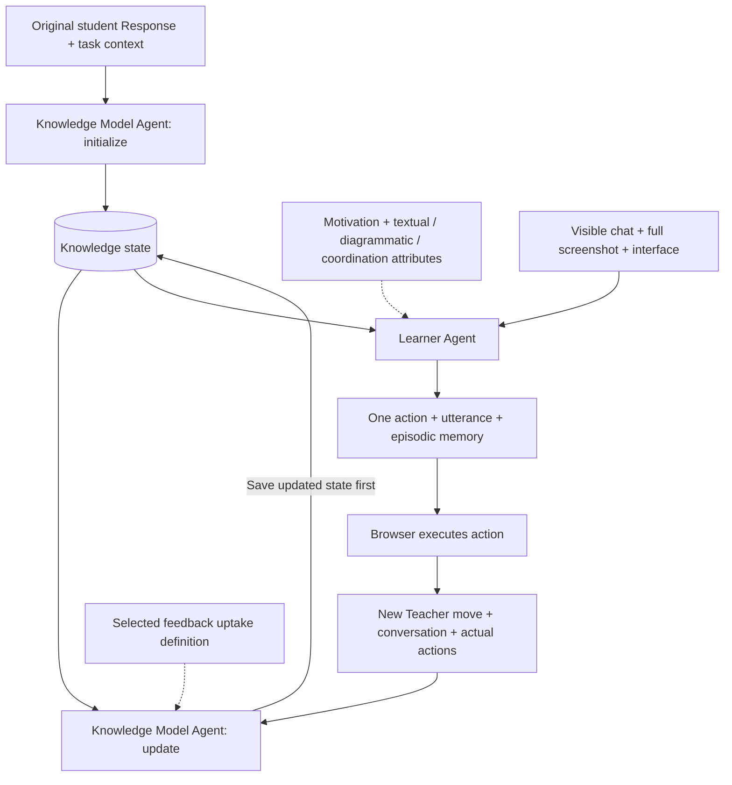

# Simulated learners through the browser UI

See [SIMULATED_LEARNERS.md](../SIMULATED_LEARNERS.md), sections 59 and 63, for the simplified architecture, cached common initialization and validation. Knowledge Model Agent owns three optional knowledge lists; it initializes from the original Response and updates after each Teacher move. Learner Agent uses the saved state plus its other profile attributes. This source revision has offline validation; no new live trial or paid model call was made. Earlier runs retain their own frozen prompts and behavior.

**Deliverable language:** authored reports, export pages, navigation, and supporting notes must be in English. Preserve original dialogue, quotations, and recorded evidence verbatim. An English review edition retains the original experiment and prompt-version identifiers and is not a new model run.

Run the commands below from the project root. The runner lets the student model choose its next action from the actual screenshot and visible interface. An independent browser then executes chat, Show, drawing edits, submission, or stop. It does not prescribe a trajectory or repair failed student operations.

The legacy configuration default selects **P1 average** and **P2 low motivation** with the old manual `math-2` case. It remains inspectable with `--dry-run`; current live runs require a newly prepared response-inferred case. P1/P2 share a prior and differ only in motivation and profile ID. Low motivation does not imply lower uptake, writing or diagrammatic ability. New content priors are inferred from the original response, without an imposed omission-means-inability policy.

Additional configurations are **P3 feedback uptake difficulties** (only `feedback_processing` is low), **P4 textual expression difficulties** (only `textual_representation` is low), **P5 diagrammatic expression difficulties** (only `diagrammatic_representation` is low), **P6 coordination and translation difficulties** (only `coordination_translation` is low), and **P7 combined support needs** (all five operational levels are low). Repeat `--profile` to include them in one experiment. Each configuration explicitly selects all three representation components; P2–P6 each change exactly one level relative to P1.

## Two-Agent architecture: simple knowledge state (2026-10-28)

There are exactly two semantic Agents. **Knowledge Model Agent** establishes the initial knowledge state from the original student Response (text, Figure or both), using the task as context. Initialization receives no uptake/profile instruction or imposed prior hypotheses. Each newly delivered Teacher move then triggers one update using the previous knowledge, dialogue, actual actions and selected feedback uptake. The Agent returns the complete updated knowledge state, which is saved before the next **Learner Agent** call.



The model-facing state has only three optional lists:

```json
{
  "known": [],
  "unknown": [],
  "possibly_known": []
}
```

A category may be omitted, null or empty; storage normalizes it to an empty list. Lists contain short knowledge statements, not component/scope IDs. `known` describes usable local understanding. `unknown` records an evidenced gap, not every omitted feature of the Response. `possibly_known` records partial/uncertain knowledge or the student's actual tentative belief, including a mistaken belief without silently correcting it. Unlisted content remains unassessed. No predefined component catalogue or forced entry in all three lists is needed.

An initialization reply is `{"knowledge_state": {...}}`. A move update is `{"move_id": "message:N", "knowledge_state": {...}}`. The move ID is internal delivery bookkeeping, not a knowledge citation. The update returns the full state and retains unaffected knowledge; when nothing changes, it returns the same state. Receiving instruction, copying wording, proposing an edit and demonstrating understanding are distinguished by the existing Knowledge Agent, using uptake and actual context. Clear local support may be usable immediately; no fixed learning delay or error quota is introduced.

Learner Agent receives `knowledge_state`, current visible chat/interface and its selected motivation plus three representation attributes. It uses chat to identify the request; that text does not independently expand the saved knowledge. Its reply has only `action`, `utterance` and `episodic_memory`. It cannot write the knowledge state. There is no `current_turn`, response-permission protocol, scope/fact/belief ID or per-field `content_grounding` in the current model interface. Full Teacher text is visible again; no separate masked screenshot is captured. Strict semantic adherence to saved knowledge is a model instruction, not a Python entailment guarantee.

Python retains the necessary runtime work: once-per-delivered-move scheduling, chronological backlog handling, typed replies, action validation, atomic storage, owner/case/uptake bindings, checkpoint hashes and exact per-call logs. UI-only actions do not trigger another KM call. Each high-level action still executes and is observed before the next Learner decision. A revision may span many actions. A failed Learner call preserves the already saved KM state.

Current memory is `knowledge-model-agent-v4`, projection `two-agent-cached-initial-knowledge-v6`, with the existing two-Agent receipt protocol. Old v2/v3 memories cannot silently resume under this state representation. `knowledge_model_agent_scoped_v3.py` and `learner_grounding.py` are explicitly historical regression utilities; the current learner entry point imports neither. Prior preparation tools and old case hypotheses remain compatible source artifacts, but the KM initializes from original Response evidence rather than inheriting those hypotheses.

The section 54 P1–P7 run and section 58 scoped-provenance diagnostics are historical evidence for their frozen revisions. Their results cannot be attributed to this simplified implementation. Current offline tests check transport, ownership, optionality and scheduling; no new behavior calibration or complete P1–P7 interaction has been performed.

### Cached common initial knowledge

Current browser batches cache one original-Response initialization and copy its
knowledge content into each profile's separate KM memory. The default cache is
`simulated_learner_initial_knowledge_cache/` beside the run output directories.
Use `--initial-knowledge-cache DIRECTORY` to select another persistent cache.
A fresh empty directory requests a new common initial inference, rather than
independent inferences for every profile.

The key includes the original Task/Response initialization payload and image
hashes, KM state/schema and prompt hashes, requested model/effort, API endpoint
(without credentials), image detail and output limit. Profile IDs, uptake and
Teacher history are excluded. A per-key process lock allows only one producer
when profiles start concurrently. Atomic writes publish only validated results;
a corrupt cache fails explicitly instead of silently generating another K0.
Dry-run does not access the cache or call a model.

`initial_knowledge_cache.py` stores immutable K0 plus original call provenance.
Each profile archives a cache receipt and initializes its own owner-bound state
from a deep copy. Teacher updates only affect that profile's memory. At run end,
`shared_initial_knowledge.json` records the common content, hash and profile cache
hits; the manifest distinguishes actual new initialization calls from reuse.
Current ordinary updates retain the simple three-list model and once-per-move
cadence. Caching controls initial-state identity; it does not prove that Learner
answers semantically follow the state. Standalone historical helper requests
without `initial_knowledge_cache_dir` remain compatible and do not share storage.

The term **Knowledge Model Agent** means the model role that infers and updates
knowledge. **knowledge_state** is the persisted known/unknown/possibly_known data
it produces and Learner reads. A claim that Learner exceeds the KM state refers
to this saved data, not a missing Agent call or a file-storage failure.

## Run

For a new task or student response, use the automatic preparation entry point below. Current live runs accept `--case-response` with the original request, or `--case` with a freshly generated case whose `provenance.prior_policy` is `response_inferred`. Old manual/imposed cases remain readable and usable with `--dry-run`, but are rejected for new live interaction. The workflow does not require hand-written knowledge components or gaps.

### Task + student text / Figure → shared prior → P1–P7

Copy [response_request.template.json](case_requests/response_request.template.json) and supply the original task and response. Each supports text, figures, or both. Figure paths are relative to the request JSON; local absolute paths are also accepted. Student text is preserved exactly, and a figure-only response is not given an invented explanation.

```json
{
  "case_id": "response_01",
  "source_id": "registered_example_id",
  "task": {"text": "Original task text", "figure_paths": ["task.png"]},
  "student_response": {"text": "Exact student text", "figure_paths": ["response.png"]}
}
```

Analyze and compile once, then generate all seven resolved profiles without starting the Feedback application:

```bash
python3 -B experiments/open_ended_sketch/simulated_students/browser_agent/prepare_case.py \
  --request response.json --out outputs/prepared_response_01
```

Add `--dry-run` to validate text and figures and save preparation files with zero API requests and no fabricated case. The output directory must be new; rerunning will not overwrite results or silently repeat a paid call. The default analysis model is the project's existing `gpt-6-astra` / low. Text and original figures are labeled by role, and one model analysis is shared across the selected profiles.

Outputs include `analysis.json` (sources, demonstrated work, gaps, uncertainty, and cross-representation relationships), `generated_case.json`, `resolved_profiles.json` (P1–P7 by default), the actual prompt/schema/API response, figure hashes, and original-image copies. Text quotations must match the input; figure references must point to actual inputs. A task figure alone cannot establish student knowledge. Text–figure conflicts must enter the actual knowledge limitations, rather than appear only in a report. API/schema validation does not establish that visual interpretation or knowledge inference is correct; retain the analysis for review.

New priors are inferred from the original response. Each analyzed component records an evidence-grounded `inferred_status`; `known` requires demonstrated response evidence. A merely omitted or unobserved skill remains tentative, because absence establishes neither ability nor inability. Gap awareness remains `unknown` unless actual submitted text supports a specific awareness claim. The previous `support_needed`, `evidence_only`, `omission_policy` and default-awareness request settings are no longer accepted. Knowledge inference does not assign motivation, uptake or representation levels. P1–P7 retain their five profile selections: P4 is textual Low and P5 is diagrammatic Low.

An existing analysis can be recompiled with zero requests only when **the original text and figures match exactly**, and the saved response-inferred policy, analysis prompt and schema match the current contract. Earlier imposed-prior analyses must be reanalyzed, rather than relabeled as current priors. Original evidence remains unchanged and reused historical usage is not counted as another call:

```bash
python3 -B experiments/open_ended_sketch/simulated_students/browser_agent/prepare_case.py \
  --request response.json --reuse-analysis outputs/prepared_response_01 \
  --out outputs/recompiled_response_01
```

The runner also supports preparation directly:

```bash
node experiments/open_ended_sketch/simulated_students/browser_agent/run.mjs \
  --case-response response.json --prepare-only --out outputs/preparation_only_01
```

This new entry point defaults to all seven profiles; `--profile` selects a subset. `--dry-run` calls neither the analysis model nor a browser. Remove `--prepare-only` to begin browser interaction after one preparation. **A browser trial requires the same student figure to be registered in the application** and its `source_id` supplied in the JSON. The current application has one editable student figure per case. The runner verifies the actual student-figure, task-figure, and source hashes, rejecting a new response attached to a different registered drawing. Text-only, multi-figure, and unregistered responses can still be prepared and combined with profiles; they are not silently replaced by the default number-line case for browser execution.

API references: [OpenAI image inputs](https://developers.openai.com/api/docs/guides/images-vision) and [structured outputs](https://developers.openai.com/api/docs/guides/structured-outputs). These interfaces support text/image input and schema parsing. Task knowledge and cross-representation meaning still depend on this project's analysis, source validation, and simulation policy.

The [multimodal prior report](../../../../outputs/simulated_learner_multimodal_prior_20261027/review.html) records the 10/27 checks: number-line text plus figure, a circuit figure-only response, and a constructed text–figure conflict were analyzed and each expanded into seven profiles with a shared prior. A further number-line analysis separated the prerequisites for starting. In the last focused P1 response, the student requested an example rather than independently providing the complete drawing method. The preceding two complete-method responses are also preserved. These were 4 analysis calls and 3 focused student calls, not another seven-profile closed-loop trial or evidence of stable behavior across tasks.

Requirements are Node.js with built-in `fetch`, Chrome, and the experiment's Python dependencies. Playwright defaults to the local Codex runtime installation. Elsewhere, set `PLAYWRIGHT_MODULE` to an installed Playwright module. Credentials reuse the existing service's environment and `.env` loading process; never place keys in commands or outputs.

If the application is not running, start it in another terminal:

```bash
python3 -B experiments/open_ended_sketch/app/server.py --port 8765
```

Offline contract checks open no browser and call no model:

```bash
python3 -B experiments/open_ended_sketch/simulated_students/browser_agent/test_contracts.py
```

Run all offline tests, including input deduplication and missing-part injection:

```bash
python3 -B -m unittest discover \
  -s experiments/open_ended_sketch/simulated_students/browser_agent -p 'test_*.py'
```

The preparation check reads the original image and scene from the local service and saves configuration and hashes. It does not submit a response or call the feedback or student model:

```bash
node experiments/open_ended_sketch/simulated_students/browser_agent/run.mjs \
  --dry-run --out outputs/simulated_students_prepare_1020
```

A live run calls the two simulator Agents and existing Feedback API, using two independent Chrome sessions by default. Supply the original task/response request:

```bash
node experiments/open_ended_sketch/simulated_students/browser_agent/run.mjs \
  --case-response response.json \
  --model gpt-6-sol --effort low --max-steps 24 --concurrency 2 \
  --out outputs/simulated_students_response_inferred_01
```

Use a new output directory. `--headless` hides the independent browsers; `--concurrency 1` runs them sequentially. Select Python with `--python` or `SIMULATED_STUDENT_PYTHON`. URLs are restricted to localhost; `--base-url` defaults to `http://127.0.0.1:8765`.

Change the case or add profiles through configuration and repeated `--profile` arguments:

```bash
node experiments/open_ended_sketch/simulated_students/browser_agent/run.mjs \
  --case outputs/prepared_response_01/generated_case.json \
  --profile experiments/open_ended_sketch/simulated_students/browser_agent/profiles/p1_average.json \
  --profile experiments/open_ended_sketch/simulated_students/browser_agent/profiles/p2_low_motivation.json \
  --profile experiments/open_ended_sketch/simulated_students/browser_agent/profiles/p3_low_feedback_uptake.json \
  --profile experiments/open_ended_sketch/simulated_students/browser_agent/profiles/p4_low_textual_expression.json \
  --out outputs/simulated_students_new_comparison
```

A live generated case must bind its `source_id`, original response and task figures to the registered application example. Its prior must use the current `response_inferred` policy; the old manual default is not a current live input. Reference answers, target repair sequences and private Teacher assessments must not enter student input. Fix the response/prior, model, reasoning settings and decision budget across profiles.

## Profiles and learner state

Current numbering is P4 = Textual expression Low and P5 = Diagrammatic expression Low, changed on 2026-10-27. The 10/25–10/26 trials retain their original numbering: historical P4 corresponds to current P5, and historical P5 to current P4. Reproduce those batches with their archived code and configurations.

Student settings use shared definitions and role-specific variable projections:

1. **Shared prompts:** `knowledge_model_agent_prompt.md` defines knowledge/uptake judgments; `student_prompt.md` defines communication, expression, observation and actions.
2. **Profile values:** `profiles/*.json` selects only `average` / `low` for each dimension. Shared knowledge and the initial response belong in the case.
3. **Selected-level instructions:** `profile_dimensions.json` defines `when_demanded`, `typical_response`, `support_and_change` and `application_notes`, plus Agent ownership and shared composite templates.
4. **Projected combinations:** `profile_prompt.py` sends only uptake plus raw prior to Knowledge Model Agent, and only motivation plus the three representation variables to Learner Agent. Its `composite_characteristics` summarize selected levels using shared templates. The same levels produce the same description regardless of profile ID.

Cases with `case.response_conditioning` also combine submitted features/gaps with component states, limitations, and learning requirements into `profile.prior_knowledge`. All seven profiles share that content-knowledge starting point. Average ability does not imply already knowing how to solve the task.

The actor's `instructions` contains the shared Learner prompt. Its `profile.dimensions.*.operational_behavior` contains the four selected motivation/representation definitions, including `application_notes`; its `learner_knowledge_model` contains current saved content knowledge. The raw prior, initial component/omission hypotheses and uptake instructions are absent from actor input. Knowledge Model Agent receives uptake and the response-inferred prior, without motivation/representation instructions. It determines usable understanding; the actor does not apply a second uptake penalty. Unselected levels are not sent. Modify shared catalogue definitions/templates rather than adding arbitrary profile-level overrides.

`profile_dimensions.json` defines the shared case's categorical `misconception_type` and the motivation, feedback uptake, and representation ability constructs. Representation has exactly three components: textual expression, diagrammatic expression, and coordination and translation. Basic correspondence belongs within the third component. For compatibility, selections use the five flat operational keys below; `constructs.representation_ability` in the actual input identifies the three components and key mapping without duplicating their behavior definitions. `resolve_profile()` expands only selected levels.

| Dimension | Configuration | Owning Agent / behavior represented |
| --- | --- | --- |
| Misconception type | `case.initial_conceptual_state.misconception_type` | Constructed initial belief category, not a verified diagnosis or an additional high/low ability score. |
| Task motivation | `profile.dimensions.task_motivation.level` | Learner Agent: voluntary effort, checking, extension, and persistence. Low favors minimum acceptable completion while retaining the possibility of learning, revision, and completion. |
| Feedback uptake | `profile.dimensions.feedback_processing.level` | Knowledge Model Agent: understanding delivered support and storing the usable local interpretation; the legacy key is retained. |
| Textual expression | `profile.dimensions.textual_representation.level` | Learner Agent: the textual component of representation ability, distinct from reading comprehension or word count. |
| Diagrammatic expression | `profile.dimensions.diagrammatic_representation.level` | Learner Agent: the diagrammatic component of representation ability, distinct from mouse precision or interface proficiency. |
| Coordination and translation | `profile.dimensions.coordination_translation.level` | Learner Agent: explaining common meaning, preserving consistency, and synchronizing local changes between representations. Low retains basic matching ability and is not merely forgetting to check. |

Each scalar dimension selects the standardized `{"level":"average"}` or `{"level":"low"}`. Profile-level overrides such as `behavioral_tendency` are rejected rather than silently ignored. Edit the catalogue to change operational definitions and retain a version record; changing a level does not require editing the prompt or Python. P1/P2 share one case and currently differ only in `task_motivation.level` and ID.

Legacy four-key profiles remain loadable: missing `coordination_translation` is explicitly defaulted to average, and the resolved configuration records this as an operational compatibility default, not an observation of real ability. Current P1–P7 all select the fifth key explicitly. Assess coordination using ideas and representations already available or scaffolded; textual or diagrammatic production difficulty must not automatically reduce coordination or supply unlearned content.

All profiles share brief, focused communication: usually a phrase or one short sentence answering only the current question. When asked why or how, provide a short relevant reason and add another short sentence only if needed. Ask only for clarification, help, or information needed for the current revision. Do not append a question to every response or volunteer unrelated issues, complete solutions, future plans, or task summaries. When a plan is requested, answer only the requested part. Textual expression controls clarity; motivation controls voluntary effort. Average-long/Low-short is not a substitute for ability differences. There are no profile-specific word limits or mandatory errors, refusals, or early exits. Apply instructions only when their demand arises and retain supported local progress. Ordinary incomplete formulations are allowed; students need not precisely diagnose or name their missing prerequisite. Low textual expression does not remove understood content from knowledge.

The 10/27 prompt and catalogue were expanded and checked offline, with a small number of focused student API checks. No seven-profile closed-loop run of the automatic-prior version had been completed in those checks. Earlier P1–P7 interactions retain their own prompt snapshots and cannot establish improved behavioral differentiation under new instructions. See the [multimodal prior report](../../../../outputs/simulated_learner_multimodal_prior_20261027/review.html) for automatic analysis, resolved profiles, and actual responses, and the earlier manual-case [prompt review](../../../../outputs/simulated_learner_response_prior_20261027/review.html).

Content knowledge is inferred from the shared original response and compiled into stable `knowledge_components` with `known`, `tentative` or `unlearned` states. The legacy default number-line seed retains its historical manual configuration for inspection, not new live runs. Initial explanations and states must not contain a complete solution. One local hint cannot automatically establish every component as mastered; later updates should follow actual interaction.

For driver compatibility, each accepted decision includes Knowledge Model Agent-derived memory summaries and component evidence (`initial:ID`, `message:INDEX`, or completed `action:STEP`). The actor does not generate this memory. Old `memory_update`, `memory_delta` and free-form memory summaries are excluded from the actor's knowledge projection. The authoritative evidence is `knowledge_audit`, completed Agent checks and the separately saved Knowledge Model Agent state, not the legacy provenance-only `audit_memory()` helper. `known` remains a constructed local simulation state, not an external test result.

Legacy/offline manual cases can use categories defined under `misconception_type.values` with `label`, `initial_belief` and `scope`. Current inferred cases do not require a researcher-imposed misconception category; response evidence and uncertainty determine their starting knowledge. Undefined categories are rejected. Use `uncertain` when evidence is insufficient; do not force a diagnosis from a drawing or short answer. Category descriptions and components may describe starting understanding or gaps, but must not contain reference answers, target endpoints, or complete repair sequences. Two local reference HTML files help identify brief answers and local difficulties; they do not empirically calibrate the levels or justify assigning motivation labels to reference students.

## Missing parts grounded in the submitted response

A shared case may supply `response_grounding`: `source_id` binds the actual response; `present_features` records observed features and evidence; `missing_parts` records omissions, evidence, and linked components. The historical manual number-line case retains the axis, endpoint arrowheads, ticks and labels while identifying absent addition operations and an unmarked result; a new inferred case derives its own features and omissions from the actual response. It does not supply three correct jumps or a numerical answer.

Each omission retains `initial_awareness` and `learner_belief`. New inferred awareness is `unknown` unless actual student text supports `unaware`, `notices_incompleteness` or `identifies_missing_part`. Absence does not imply a belief or lack of awareness. The old manual math-2 case's `unaware` values belong to its historical setup and are not current defaults.

`student_model.py` validates sources, fields, and component mappings, then projects the material into `case_config.initial_response_context`. This context goes to Knowledge Model Agent, while the actor reads the resulting saved knowledge and basic task/original explanation. Private diagnoses, scores and reference answers are excluded. Legacy cases remain readable and usable for offline checks, but current live trials require the inferred policy. A different real response needs its own observed features and gaps rather than inheriting this case's annotations.

These annotations describe only the initial response. Later feedback, observations, and revisions may change awareness. Do not force an initial omission to persist forever or equate missing evidence with inability. Knowledge and ability assumptions remain explicit in the independent case/profile configuration.

## Observation and action boundary

| Call | Model-visible content |
| --- | --- |
| Knowledge initialization | Original task/response text and figures, response-based prior and selected uptake definition. |
| Knowledge move check | New delivered Teacher move, conversation and completed-attempt evidence, current stored knowledge, prior and uptake. |
| Learner action | Basic task/original explanation, saved knowledge, four motivation/representation variables and composite, screenshot/DOM observation, action history and episodic memory. |

Current Learner Agent input uses `two-agent-profile-split-v3`, layered over the earlier `deduplicated-v1` layout/text projection. It retains public actions, actual results and message indices, excludes actor-authored memory, and supplies the current scoped knowledge model. Historical inputs using lossless `memory_delta` remain unchanged. Graphic layout numbers use two decimals and coordinate transforms six decimals; mathematical fields and actual action arguments are not rounded.

Full requests and action traces remain local. `model_visible_input` is the Learner Agent input; each actual Agent call has exact input/prompt/schema/response/image sidecars. A new move invokes Knowledge Model Agent once before Learner Agent; UI-only steps invoke only Learner Agent. Initialization is one additional Knowledge Model Agent call per profile. All usage is retained; historical compaction comparisons do not measure this two-Agent architecture.

`student_model.py` accepts only permitted case/profile fields, the current screenshot, rendered text, diagram elements, controls, dialogue, and actual operation results. Source payloads, provenance, private teacher review, rubrics, routing, and undisplayed visual instructions do not enter student input. Show reveals a visual only after an actual click. Element IDs are locators for visible diagram elements. `elements.texts` contains literal SVG text; `locator_description` is an ARIA/accessibility description whose wording may not be printed. Historical element/handle `label` metadata normalizes to `locator_description` before model input. Control labels continue to identify UI actions. A Hint cooldown notice is not a new Hint, and an error notice is not received instructional support.

`browser_driver.mjs` uses existing controls and pointer/keyboard handlers rather than editing application scene state directly. Its structured action interface computes visible SVG coordinates, so this experiment does not measure students' DOM navigation, mouse precision, or real interface proficiency. Diagrammatic understanding and expression fidelity need separate evaluation.

The model selects one action at a time. Retain invalid arguments, disabled controls, failures, and no-change operations as results. The system does not automatically perform useful repairs. `student_stopped` means the model selected stop; `step_budget_reached` is an external limit, not task completion. Record API/execution failures separately rather than interpreting them as low motivation.

## Outputs and checks

Each run saves:

- `index.html`: the versioned entry point linking each student's `review.html`, which places interaction and corresponding prompts together.
- `prompt_version.json`, `prompt_bundle.json`, `prompts.html`: the shared student prompt, ability catalogue, case/prior, selected profiles, system templates, and content hashes. Shared learner, system-template, and whole-batch configuration versions are separate; timestamps, process IDs, paths, and ports do not alter content versions.
- `actual_prompt_index.json`: actual student requests and captured Evaluation/Tutor instructions, inputs, schemas, and responses. Dynamically assembled Tutor examples are preserved in each actual `*.prompt.md`; a saved template does not imply a call occurred.
- Each student's `review.html`, `export_metadata.json`, `resolved_profile.json`: version linkage, full actual student settings, original interaction, and native HTML hashes. `resolved_profile.json` is created only when actual model-visible student input was saved.
- `experiment_manifest.json`, `seed_payload.json`, `original_student_response.png`: common starting point, configuration, code, and input hashes. The seed payload is research evidence, not student input.
- Each profile's `step_*_request.json` / `step_*_response.json`, screenshots, `action_trace.jsonl`, `run_summary.json`: visible input, model decisions, actual execution, and stopping reason. `model_visible_input` contains the text actually sent, including the selected expanded definitions; catalogue hashes and `memory_audit` are retained.
- `step_*_knowledge_model_initialize.*`, `step_*_knowledge_model_move_INDEX.*`, `step_*_learner_agent.*`: exact Agent prompts, JSON inputs, schemas, images and API responses, with response IDs and usage.
- `knowledge_model_agent_memory.json`, `learner_knowledge_model.json`, `step_*_knowledge_audit.json`, `knowledge_timeline.json`: Agent-owned persistent state, before/checks/after, exact checked move IDs, Learner Agent read-state hash and actual execution. `learner_agent_memory.json` is separate episodic memory. No independent gate is called.
- `.case.html` / `.exploration.json`: files downloaded through the existing **Export case HTML** and **Save** buttons, without rewriting them or modifying the original case.

HTML shows submitted diagrams and actual dialogue. Unsubmitted drafts and intermediate operations remain in exploration JSON and action traces. Exporting does not force a student to submit a draft. Never feed exported teacher diagnoses or research metadata back to the student.

Versioned presentation is an export feature of the **automatic trial runner**. The application's manual button still produces an unchanged native HTML file, archived as an independent original. Open `review.html` by default to see version and interaction together.

By default, the runner collects newly created call records from the corresponding application's `app/runs` and associates them by session. It excludes completed unrelated sessions. Failed calls without a session remain unassigned rather than being attributed speculatively. For an isolated frozen service writing elsewhere, supply the location explicitly:

```bash
node experiments/open_ended_sketch/simulated_students/browser_agent/run.mjs \
  --case prepared_response/generated_case.json \
  --profile experiments/open_ended_sketch/simulated_students/browser_agent/profiles/p1_average.json \
  --tutor-records-root outputs/trial_preparation/tutor_api_runs \
  --runtime-config outputs/trial_preparation/runtime_config.json \
  --out outputs/new_versioned_trial
```

`--runtime-config` accepts the service's actual public model settings; credentials are forbidden. If omitted, the runner does not guess the running service's settings; consult captured responses. New batches append to `outputs/simulated_learner_run_history.jsonl` and generate its HTML history page. `--history-catalogue` selects another location. Historical experiments are neither rewritten nor assigned invented versions. One output directory cannot be registered under a different version.

Zero-API version checks: `node --test .../test_prompt_versions.mjs`. Cross-session record isolation: `node .../test_tutor_record_capture.mjs`. These verify linkage between versions and materials, not teaching or learner fidelity.

After a live run, verify offline that each selected profile's exported scene, original image bytes, explanation, configuration, and actions match the common starting point:

```bash
SIMULATED_STUDENT_AUDIT_DIR=outputs/simulated_students_response_inferred_01 \
  python3 -B experiments/open_ended_sketch/simulated_students/browser_agent/test_contracts.py
```

**Interpretation:** these are autonomous interactions by constructed profiles. Differences in one run cannot establish causal effects of selected traits, calibrated profiles, human-like behavior, or improved learning for real students. Common-starting-point and input-isolation checks verify implementation only. Behavioral fidelity requires real student data, independent coding, and repeated runs.

## Response-conditioned prior knowledge and minimal annotations

`case.response_conditioning` specifies this simulation's interpretation of the submitted response. The helper validates it and assembles `profile.prior_knowledge`. Each component retains an initial state, statement, submitted evidence such as `feature:F1` / `gap:G1`, limitation, and required support. Sources, components, present features, and gaps must agree; neither another response's gaps nor existing features may substitute for required gap bindings. Unconfigured legacy cases do not automatically acquire an omission-means-inability assumption.

The historical constructed math-2 starting point treated omitted operations and results as explicitly unlearned under its archived policy. New live priors instead use response-based `inferred_status`, retaining uncertainty about merely omitted skills. A generic request to invent a method still does not teach that method; actual local instruction and grounded attempts support only their recorded scopes. This revision keeps the existing local-transfer boundary rather than adding stronger generalization. Supported learning remains possible without fixed failure counts or permanent confusion.

Use only values, symbols, or necessary short names on the diagram. Number-line card connections use the card value directly, such as `−6`, `12`, or `−4`, without explanations such as `six spaces left` or additional procedure text. `submit_revisions.reason` defaults to null; when explicitly asked, provide only the requested short explanation. The driver clears/fills the reason on every submission to avoid retaining an earlier long explanation, while preserving an explicitly supplied reason. Both application versions retain their fixed submission notice.

The separate zero-API local browser regression `test_submission_browser.mjs` verifies that a null reason clears old text, an explicit short reason is preserved, and a subsequent omitted reason clears it again. The focused replays described above are student API checks of saved contexts, not new closed-loop system trials. Historical P1–P7 HTML remains unchanged.

## Fixed-context profile diagnostics

The current harness uses `matched-profile-comparison-v2-simple-knowledge`. It freezes requests and source/assets without API calls:

```bash
python3 -B experiments/open_ended_sketch/simulated_students/browser_agent/compare_profiles.py \
  --dry-run --output outputs/matched_profiles_simple_prepared
```

Only after the inputs and paid API scope are authorized, run:

```bash
python3 -B experiments/open_ended_sketch/simulated_students/browser_agent/compare_profiles.py \
  --live --prepared outputs/matched_profiles_simple_prepared --output outputs/matched_profiles_simple_run
```

Eight contexts × two profiles × two repetitions have a maximum of 64 role calls and concurrency 2. Each episode calls KM for one pending move then Learner for one proposed action. No Teacher model, browser action, semantic judge or corrective retry is used. Existing archived positive statements are imported through a labelled simple-state fixture conversion; evidence absence never becomes an unknown entry. Old prepared manifests are intentionally rejected, while old outputs stay unchanged. One action and two repetitions are diagnostic examples, not human calibration or retention evidence.
